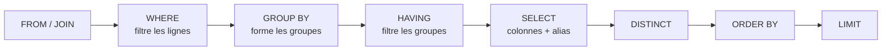

> **Moteurs visés** : Hive, Spark SQL, Impala (stack Cloudera). Les différences de dialecte sont signalées quand elles comptent.

---

## 0. Pourquoi ce blog existe

En entretien, on ne te demande presque jamais « que fait un `SELECT` ? ». On te demande :

- « Quelle est la différence entre `WHERE` et `HAVING` ? »
- « Pourquoi cette requête avec `NOT IN` ne renvoie aucune ligne ? »
- « Pourquoi mon `LEFT JOIN` se comporte comme un `INNER JOIN` ? »

Ce sont des questions sur les **bases**, mais sur leurs **pièges**. Ce blog est donc construit autour d'un scénario unique, vécu dans tous les projets data :

> **Lundi, 9h02.** La Finance t'écrit : *« Quel est le chiffre d'affaires validé de mars 2024 ? Le dashboard dit 3 120, l'ERP dit 2 950, et le rapport du data analyst dit 2 775. Qui a raison ? »*

Spoiler : **les trois requêtes sont « correctes »**. Elles répondent simplement à trois questions différentes sans le savoir. À la fin du blog, tu sauras expliquer chaque écart, avec du SQL, en quelques minutes.

### Plan

1. [Le jeu de données](#1-le-jeu-de-données)
2. [SELECT : lire proprement](#2-select--lire-proprement)
3. [L'ordre d'exécution logique](#3-lordre-dexécution-logique)
4. [WHERE : filtrer avant d'agréger](#4-where--filtrer-avant-dagréger)
5. [NULL : la logique à trois valeurs](#5-null--la-logique-à-trois-valeurs)
6. [GROUP BY, agrégats et HAVING](#6-group-by-agrégats-et-having)
7. [CASE : de la logique dans la requête](#7-case--de-la-logique-dans-la-requête)
8. [Les JOIN](#8-les-join)
9. [Résolution de l'incident : 3 chiffres, 1 vérité](#9-résolution-de-lincident--3-chiffres-1-vérité)
10. [10 questions d'entretien](#10-10-questions-dentretien)
11. [5 exercices](#11-5-exercices)
12. [Checklist avant de livrer une requête](#12-checklist-avant-de-livrer-une-requête)
13. [Prochain blog](#13-prochain-blog)

---

## 1. Le jeu de données

Deux petites tables, volontairement **sales**, car c'est la réalité. Chaque anomalie est là pour une raison.

```sql
CREATE DATABASE IF NOT EXISTS blog_sql;
USE blog_sql;

CREATE TABLE clients (
  client_id        INT,
  nom              STRING,
  pays             STRING,
  segment          STRING,
  date_inscription DATE
) STORED AS PARQUET;

CREATE TABLE ventes (
  vente_id   INT,
  client_id  INT,
  produit    STRING,
  categorie  STRING,
  montant    DECIMAL(10,2),
  quantite   INT,
  statut     STRING,
  date_vente DATE
) STORED AS PARQUET;

INSERT INTO clients VALUES
  (1, 'Alice Martin',  'FR', 'Premium',  DATE '2023-01-15'),
  (2, 'Bruno Diallo',  'SN', 'Standard', DATE '2023-03-02'),
  (3, 'Chloé Benali',  'MA', 'Premium',  DATE '2023-05-20'),
  (4, 'David Chen',    'FR', NULL,       DATE '2024-01-10'),   -- segment inconnu
  (5, 'Emma Rossi',    'IT', 'Standard', DATE '2024-02-14'),   -- aucune vente
  (6, 'Farid Haddad',  'MA', 'Standard', DATE '2024-06-01');   -- aucune vente

INSERT INTO ventes VALUES
  (101, 1,    'Laptop',   'Informatique', 1200.00, 1, 'VALIDEE', DATE '2024-03-01'),
  (102, 1,    'Souris',   'Informatique',   25.00, 2, 'VALIDEE', DATE '2024-03-01'),
  (103, 2,    'Clavier',  'Informatique',   80.00, 1, 'ANNULEE', DATE '2024-03-05'),
  (104, 3,    'Casque',   'Audio',         150.00, 1, 'VALIDEE', DATE '2024-03-07'),
  (105, 3,    'Enceinte', 'Audio',            NULL, 1, 'VALIDEE', DATE '2024-03-09'),  -- montant manquant
  (106, 4,    'Laptop',   'Informatique', 1100.00, 1, 'VALIDEE', DATE '2024-03-10'),
  (107, NULL, 'Souris',   'Informatique',   25.00, 1, 'VALIDEE', DATE '2024-03-11'),  -- client_id NULL
  (108, 99,   'Casque',   'Audio',         150.00, 2, 'VALIDEE', DATE '2024-03-12'),  -- client 99 inexistant
  (109, 2,    'Ecran',    'Informatique',  300.00, 1, 'VALIDEE', DATE '2024-03-15'),
  (110, 1,    'Enceinte', 'Audio',          90.00, 3, NULL,      DATE '2024-03-20');  -- statut NULL
```

> **Dialecte** : sur Hive < 3 ou Impala, remplace `DATE '2024-03-01'` par `CAST('2024-03-01' AS DATE)` si le littéral n'est pas accepté. Sur Cloudera CDP, les tables managed Hive sont ACID/ORC par défaut : l'`INSERT ... VALUES` fonctionne sans changement.

### Les anomalies planquées

| Anomalie | Ligne(s) | Pourquoi elle est là |
|---|---|---|
| `statut` NULL | vente 110 | Piège du `<>` et du `WHERE` |
| `montant` NULL | vente 105 | Piège de `SUM`, `AVG`, `COUNT` |
| `client_id` NULL | vente 107 | Piège des jointures et de `NOT IN` |
| `client_id` orphelin (99) | vente 108 | Différence `INNER` / `LEFT` |
| `segment` NULL | client 4 | Comportement de `GROUP BY` sur NULL |
| Clients sans vente | clients 5 et 6 | `LEFT JOIN`, anti-jointure |

Garde ce tableau sous les yeux : chaque résultat de ce blog peut être recalculé à la main sur 10 lignes.

---

## 2. SELECT : lire proprement

### 2.1 Le minimum à maîtriser

```sql
SELECT
  vente_id,
  produit,
  montant * quantite AS total_ligne,         -- expression + alias
  CAST(date_vente AS STRING) AS date_txt     -- conversion explicite
FROM ventes
WHERE statut = 'VALIDEE'
ORDER BY total_ligne DESC
LIMIT 5;
```

Cinq habitudes à prendre dès maintenant :

1. **Jamais de `SELECT *` dans un pipeline.** Sur du Parquet/ORC (format colonnaire), lister les colonnes permet de ne lire que celles-là (*column pruning*). Avec `*`, tu lis tout, et ton job casse en silence le jour où quelqu'un ajoute une colonne.
2. **Alias explicites** pour toute expression calculée. Les noms auto-générés (`_c0`, `sum(montant)`) font des schémas illisibles en aval.
3. **`LIMIT` sans `ORDER BY` n'est pas déterministe.** Sur un cluster, « les 5 premières lignes » dépendent de la distribution des données. Deux exécutions peuvent donner deux résultats.
4. **`DISTINCT` n'est pas un pansement.** Si tu l'ajoutes parce que « il y a des doublons », tu as probablement un problème de jointure (section 8.6).
5. **Aie le réflexe `DECIMAL` pour l'argent.** `DOUBLE` est un flottant binaire :

```sql
SELECT CAST(0.1 AS DOUBLE) + CAST(0.2 AS DOUBLE);   -- 0.30000000000000004
SELECT CAST(0.1 AS DECIMAL(10,2)) + CAST(0.2 AS DECIMAL(10,2));  -- 0.30
```

En comptabilité, 0,30000000000000004 est un incident de production.

### 2.2 DISTINCT et ses coûts

```sql
SELECT DISTINCT categorie FROM ventes;   -- 2 lignes : Informatique, Audio
```

`DISTINCT` déclenche un **shuffle** (redistribution des données entre machines) pour regrouper les valeurs identiques. Sur 2 milliards de lignes, c'est une opération coûteuse. Ça deviendra important au Blog 4.

---

## 3. L'ordre d'exécution logique

**C'est la notion qui explique 80 % des erreurs de débutant et 80 % des questions d'entretien.** On écrit le SQL dans un ordre, le moteur le raisonne dans un autre.

### 3.1 L'ordre d'écriture vs l'ordre logique

```
Ordre d'ÉCRITURE         Ordre d'EXÉCUTION LOGIQUE
─────────────────        ─────────────────────────
SELECT                   1. FROM / JOIN      → quelles tables, combinées comment
FROM                     2. WHERE            → filtre les LIGNES
WHERE                    3. GROUP BY         → regroupe les lignes
GROUP BY                 4. HAVING           → filtre les GROUPES
HAVING                   5. SELECT           → calcule les colonnes et alias
ORDER BY                 6. DISTINCT         → déduplique
LIMIT                    7. ORDER BY         → trie
                         8. LIMIT            → coupe
```



> **Attention, « logique » ne veut pas dire « physique ».** L'optimiseur (Catalyst dans Spark, CBO dans Hive) peut réordonner les opérations (par exemple pousser un filtre avant une jointure, c'est le *predicate pushdown*), **tant que le résultat reste identique à l'ordre logique**. L'ordre logique définit la *sémantique* ; le plan physique définit la *performance*.

### 3.2 Les conséquences à connaître par cœur

**Conséquence 1 : on ne peut pas utiliser un alias du `SELECT` dans le `WHERE`.**

```sql
-- ❌ Erreur : au moment du WHERE, 'total_ligne' n'existe pas encore
SELECT montant * quantite AS total_ligne
FROM ventes
WHERE total_ligne > 100;

-- ✅ Solution 1 : répéter l'expression
SELECT montant * quantite AS total_ligne
FROM ventes
WHERE montant * quantite > 100;

-- ✅ Solution 2 : encapsuler (plus lisible si l'expression est complexe)
WITH lignes AS (
  SELECT vente_id, montant * quantite AS total_ligne FROM ventes
)
SELECT * FROM lignes WHERE total_ligne > 100;
```

**Conséquence 2 : on PEUT utiliser un alias dans `ORDER BY`**, car il s'exécute après le `SELECT`.

**Conséquence 3 : on ne peut pas mettre une fonction d'agrégat dans le `WHERE`.** Au moment du `WHERE`, les groupes n'existent pas encore.

```sql
-- ❌ Erreur
SELECT client_id FROM ventes WHERE SUM(montant) > 500 GROUP BY client_id;

-- ✅ Le filtre sur un agrégat va dans HAVING
SELECT client_id FROM ventes GROUP BY client_id HAVING SUM(montant) > 500;
```

**Conséquence 4 : tout ce qui est dans le `SELECT` sans agrégat doit être dans le `GROUP BY`.** Après le regroupement, il ne reste qu'une ligne par groupe : le moteur ne sait pas quelle valeur individuelle afficher.

```sql
-- ❌ Erreur : 'produit' n'est ni agrégé ni groupé
SELECT categorie, produit, SUM(montant) FROM ventes GROUP BY categorie;
```

> **Alias dans `GROUP BY` / `HAVING`** : certains moteurs le tolèrent (Spark par exemple), d'autres non, et ça varie selon la version. Ne compte pas dessus : écris du SQL portable.

### 3.3 Mini-quiz

Que renvoie cette requête, et pourquoi ?

```sql
SELECT categorie, COUNT(*) AS nb
FROM ventes
WHERE nb > 3
GROUP BY categorie;
```

<details>
<summary>Réponse</summary>

Une **erreur** : `nb` est défini dans le `SELECT` (étape 5) et utilisé dans le `WHERE` (étape 2), et `COUNT(*)` ne peut de toute façon pas apparaître dans un `WHERE`. La bonne version : `GROUP BY categorie HAVING COUNT(*) > 3`.
</details>

---

## 4. WHERE : filtrer avant d'agréger

### 4.1 Les opérateurs essentiels

```sql
-- Comparaisons, combinaisons
WHERE statut = 'VALIDEE' AND montant >= 100

-- IN : liste de valeurs
WHERE categorie IN ('Audio', 'Informatique')

-- BETWEEN : bornes INCLUSES des deux côtés
WHERE montant BETWEEN 100 AND 500

-- LIKE : % = n'importe quelle suite de caractères, _ = un seul caractère
WHERE produit LIKE 'E%'          -- Enceinte, Ecran

-- Dates
WHERE date_vente >= DATE '2024-03-01' AND date_vente < DATE '2024-04-01'
```

### 4.2 Pièges classiques

**Piège A : la précédence `AND` / `OR`.** `AND` est prioritaire sur `OR`.

```sql
-- Tu veux : (Audio OU Informatique) ET validées
WHERE categorie = 'Audio' OR categorie = 'Informatique' AND statut = 'VALIDEE'
-- Le moteur lit : Audio OU (Informatique ET validées) → les ventes Audio annulées passent !

-- ✅ Toujours des parenthèses
WHERE (categorie = 'Audio' OR categorie = 'Informatique') AND statut = 'VALIDEE'
```

**Piège B : la casse et les espaces.** En Hive et Spark, `'validee' = 'VALIDEE'` est **faux**, et `'VALIDEE '` (avec un espace) aussi. Les fichiers sources arrivent rarement propres :

```sql
WHERE UPPER(TRIM(statut)) = 'VALIDEE'
```

À utiliser avec discernement : appliquer une fonction sur une colonne empêche parfois l'utilisation des statistiques ou du pruning. Le vrai fix est de **normaliser à l'ingestion**.

**Piège C : `BETWEEN` sur des timestamps.** Si `date_vente` était un `TIMESTAMP`, `BETWEEN '2024-03-01' AND '2024-03-31'` s'arrête à `2024-03-31 00:00:00` et **perd toute la journée du 31**. Utilise toujours l'intervalle semi-ouvert `>= début AND < fin_exclusive`.

**Piège D : le `<>` et le NULL** (le plus important, voir section 5) :

```sql
SELECT COUNT(*) FROM ventes WHERE statut <> 'ANNULEE';
-- Résultat : 8, et non 9 ! La vente 110 (statut NULL) disparaît.
```

### 4.3 WHERE et partitions (spécifique Big Data)

Sur une table Hive partitionnée (par exemple par `dt`), filtrer **directement sur la colonne de partition** permet au moteur de ne lire que les dossiers concernés (*partition pruning*) :

```sql
-- ✅ Lit uniquement les partitions de mars
WHERE dt >= '2024-03-01' AND dt < '2024-04-01'

-- ⚠️ Appliquer une fonction sur la colonne de partition peut empêcher le pruning
WHERE substr(dt, 1, 7) = '2024-03'
```

Sur une table de 3 ans d'historique, la différence est entre lire 31 dossiers ou 1 095. Vérifie toujours avec `EXPLAIN` (Blog 4).

---

## 5. NULL : la logique à trois valeurs

**NULL ne veut pas dire « vide » ni « zéro ». NULL veut dire « inconnu ».** C'est cette phrase qui explique tout le reste.

### 5.1 La logique à trois valeurs

En SQL, une condition ne vaut pas seulement `TRUE` ou `FALSE`, mais aussi **`UNKNOWN`** (représenté par NULL). Et **`WHERE` ne garde que les lignes où la condition vaut `TRUE`**.

| Expression | Résultat | Explication |
|---|---|---|
| `NULL = NULL` | NULL | Deux inconnus ne sont pas forcément égaux |
| `NULL <> 'x'` | NULL | On ne sait pas |
| `NULL > 5` | NULL | On ne sait pas |
| `1 + NULL` | NULL | Toute opération avec un inconnu est inconnue |
| `NULL IS NULL` | TRUE | Le seul test fiable |
| `TRUE AND NULL` | NULL | Ça dépend de l'inconnu |
| `FALSE AND NULL` | **FALSE** | Quel que soit l'inconnu, c'est faux |
| `TRUE OR NULL` | **TRUE** | Quel que soit l'inconnu, c'est vrai |
| `FALSE OR NULL` | NULL | Ça dépend de l'inconnu |
| `NOT NULL` | NULL | L'inverse d'un inconnu est inconnu |

### 5.2 Les 7 pièges de NULL

**Piège 1 : `= NULL` ne marche jamais.**

```sql
SELECT * FROM ventes WHERE statut = NULL;    -- 0 ligne, toujours
SELECT * FROM ventes WHERE statut IS NULL;   -- 1 ligne (vente 110)
```

**Piège 2 : `<>` et `NOT IN` éliminent silencieusement les NULL.**

```sql
SELECT COUNT(*) FROM ventes WHERE statut <> 'ANNULEE';           -- 8
SELECT COUNT(*) FROM ventes WHERE statut IS DISTINCT FROM 'ANNULEE';  -- 9 (si supporté)

-- Portable partout :
SELECT COUNT(*) FROM ventes WHERE statut <> 'ANNULEE' OR statut IS NULL;   -- 9
```

Question à te poser à chaque filtre d'exclusion : *« que veux-je faire des lignes où la colonne est NULL ? »* Les ignorer doit être un **choix**, pas un accident.

**Piège 3 : les agrégats ignorent les NULL (sauf `COUNT(*)`).**

```sql
SELECT
  COUNT(*)                 AS nb_lignes,            -- 10
  COUNT(montant)           AS nb_montants,          -- 9  (la vente 105 est ignorée)
  COUNT(DISTINCT montant)  AS nb_montants_distincts,-- 7 : 1200, 25, 80, 150, 1100, 300, 90
  SUM(montant)             AS ca,                   -- 3120.00
  AVG(montant)             AS moyenne               -- 346.67 (3120 / 9, pas / 10)
FROM ventes;
```

`AVG` divise par le nombre de valeurs **non NULL**. Si le NULL signifie « zéro », la moyenne est faussée :

```sql
SELECT AVG(COALESCE(montant, 0)) FROM ventes;       -- 312.00 (3120 / 10)
```

Aucune des deux n'est « la bonne » : tout dépend de la signification métier du NULL. **Pose la question au métier et documente la réponse.**

**Piège 4 : `SUM` d'un groupe entièrement NULL vaut NULL, pas 0.**

```sql
SELECT SUM(montant) FROM ventes WHERE vente_id = 105;     -- NULL
SELECT COALESCE(SUM(montant), 0) FROM ventes WHERE vente_id = 105;   -- 0
```

Un dashboard qui affiche « NULL » ou une cellule vide à la place de 0 génère des tickets de support.

**Piège 5 : `NOT IN` avec un NULL dans la liste renvoie… zéro ligne.**

Objectif : lister les clients qui n'ont **aucune** vente (on attend les clients 5 et 6).

```sql
-- ❌ Renvoie 0 ligne
SELECT * FROM clients
WHERE client_id NOT IN (SELECT client_id FROM ventes);
```

Pourquoi ? La sous-requête contient `1, 2, 3, 4, 99, NULL`. Pour le client 5, le moteur évalue :
`5 <> 1 AND 5 <> 2 AND ... AND 5 <> 99 AND 5 <> NULL` → le dernier terme vaut `UNKNOWN`, donc tout le `AND` vaut `UNKNOWN` (jamais `TRUE`), donc la ligne est rejetée. **Une seule valeur NULL dans la liste suffit à vider le résultat.**

```sql
-- ✅ Fix 1 : exclure les NULL de la sous-requête
SELECT * FROM clients
WHERE client_id NOT IN (SELECT client_id FROM ventes WHERE client_id IS NOT NULL);

-- ✅ Fix 2 (préféré) : NOT EXISTS, insensible aux NULL
SELECT c.* FROM clients c
WHERE NOT EXISTS (SELECT 1 FROM ventes v WHERE v.client_id = c.client_id);

-- ✅ Fix 3 : LEFT JOIN + IS NULL (voir section 8)
```

> **C'est LA question d'entretien sur NULL.** Retiens la règle : **n'utilise jamais `NOT IN` avec une sous-requête dont la colonne peut contenir du NULL.** Selon ta version de Hive, `NOT EXISTS` peut avoir des limites : vérifie, sinon passe par `LEFT JOIN ... IS NULL`.

**Piège 6 : le comportement de NULL dans `GROUP BY`, `DISTINCT` et `ORDER BY`.**

Dans `GROUP BY` et `DISTINCT`, les NULL sont **regroupés ensemble** (ils sont « non distincts » entre eux), contrairement à `=` :

```sql
SELECT segment, COUNT(*) AS nb FROM clients GROUP BY segment;
-- Premium  → 2
-- Standard → 3
-- NULL     → 1   (le client 4)
```

Dans `ORDER BY`, la position des NULL **varie selon le moteur** :

| Moteur | `ASC` par défaut |
|---|---|
| Hive, Spark SQL | NULL en **premier** |
| Impala | NULL en **dernier** (NULL traité comme la plus grande valeur) |

Sur une plateforme Cloudera où Hive et Impala coexistent, le même `ORDER BY` peut donc donner deux résultats. **Précise toujours `NULLS FIRST` ou `NULLS LAST`** :

```sql
SELECT * FROM clients ORDER BY segment ASC NULLS LAST;
```

**Piège 7 : les jointures sur une clé NULL ne matchent jamais.** `NULL = NULL` n'est pas `TRUE`, donc la vente 107 (`client_id` NULL) ne trouvera jamais de client, même s'il existait un client dont l'id serait NULL. On y revient en section 8.

### 5.3 La boîte à outils NULL

| Besoin | Outil |
|---|---|
| Tester | `IS NULL`, `IS NOT NULL` |
| Remplacer | `COALESCE(a, b, c)` : première valeur non NULL |
| Transformer une valeur en NULL | `NULLIF(a, b)` : renvoie NULL si `a = b` (utile pour éviter la division par zéro : `x / NULLIF(y, 0)`) |
| Égalité qui tient compte des NULL | `a <=> b` (Hive, Spark, Impala) ou `a IS NOT DISTINCT FROM b` (support selon version) |
| Compter les NULL | `SUM(CASE WHEN col IS NULL THEN 1 ELSE 0 END)` ou `COUNT(*) - COUNT(col)` |

```sql
-- Taux de complétude des colonnes clés : un réflexe de data quality
SELECT
  COUNT(*)                                   AS total,
  COUNT(*) - COUNT(client_id)                AS client_id_null,
  COUNT(*) - COUNT(montant)                  AS montant_null,
  COUNT(*) - COUNT(statut)                   AS statut_null
FROM ventes;
-- total 10 | client_id_null 1 | montant_null 1 | statut_null 1
```

---

## 6. GROUP BY, agrégats et HAVING

### 6.1 Le principe

`GROUP BY` transforme **N lignes en 1 ligne par groupe**. Les fonctions d'agrégat (`COUNT`, `SUM`, `AVG`, `MIN`, `MAX`) calculent une valeur par groupe.

```sql
SELECT
  categorie,
  COUNT(*)        AS nb_ventes,
  COUNT(montant)  AS nb_montants,
  SUM(montant)    AS ca
FROM ventes
GROUP BY categorie;
```

| categorie | nb_ventes | nb_montants | ca |
|---|---|---|---|
| Informatique | 6 | 6 | 2730.00 |
| Audio | 4 | 3 | 390.00 |

Remarque : pour Audio, `nb_ventes = 4` mais `nb_montants = 3` : la vente 105 a un montant NULL.

### 6.2 WHERE vs HAVING : la question d'entretien n°1

**La différence tient en une phrase : `WHERE` filtre les lignes AVANT le regroupement, `HAVING` filtre les groupes APRÈS le regroupement.**

| | `WHERE` | `HAVING` |
|---|---|---|
| S'exécute | Avant `GROUP BY` | Après `GROUP BY` |
| Filtre | Des **lignes** individuelles | Des **groupes** |
| Peut utiliser un agrégat (`SUM`, `COUNT`...) | ❌ Non | ✅ Oui |
| Effet sur le calcul des agrégats | Change ce qui est agrégé | Ne change pas les valeurs, supprime des groupes |
| Performance | Réduit les données **avant** le shuffle | Intervient après l'agrégation |

**Exemple : « les clients dont le CA validé dépasse 500 ».**

```sql
SELECT
  client_id,
  SUM(montant) AS ca_valide
FROM ventes
WHERE statut = 'VALIDEE'          -- 1) on ne garde que les ventes validées (lignes)
GROUP BY client_id                -- 2) on regroupe par client
HAVING SUM(montant) > 500;        -- 3) on ne garde que les groupes > 500
```

| client_id | ca_valide |
|---|---|
| 1 | 1225.00 |
| 4 | 1100.00 |

Les deux filtres coexistent et ne sont **pas interchangeables** :

- Retire le `WHERE` : le client 1 passe à **1315.00** (la vente 110 de 90 est incluse). Les chiffres changent car on agrège plus de lignes.
- Déplace `statut = 'VALIDEE'` dans le `HAVING` : **erreur**, `statut` n'est ni groupée ni agrégée.
- Mets `HAVING categorie = 'Audio'` à la place d'un `WHERE` : ça fonctionne, mais tu laisses le moteur agréger toutes les catégories pour en jeter la plupart après coup. Selon l'optimiseur, il peut le corriger, mais **ne compte pas dessus**.

> **La règle pratique** : tout filtre qui porte sur une colonne brute va dans `WHERE`. Seul ce qui porte sur un résultat d'agrégat va dans `HAVING`.

### 6.3 Le piège de la moyenne des moyennes

```sql
SELECT categorie, AVG(montant) AS moyenne FROM ventes GROUP BY categorie;
-- Informatique : 455.00  (2730 / 6)
-- Audio        : 130.00  (390 / 3, le NULL est ignoré)
```

La moyenne des deux moyennes donne `(455 + 130) / 2 = 292.50`, alors que la vraie moyenne globale est `3120 / 9 = 346.67`. **On ne moyenne pas des moyennes** : on conserve `SUM` et `COUNT` aux niveaux fins et on divise à la fin. C'est un principe de modélisation d'agrégats qu'on reverra dans la série (tables de faits).

### 6.4 Les pièges du GROUP BY

1. **Mauvaise granularité** : grouper par `client_id` seul alors qu'on veut `client_id` + mois produit des totaux trop gros, sans erreur ni avertissement.
2. **Colonne non agrégée dans le SELECT** : erreur chez Hive, Spark et Impala. (Certains moteurs comme MySQL l'acceptent et renvoient une valeur arbitraire, ce qui est pire.)
3. **Agrégat imbriqué** : `AVG(SUM(montant))` est interdit dans la plupart des moteurs. Passe par une sous-requête ou une CTE.
4. **`COUNT(*)` après une jointure** : tu comptes des lignes de jointure, pas des entités. Si tu veux compter des clients, c'est `COUNT(DISTINCT c.client_id)`.
5. **NULL dans la clé de groupe** : tous les NULL forment un seul groupe (voir section 5). C'est souvent un signal de data quality à traiter, pas à cacher.

---

## 7. CASE : de la logique dans la requête

`CASE` est le `if / else` du SQL. Deux formes existent, mais **retiens la forme « searched »**, plus puissante :

```sql
-- Forme simple : compare une expression à des valeurs (égalité uniquement)
CASE statut WHEN 'VALIDEE' THEN 1 WHEN 'ANNULEE' THEN 0 END

-- Forme searched : conditions arbitraires
CASE
  WHEN montant IS NULL  THEN 'INCONNU'
  WHEN montant >= 1000  THEN 'GROS'
  WHEN montant >= 100   THEN 'MOYEN'
  ELSE 'PETIT'
END
```

### 7.1 Règles et pièges

1. **Le premier `WHEN` vrai gagne**, les suivants ne sont pas évalués. L'ordre compte : mets le cas le plus restrictif en premier.
2. **Sans `ELSE`, le résultat est NULL** quand rien ne matche. Ce n'est pas une erreur, c'est un trou silencieux.
3. **Un NULL tombe dans le `ELSE`, pas dans le `WHEN` :** `NULL >= 1000` vaut `UNKNOWN`, donc faux pour `CASE`. Sans le `WHEN montant IS NULL` en tête, la vente 105 serait classée « PETIT », ce qui est faux métier.
4. **Tous les `THEN` doivent avoir des types compatibles.** Mélanger `'N/A'` (STRING) et `0` (INT) provoque une erreur ou un cast implicite surprenant.

Résultat de la classification sur nos données :

| vente_id | montant | tranche |
|---|---|---|
| 101 | 1200.00 | GROS |
| 102 | 25.00 | PETIT |
| 103 | 80.00 | PETIT |
| 104 | 150.00 | MOYEN |
| 105 | NULL | INCONNU |
| 106 | 1100.00 | GROS |
| 107 | 25.00 | PETIT |
| 108 | 150.00 | MOYEN |
| 109 | 300.00 | MOYEN |
| 110 | 90.00 | PETIT |

### 7.2 L'usage le plus puissant : l'agrégation conditionnelle

`CASE` **à l'intérieur** d'un agrégat permet de calculer plusieurs métriques en un seul passage sur les données (un pivot manuel) :

```sql
SELECT
  categorie,
  SUM(CASE WHEN statut = 'VALIDEE'  THEN montant ELSE 0 END) AS ca_valide,
  SUM(CASE WHEN statut = 'ANNULEE'  THEN montant ELSE 0 END) AS ca_annule,
  SUM(CASE WHEN statut IS NULL      THEN montant ELSE 0 END) AS ca_statut_inconnu,
  SUM(montant)                                                AS ca_total
FROM ventes
GROUP BY categorie;
```

| categorie | ca_valide | ca_annule | ca_statut_inconnu | ca_total |
|---|---|---|---|---|
| Informatique | 2650.00 | 80.00 | 0.00 | 2730.00 |
| Audio | 300.00 | 0.00 | 90.00 | 390.00 |

Remarque : la somme de `ca_valide + ca_annule + ca_statut_inconnu` retombe bien sur `ca_total`. C'est un **test de cohérence** à reprendre : si les colonnes ne s'additionnent pas, il manque un cas.

**Piège spécifique avec `COUNT`** :

```sql
COUNT(CASE WHEN statut = 'VALIDEE' THEN 1 END)        -- ✅ compte les validées (les autres → NULL, ignorés)
COUNT(CASE WHEN statut = 'VALIDEE' THEN 1 ELSE 0 END) -- ❌ compte TOUTES les lignes (0 n'est pas NULL)
```

Pour compter conditionnellement, utilise soit `COUNT(CASE ... THEN 1 END)` sans `ELSE`, soit `SUM(CASE ... THEN 1 ELSE 0 END)`.

---

## 8. Les JOIN

Une jointure combine deux tables selon une condition. Le type de jointure décide **quoi faire des lignes sans correspondance**.

### 8.1 Vue d'ensemble sur nos données

Rappel : `ventes` a 10 lignes et `clients` en a 6. Les ventes 107 (`client_id` NULL) et 108 (`client_id` 99) n'ont pas de client. Les clients 5 et 6 n'ont pas de vente.

| Type | Garde | Lignes sur nos données |
|---|---|---|
| `INNER JOIN` | Uniquement les lignes avec correspondance des deux côtés | **8** |
| `LEFT JOIN` (ventes → clients) | Toutes les ventes, clients si trouvés | **10** |
| `RIGHT JOIN` (ventes → clients) | Tous les clients, ventes si trouvées | **10** |
| `FULL OUTER JOIN` | Tout des deux côtés | **12** (8 + 2 ventes orphelines + 2 clients sans vente) |
| `LEFT SEMI JOIN` | Les lignes de gauche **qui ont** une correspondance (sans dupliquer) | 4 clients (1, 2, 3, 4) |
| `LEFT ANTI JOIN` / `NOT EXISTS` | Les lignes de gauche **sans** correspondance | 2 clients (5, 6) |
| `CROSS JOIN` | Produit cartésien, toutes les combinaisons | **60** (10 × 6) |

```
          Gauche (ventes)          Droite (clients)
INNER     ████ [ intersection ] ████
LEFT      ████ [ intersection ] ████ + reste de gauche
FULL      reste gauche + [ intersection ] + reste droite
ANTI      reste de gauche uniquement
```

### 8.2 INNER JOIN : la plus dangereuse par omission

```sql
SELECT v.vente_id, v.montant, c.nom
FROM ventes v
INNER JOIN clients c ON v.client_id = c.client_id;
```

→ **8 lignes**. Les ventes 107 et 108 **disparaissent sans aucun message**. C'est exactement ce qui est arrivé au data analyst de notre scénario : son 2 775 exclut ces 175 de CA, simplement parce qu'il a joint sur les clients.

> **Réflexe** : après chaque jointure, compare `COUNT(*)` avant et après. Si le nombre de lignes change de façon inattendue, tu viens de perdre ou de dupliquer des données.

### 8.3 LEFT JOIN : garder la table de référence entière

```sql
SELECT v.vente_id, v.montant, c.nom
FROM ventes v
LEFT JOIN clients c ON v.client_id = c.client_id;
```

→ **10 lignes**. Les ventes 107 et 108 sont conservées, avec `nom = NULL`. Règle : **la table dont tu ne veux perdre aucune ligne va à gauche** (ici les ventes, la source du CA).

### 8.4 Anti-jointure : trouver ce qui manque

Cas d'usage fréquent en data quality : « quelles ventes n'ont pas de client connu ? », « quels clients n'ont jamais acheté ? ».

```sql
-- Ventes sans client valide (107 et 108)
SELECT v.*
FROM ventes v
LEFT JOIN clients c ON v.client_id = c.client_id
WHERE c.client_id IS NULL;

-- Clients sans aucune vente (5 et 6)
SELECT c.*
FROM clients c
LEFT JOIN ventes v ON c.client_id = v.client_id
WHERE v.vente_id IS NULL;
```

**Astuce** : teste `IS NULL` sur la **clé primaire de la table de droite** (ici `vente_id`, jamais NULL quand la ligne existe). Si tu testes une colonne qui peut être NULL légitimement, tu confonds « pas de correspondance » et « correspondance avec valeur NULL ».

Variantes selon le moteur : `LEFT ANTI JOIN` (Spark, Impala) et `LEFT SEMI JOIN` (Hive, Spark, Impala) existent et sont souvent plus lisibles et mieux optimisés.

### 8.5 Le piège n°1 du LEFT JOIN : ON vs WHERE

**Objectif** : tous les clients avec leurs ventes **validées** (les clients sans vente validée doivent rester présents).

```sql
-- ❌ Le filtre dans le WHERE annule le LEFT JOIN
SELECT c.nom, v.vente_id
FROM clients c
LEFT JOIN ventes v ON c.client_id = v.client_id
WHERE v.statut = 'VALIDEE';
-- → 6 lignes. Les clients 5 et 6 ont disparu !

-- ✅ Le filtre sur la table de droite va dans le ON
SELECT c.nom, v.vente_id
FROM clients c
LEFT JOIN ventes v
  ON c.client_id = v.client_id
 AND v.statut = 'VALIDEE';
-- → 8 lignes. Les clients 5 et 6 sont là, avec vente_id NULL.
```

Pourquoi ? Pour un client sans vente, le `LEFT JOIN` produit une ligne avec `v.statut = NULL`. Le `WHERE v.statut = 'VALIDEE'` s'exécute **après** la jointure (section 3), évalue `NULL = 'VALIDEE'` → `UNKNOWN` → ligne rejetée. **Le `LEFT JOIN` s'est transformé en `INNER JOIN`.**

| Filtre sur la table de **gauche** | Filtre sur la table de **droite** |
|---|---|
| `WHERE` (aucun risque) | `ON` pour garder les lignes sans correspondance |

### 8.6 Le piège n°2 : les clés dupliquées gonflent les chiffres

Si la clé de jointure n'est **pas unique** dans l'une des tables, chaque ligne de l'autre table est multipliée. Simulons un doublon dans le référentiel clients (un cas très courant après une réingestion) :

```sql
WITH clients_dup AS (
  SELECT * FROM clients
  UNION ALL
  SELECT * FROM clients WHERE client_id = 1      -- Alice apparaît deux fois
)
SELECT SUM(v.montant) AS ca
FROM ventes v
JOIN clients_dup c ON v.client_id = c.client_id;
```

- Sans doublon : **2945.00**
- Avec le doublon : **4260.00** (les 3 ventes du client 1, soit 1315, sont comptées deux fois)

Aucune erreur, aucun avertissement : juste un CA gonflé de 45 %. **Avant toute jointure, vérifie l'unicité de la clé du côté « un »** :

```sql
SELECT client_id, COUNT(*) AS n
FROM clients
GROUP BY client_id
HAVING COUNT(*) > 1;      -- doit renvoyer 0 ligne
```

> Et non, `SELECT DISTINCT` après coup n'est pas la solution : tu masques le symptôme (et tu changes éventuellement le résultat) sans corriger la cause. La solution est de dédupliquer **la source** de façon déterministe, ce qu'on verra avec les window functions.

### 8.7 Autres pièges de jointure

- **Produit cartésien accidentel** : oublier la condition `ON` (ou écrire `ON 1=1`) donne 10 × 6 = 60 lignes. Sur 100 millions × 1 million de lignes, c'est un job qui ne finit jamais. Les moteurs récents bloquent souvent le `CROSS JOIN` implicite par défaut : ne contourne pas cette protection à la légère.
- **Colonnes ambiguës** : si les deux tables ont une colonne `client_id`, `SELECT client_id` échoue. **Qualifie toujours** : `v.client_id`, `c.client_id`.
- **Clé NULL** : `NULL = NULL` n'est pas vrai, donc les lignes à clé NULL ne se rejoignent jamais (la vente 107 ne matche rien). Traite-les explicitement (valeur par défaut, quarantaine) plutôt que de les perdre en silence.
- **Types différents** : joindre un `INT` sur un `STRING` provoque un cast implicite qui peut empêcher les optimisations et produire des correspondances surprenantes (`'007'` vs `7`). Aligne les types **avant**.
- **Jointure sur colonnes transformées** : `ON UPPER(a.code) = UPPER(b.code)` fonctionne, mais coûte cher en Big Data. Normalise à l'ingestion.

---

## 9. Résolution de l'incident : 3 chiffres, 1 vérité

Retour au lundi 9h02. Voici les trois requêtes :

```sql
-- Dashboard
SELECT SUM(montant) FROM ventes;                                           -- 3120.00

-- ERP
SELECT SUM(montant) FROM ventes WHERE statut = 'VALIDEE';                  -- 2950.00

-- Data analyst
SELECT SUM(v.montant)
FROM ventes v JOIN clients c ON v.client_id = c.client_id
WHERE v.statut = 'VALIDEE';                                                -- 2775.00
```

Pour expliquer les écarts de façon **traçable**, on classe chaque ligne dans un seau de rapprochement avec `LEFT JOIN` + `CASE`, puis on agrège (tout le blog en une requête) :

```sql
WITH base AS (
  SELECT
    v.vente_id,
    v.montant,
    CASE
      WHEN v.statut IS NULL        THEN 'STATUT_INCONNU'
      WHEN v.statut = 'ANNULEE'    THEN 'ANNULEE'
      WHEN v.client_id IS NULL     THEN 'VALIDEE_SANS_CLIENT'
      WHEN c.client_id IS NULL     THEN 'VALIDEE_CLIENT_ORPHELIN'
      ELSE                              'VALIDEE_OK'
    END AS seau
  FROM ventes v
  LEFT JOIN clients c ON v.client_id = c.client_id
)
SELECT
  seau,
  COUNT(*)                     AS nb_lignes,
  COUNT(montant)               AS nb_montants_renseignes,
  COALESCE(SUM(montant), 0)    AS ca
FROM base
GROUP BY seau
ORDER BY ca DESC;
```

| seau | nb_lignes | nb_montants_renseignes | ca |
|---|---|---|---|
| VALIDEE_OK | 6 | 5 | 2775.00 |
| VALIDEE_CLIENT_ORPHELIN | 1 | 1 | 150.00 |
| STATUT_INCONNU | 1 | 1 | 90.00 |
| ANNULEE | 1 | 1 | 80.00 |
| VALIDEE_SANS_CLIENT | 1 | 1 | 25.00 |

### Les écarts expliqués

| Du chiffre... | ...au chiffre | Écart | Cause |
|---|---|---|---|
| **3120** (dashboard) | **2950** (ERP) | −170 | Ventes annulée (80) et à statut NULL (90) exclues par `WHERE statut = 'VALIDEE'` |
| **2950** (ERP) | **2775** (analyste) | −175 | `INNER JOIN` : vente sans client (25) et client orphelin (150) perdues |

Trois requêtes, trois chiffres, **zéro bug SQL** : trois définitions implicites différentes du « CA ». Le vrai travail d'un data engineer, c'est de rendre ces définitions explicites, et de **faire apparaître les écarts plutôt que les cacher**.

### Les vrais sujets à remonter

1. **La vente 105** a un montant NULL, donc **aucun des trois chiffres n'est exact** : le CA réel est supérieur. Ticket data quality vers la source.
2. **La vente 110** a un statut NULL (90) : validée ou non ? Question au métier, pas au SQL.
3. **Les ventes 107 et 108** sont des violations d'intégrité référentielle : quarantaine + alerte, pas de suppression silencieuse.
4. **La définition officielle du CA** doit être écrite quelque part (data contract, catalogue), et la requête de référence publiée une seule fois.

---

## 10. 10 questions d'entretien

**1. Quelle est la différence entre `WHERE` et `HAVING` ?**
`WHERE` filtre les lignes avant le regroupement et ne peut pas contenir d'agrégat. `HAVING` filtre les groupes après le `GROUP BY` et peut utiliser des agrégats. Bonus : un filtre sur une colonne brute va toujours dans `WHERE`, pour réduire les données avant le shuffle.

**2. Pourquoi `WHERE statut = NULL` ne renvoie rien ?**
Parce que `NULL` signifie « inconnu » et que `x = NULL` vaut `UNKNOWN`, jamais `TRUE`. `WHERE` ne garde que les lignes évaluées à `TRUE`. On utilise `IS NULL` (ou `<=>` pour une égalité null-safe).

**3. Pourquoi `NOT IN (sous-requête)` renvoie-t-il 0 ligne quand la sous-requête contient un NULL ?**
`x NOT IN (1, 2, NULL)` équivaut à `x <> 1 AND x <> 2 AND x <> NULL`, et le dernier terme est `UNKNOWN`, donc le tout n'est jamais `TRUE`. Solutions : `NOT EXISTS`, filtrer les NULL dans la sous-requête, ou un anti-join.

**4. Quelle différence entre `COUNT(*)`, `COUNT(col)` et `COUNT(DISTINCT col)` ?**
`COUNT(*)` compte toutes les lignes ; `COUNT(col)` compte les valeurs non NULL ; `COUNT(DISTINCT col)` compte les valeurs distinctes non NULL. Sur nos données pour `montant` : 10, 9, 7.

**5. Dans quel ordre le moteur exécute-t-il une requête, et quelles conséquences ?**
`FROM/JOIN → WHERE → GROUP BY → HAVING → SELECT → DISTINCT → ORDER BY → LIMIT`. Conséquences : pas d'alias du `SELECT` dans le `WHERE`, pas d'agrégat dans le `WHERE`, alias autorisé dans `ORDER BY`.

**6. Mon `LEFT JOIN` ne renvoie pas les lignes sans correspondance. Pourquoi ?**
Un filtre sur la table de droite placé dans le `WHERE` rejette les lignes où cette table vaut NULL, ce qui transforme le `LEFT JOIN` en `INNER JOIN`. Le filtre doit aller dans la clause `ON`.

**7. Après une jointure, mon CA a augmenté de 45 %. Que vérifies-tu ?**
L'unicité de la clé de jointure du côté « un » (`GROUP BY clé HAVING COUNT(*) > 1`). Une clé dupliquée multiplie les lignes de l'autre table. Je compare aussi les `COUNT(*)` avant et après la jointure.

**8. Pourquoi utiliser `DECIMAL` plutôt que `DOUBLE` pour des montants ?**
`DOUBLE` est un flottant binaire qui ne représente pas exactement certaines décimales (`0.1 + 0.2 = 0.30000000000000004`). `DECIMAL(p, s)` est exact, ce qui est indispensable en finance.

**9. Comment remplacer un NULL, et comment éviter une division par zéro ?**
`COALESCE(col, valeur_defaut)` pour remplacer ; `x / NULLIF(y, 0)` pour que la division renvoie NULL au lieu d'échouer quand `y = 0`.

**10. Tu as le choix entre `HAVING categorie = 'Audio'` et `WHERE categorie = 'Audio'`. Lequel et pourquoi ?**
`WHERE`, car le filtre porte sur une colonne brute : il réduit le volume avant l'agrégation. Les deux sont corrects fonctionnellement, mais un bon optimiseur n'est pas une excuse pour écrire un SQL imprécis.

---

## 11. 5 exercices

Les résultats attendus sont donnés pour que tu puisses t'auto-corriger. **Essaie avant d'ouvrir la solution.**

### Exercice 1 : CA validé par pays client
Pour chaque pays, donne le nombre de ventes validées et leur CA (ventes avec client connu uniquement).

<details>
<summary>Solution</summary>

```sql
SELECT
  c.pays,
  COUNT(*)        AS nb_ventes,
  SUM(v.montant)  AS ca
FROM ventes v
JOIN clients c ON v.client_id = c.client_id
WHERE v.statut = 'VALIDEE'
GROUP BY c.pays;
```

| pays | nb_ventes | ca |
|---|---|---|
| FR | 3 | 2325.00 |
| SN | 1 | 300.00 |
| MA | 2 | 150.00 |

Note : MA a 2 ventes mais seulement 150 de CA, la vente 105 ayant un montant NULL.
</details>

### Exercice 2 : clients sans aucune vente
Liste-les avec trois méthodes différentes.

<details>
<summary>Solution</summary>

```sql
-- 1) LEFT JOIN + IS NULL
SELECT c.* FROM clients c
LEFT JOIN ventes v ON c.client_id = v.client_id
WHERE v.vente_id IS NULL;

-- 2) NOT EXISTS
SELECT c.* FROM clients c
WHERE NOT EXISTS (SELECT 1 FROM ventes v WHERE v.client_id = c.client_id);

-- 3) NOT IN, avec protection contre le NULL
SELECT * FROM clients
WHERE client_id NOT IN (SELECT client_id FROM ventes WHERE client_id IS NOT NULL);
```

Résultat : les clients 5 (Emma Rossi) et 6 (Farid Haddad). Sans le `WHERE client_id IS NOT NULL` de la méthode 3, tu obtiendrais 0 ligne.
</details>

### Exercice 3 : taux d'annulation par catégorie
Calcule la part de ventes annulées pour chaque catégorie.

<details>
<summary>Solution</summary>

```sql
SELECT
  categorie,
  COUNT(*) AS nb_ventes,
  SUM(CASE WHEN statut = 'ANNULEE' THEN 1 ELSE 0 END) AS nb_annulees,
  SUM(CASE WHEN statut = 'ANNULEE' THEN 1 ELSE 0 END) * 1.0 / COUNT(*) AS taux_annulation
FROM ventes
GROUP BY categorie;
```

| categorie | nb_ventes | nb_annulees | taux_annulation |
|---|---|---|---|
| Informatique | 6 | 1 | 0.1667 |
| Audio | 4 | 0 | 0.0000 |

Le `* 1.0` évite une division entière dans les moteurs où elle serait appliquée.
</details>

### Exercice 4 : catégories « solides »
Quelles catégories ont **au moins 3 ventes validées** et un **CA validé supérieur à 500** ?

<details>
<summary>Solution</summary>

```sql
SELECT
  categorie,
  COUNT(*)       AS nb_validees,
  SUM(montant)   AS ca_valide
FROM ventes
WHERE statut = 'VALIDEE'
GROUP BY categorie
HAVING COUNT(*) >= 3 AND SUM(montant) > 500;
```

Résultat : seulement **Informatique** (5 ventes validées, CA 2650). Audio a 3 ventes validées mais un CA de 300, donc il échoue sur le second critère. Ici, `WHERE` et `HAVING` travaillent ensemble.
</details>

### Exercice 5 : le détective du NOT IN
Un collègue écrit cette requête pour trouver les ventes dont le client n'existe pas. Elle ne renvoie qu'une ligne alors qu'il devrait y en avoir 2. Explique et corrige.

```sql
SELECT * FROM ventes
WHERE client_id NOT IN (SELECT client_id FROM clients);
```

<details>
<summary>Solution</summary>

Ici, la sous-requête (`clients.client_id`) ne contient pas de NULL, donc `NOT IN` fonctionne pour la vente 108, mais **la vente 107 a un `client_id` NULL** : `NULL NOT IN (1,2,3,4,5,6)` vaut `UNKNOWN`, donc elle est rejetée. Le collègue obtient donc 1 ligne (la vente 108) et pas les 2 attendues. La version correcte, qui traite aussi les clés NULL :

```sql
SELECT v.*
FROM ventes v
LEFT JOIN clients c ON v.client_id = c.client_id
WHERE c.client_id IS NULL;
```

Résultat : les ventes 107 et 108. **Le NULL peut piéger aussi bien la liste de droite que la valeur testée à gauche.**
</details>

---

## 12. Checklist avant de livrer une requête

- [ ] Aucun `SELECT *` : colonnes explicites et alias parlants
- [ ] Chaque filtre d'exclusion (`<>`, `NOT IN`) a une décision explicite sur les NULL
- [ ] `WHERE` pour les filtres sur colonnes brutes, `HAVING` uniquement pour les agrégats
- [ ] Parenthèses autour de tout mélange `AND` / `OR`
- [ ] Filtre de dates en intervalle semi-ouvert (`>= début AND < fin`)
- [ ] Filtre sur la colonne de partition écrit sans fonction, pour permettre le pruning
- [ ] Clé de jointure vérifiée comme unique du côté « un »
- [ ] `COUNT(*)` comparé avant et après chaque jointure
- [ ] Filtre sur la table de droite d'un `LEFT JOIN` placé dans le `ON`
- [ ] `ORDER BY` avec `NULLS FIRST` / `NULLS LAST` explicite, et un `ORDER BY` avec chaque `LIMIT`
- [ ] Montants en `DECIMAL`, jamais en `DOUBLE`
- [ ] Définition métier de la métrique écrite en commentaire ou dans le catalogue

---

## 13. Prochain blog

**Blog 2 : SQL intermédiaire**, sous-requêtes, CTE, `UNION` / `INTERSECT` / `EXCEPT`, fonctions de dates et de chaînes, `EXISTS` vs `JOIN`, et une première introduction aux window functions.

On reprendra **les mêmes tables `clients` et `ventes`** (garde-les) et on ajoutera la déduplication déterministe du référentiel clients, le problème évoqué en section 8.6.

> **Exercice pour la suite** : ré-écris la requête de la section 9 sans CTE, en sous-requête. Qu'est-ce qui devient moins lisible ? C'est la question qui ouvre le Blog 2.

---

*Si cet article t'a aidé, la meilleure façon de le consolider est de l'adapter à ton propre jeu de données et de provoquer toi-même chaque piège.*