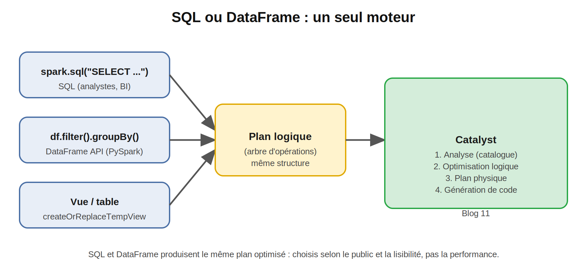
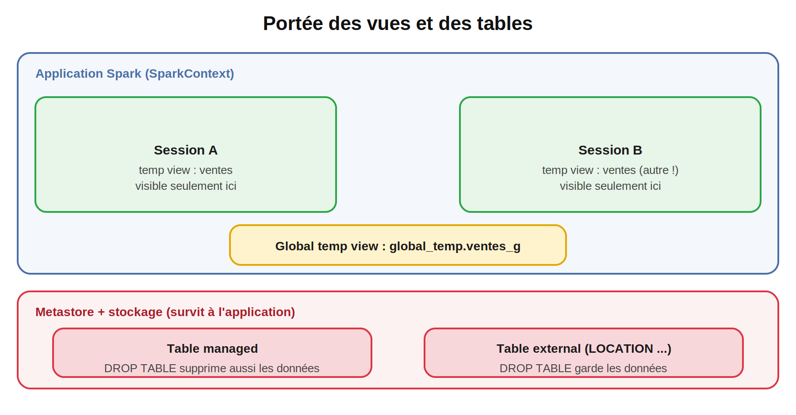
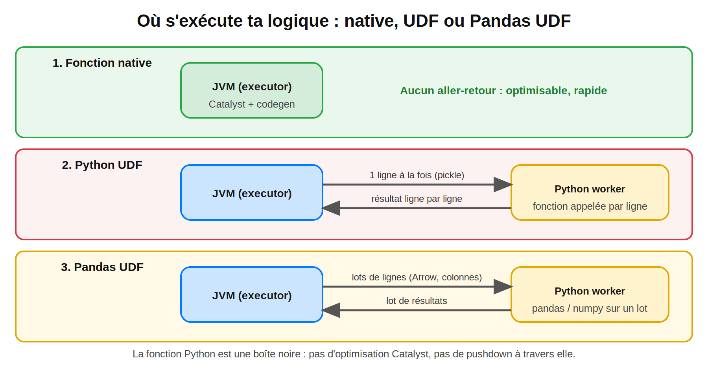
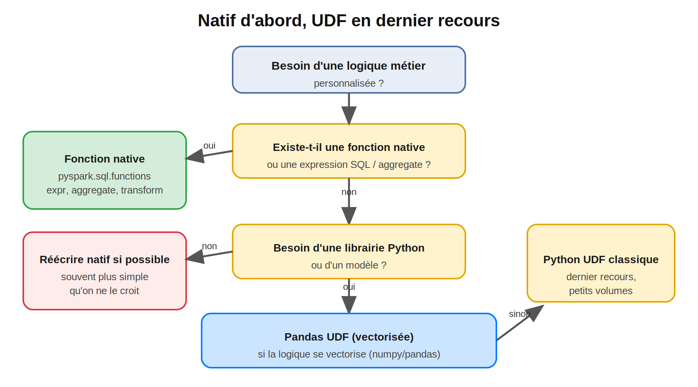

## Spark SQL, UDF et fonctions avancées : règles métier, performance et pièges en production

> **Temps de lecture :** ~30 min 

#Spark #ApacheSpark #PySpark #SparkSQL #UDF #PandasUDF #HigherOrderFunctions #DataQuality #DataEngineering #BigData #Performance #SparkDeZeroAExpert

---

## Sommaire

1. Rappel : les 3 questions du Blog 6
2. Pourquoi ce blog est différent
3. Données de travail
4. Spark SQL : un seul moteur, deux langages
5. Vues et tables : portée et durée de vie
6. Les pièges de Spark SQL en entreprise
7. UDF : pourquoi elles coûtent cher
8. La règle d'or : natif d'abord
9. Écrire une UDF et une Pandas UDF correctement
10. Mesurer : natif vs Python UDF vs Pandas UDF
11. Les 8 problèmes d'UDF en production
12. Fonctions natives avancées : tableaux, structures, JSON, pivot
13. Cas complet : pipeline de qualité des contacts
14. Checklist avant de livrer une UDF
15. Questions type certification
16. Prochain blog

---

## 1. Rappel : les 3 questions du Blog 6

| Question | Réponse courte |
|---|---|
| Une requête en **SQL** et la même en **DataFrame** donnent-elles le même plan ? | **Oui** : les deux passent par Catalyst. Je l'ai vérifié : les plans optimisés sont identiques. Section 4 |
| Comment exposer un DataFrame comme **table temporaire** ? | `createOrReplaceTempView("nom")`, puis `spark.sql(...)`. Section 5 |
| Pourquoi une **UDF Python** peut-elle ralentir un job de façon spectaculaire ? Que change une **Pandas UDF** ? | Chaque ligne fait un **aller-retour JVM ↔ Python** et la fonction est une **boîte noire** pour Catalyst. La Pandas UDF transfère des **lots en colonnes** (Arrow). Sections 7 et 10 |

---

## 2. Pourquoi ce blog est différent

En entreprise, tes DataFrames ne sont pas seulement lus par toi :

- les **analystes** et la **BI** veulent du **SQL** sur des vues stables ;
- les **règles métier** (valider un IBAN, normaliser un téléphone, scorer un client) n'existent dans aucun catalogue de fonctions ;
- la tentation est d'écrire une **UDF Python**, et c'est là que les jobs passent de 20 minutes à plusieurs heures sans qu'aucune erreur ne s'affiche.

Ce blog suit un fil rouge : **la qualité des données de contact** (téléphone et IBAN marocains). On verra qu'une règle qui *semble* exiger une UDF peut souvent s'écrire **en natif**, et comment faire proprement quand ce n'est vraiment pas possible.

> **Note de transparence :** le code de ce blog a été exécuté sur PySpark **3.5.3** en local (Java 17). Les chronométrages donnés plus bas sont ceux de ce test : sur ton cluster, les chiffres changent, la démarche reste la même.

---

## 3. Données de travail

On réutilise `ventes_enrichies` (Blog 6) et on génère une table de **contacts** avec des formats volontairement sales.

```python
from pyspark.sql import SparkSession, functions as F
from pyspark.sql.functions import udf, pandas_udf
import pandas as pd

spark = (
    SparkSession.builder
    .appName("blog7-sql-udf")
    .master("spark://spark-master:7077")
    .config("spark.driver.host", "jupyter")
    .config("spark.driver.bindAddress", "0.0.0.0")
    .config("spark.executor.memory", "1g")
    .config("spark.cores.max", "4")
    .getOrCreate()
)

ventes = spark.read.parquet("/data/out/ventes_enrichies")
ventes.createOrReplaceTempView("ventes_enrichies")

ibans = ["MA64011519000001205000534921",      # valide
         "MA59291417776317066907439150",      # valide
         "MA59291417776317066907439151",      # 1 chiffre faux
         "MA12",                              # trop court
         None,                                # absent
         "ma59 2914 1777 6317 0669 0743 9150"]  # valide, mais minuscules et espaces
tels  = ["06 12 34 56 78", "+212612345678", "0612-345678",
         "212 7 12 34 56 78", "12345", "00 212 6 12 34 56 78"]

def pick(valeurs, c):
    """Choisit une valeur de la liste de façon cyclique, selon la colonne c."""
    return F.element_at(F.array(*[F.lit(v) for v in valeurs]), (c % len(valeurs) + 1).cast("int"))

contacts = spark.range(1_000_000).select(
    F.col("id").alias("contact_id"),
    (F.col("id") % 1000).cast("int").alias("client_id"),
    pick(ibans, F.col("id")).alias("iban"),
    pick(tels,  F.col("id") * 7).alias("telephone"),
)
contacts.show(3, truncate=False)
```

---

## 4. Spark SQL : un seul moteur, deux langages



`spark.sql("...")` et l'API DataFrame produisent le **même plan logique**, optimisé par **Catalyst** (Blog 11). Il n'y a **aucune différence de performance** à écrire l'un ou l'autre : on choisit selon le public et la lisibilité.

| Situation | Préférer |
|---|---|
| Requêtes lues par des analystes, vues partagées, BI | **SQL** |
| Pipelines construits par étapes, logique conditionnelle, tests unitaires | **DataFrame** |
| Requêtes très longues avec plusieurs CTE | **SQL** |
| Code généré dynamiquement | **DataFrame** (voir problème n°1, section 6) |

### 4.1 Squelette : la même requête des deux côtés

Indicateurs par pays et par année, sur les ventes supérieures à 100.


```python
kpi_sql = spark.sql("""
    WITH kpi AS (
        SELECT pays, annee, COUNT(*) AS nb, ROUND(SUM(montant), 2) AS ca
        FROM ventes_enrichies
        WHERE montant > 100
        GROUP BY pays, annee
    )
    SELECT * FROM kpi ORDER BY ca DESC
""")

kpi_api = (
    ventes
    .filter("montant > 100")
    .groupBy("pays", "annee")
    .agg(F.count("*").alias("nb"), F.round(F.sum("montant"), 2).alias("ca"))
    .orderBy(F.desc("ca"))
)
```

### 4.2 Vérifier que le plan est le même

```python
kpi_sql.explain()
kpi_api.explain()
```

Compare les deux sorties : mêmes opérateurs (`Filter`, `HashAggregate`, `Exchange`, `Sort`), seuls les numéros d'identifiants de colonnes diffèrent.

### 4.3 SQL moderne : ce que tu peux utiliser

```python
# GROUP BY ALL (Spark 3.4+) : regroupe automatiquement sur les colonnes non agrégées
spark.sql("SELECT pays, annee, COUNT(*) AS nb FROM ventes_enrichies GROUP BY ALL").show()

# Fenêtres, comme au Blog 6
spark.sql("""
    SELECT client_id, date_vente, montant,
           SUM(montant) OVER (PARTITION BY client_id ORDER BY date_vente, vente_id
                              ROWS BETWEEN UNBOUNDED PRECEDING AND CURRENT ROW) AS cumul
    FROM ventes_enrichies
""")
```

### 4.4 Requêtes paramétrées : ne jamais concaténer du texte

```python
# ❌ À ne jamais faire : injection SQL et erreurs de guillemets
pays = "MA"
spark.sql(f"SELECT COUNT(*) FROM ventes_enrichies WHERE pays = '{pays}'")

# ✅ Paramètres nommés (Spark 3.4+)
spark.sql(
    "SELECT COUNT(*) AS n FROM ventes_enrichies WHERE pays = :pays AND montant > :seuil",
    args={"pays": "MA", "seuil": 100.0},
).show()
```

Dès que la valeur vient d'un utilisateur, d'un fichier de configuration ou d'une autre application, **utilise des paramètres**.

---

## 5. Vues et tables : portée et durée de vie



| Objet | Création | Visible par | Durée de vie |
|---|---|---|---|
| **Temp view** | `df.createOrReplaceTempView("v")` | La **session** courante | Jusqu'à la fin de la session |
| **Global temp view** | `df.createOrReplaceGlobalTempView("v")` | Toutes les sessions de l'**application** (`global_temp.v`) | Jusqu'à la fin de l'application |
| **Table managed** | `df.write.saveAsTable("t")` | Tous (via le metastore) | Persistante **si un metastore est configuré** ; `DROP TABLE` **supprime les données** |
| **Table external** | `CREATE TABLE ... USING parquet LOCATION '...'` | Tous (via le metastore) | Persistante **si un metastore est configuré** ; `DROP TABLE` **garde les données** |

```python
ventes.createOrReplaceTempView("ventes_enrichies")
ventes.createOrReplaceGlobalTempView("ventes_g")

spark.sql("SELECT COUNT(*) FROM global_temp.ventes_g").show()     # préfixe obligatoire
spark.table("ventes_enrichies")                                   # retourne un DataFrame
spark.catalog.listTables()                                        # inventaire
```

Une **vue est une requête, pas une copie** : elle n'occupe aucune mémoire et est recalculée à chaque usage (sauf `cache()`).

### 5.1 Tables managed vs external

```python
# Managed : Spark gère données ET métadonnées (dossier spark.sql.warehouse.dir)
ventes.write.mode("overwrite").saveAsTable("ventes_gold")

# External : les données restent là où elles sont
spark.sql("""
    CREATE TABLE IF NOT EXISTS ventes_ext
    USING parquet
    LOCATION '/data/out/ventes_enrichies'
""")
```

**En entreprise :** les tables de production sont **external** (ou gouvernées par un catalogue : Hive Metastore, Glue, Unity Catalog). Une erreur de `DROP TABLE` sur une managed détruit les données.

---

## 6. Les pièges de Spark SQL en entreprise

### Problème 1 : SQL construit par concaténation

Voir section 4.4 : erreurs de guillemets, injection, requêtes illisibles. **Solution :** paramètres nommés.

### Problème 2 : `TABLE_OR_VIEW_NOT_FOUND` alors que « la vue existe »

Les temp views sont **par session**. Un autre notebook, un autre job, ou une session recréée ne la voit pas.

| Cas | Solution |
|---|---|
| Vue créée dans un autre notebook | La recréer, ou en faire une **table** |
| Partage entre sessions d'une même application | `createGlobalTempView` + préfixe `global_temp.` |
| Partage entre applications / équipes | Table dans un **catalogue** |

### Problème 3 : `TEMP_TABLE_OR_VIEW_ALREADY_EXISTS`

`createTempView` **échoue** si la vue existe déjà. Utilise `createOrReplaceTempView`, sauf si tu veux explicitement protéger contre l'écrasement.

### Problème 4 : `LOCATION_ALREADY_EXISTS` sur une table managed

Le dossier de la table existe déjà dans le warehouse, mais Spark n'en connaît plus la table : `saveAsTable` refuse de repartir dessus. Deux causes fréquentes : une écriture précédente interrompue, ou un **catalogue en mémoire** (voir problème 5) qui a « oublié » la table à la fin de la session alors que les fichiers sont restés. **Solutions :** supprimer le dossier orphelin, ou écrire avec un chemin explicite (table external), ou configurer un vrai metastore.

### Problème 5 : le warehouse n'est pas partagé (Docker, cluster)

Par défaut, `spark.sql.warehouse.dir` est un dossier **local au driver**. Sur notre cluster Docker, les executors doivent écrire au **même** endroit : place le warehouse sur le volume partagé.

```python
.config("spark.sql.warehouse.dir", "/data/warehouse")
```

Autre point à connaître : **sans `enableHiveSupport()` ni catalogue externe, le catalogue est en mémoire**. Les tables managed existent le temps de la session ; à la fin, **les fichiers restent** dans le warehouse mais Spark ne connaît plus la table. Avec Hive support et sans metastore externe, Spark crée une base Derby locale (`metastore_db`) limitée à **un seul utilisateur à la fois**. En entreprise, on branche un vrai metastore (Hive Metastore, Glue, Unity Catalog).

### Problème 6 : même requête, résultats différents selon le mode ANSI

```python
spark.sql("SELECT 1/0").show()                       # NULL (mode non-ANSI, défaut Spark 3.5)

spark.conf.set("spark.sql.ansi.enabled", True)
spark.sql("SELECT 1/0").show()                       # erreur DIVIDE_BY_ZERO
spark.sql("SELECT try_divide(1, 0)").show()          # NULL, explicitement toléré
```

| Mode | Division par zéro, cast impossible, dépassement d'entier |
|---|---|
| ANSI désactivé | Retourne `NULL` ou une valeur tronquée **sans erreur** |
| ANSI activé | **Erreur** (plus sûr pour la qualité des données) |

En production, un résultat `NULL` silencieux est souvent **pire** qu'une erreur. Sur de nouveaux pipelines, active ANSI et utilise `try_*` là où tu tolères les anomalies. Vérifie la valeur par défaut de ta version de Spark.

### Problème 7 : mots réservés et sensibilité à la casse

Une colonne nommée `order`, `date` ou `group` demande des **backticks** : ``SELECT `order` FROM t``. Les noms de colonnes sont insensibles à la casse par défaut (`spark.sql.caseSensitive=false`).

---

## 7. UDF : pourquoi elles coûtent cher

Une **UDF** (*User Defined Function*) est une fonction que tu écris toi-même pour l'utiliser dans une requête Spark.



| | Fonction native | Python UDF | Pandas UDF |
|---|---|---|---|
| Où s'exécute-t-elle ? | Dans la **JVM** | Dans un **Python worker** | Dans un **Python worker** |
| Transfert | Aucun | **Ligne par ligne** (sérialisation pickle) | **Par lots** en colonnes (Apache Arrow) |
| Visible par Catalyst | ✅ Optimisée | ❌ **Boîte noire** | ❌ Boîte noire |
| Génération de code | ✅ | ❌ | ❌ |
| Plan d'exécution | — | `BatchEvalPython` | `ArrowEvalPython` |

**Les trois coûts d'une UDF Python :**

1. **Sérialisation** : chaque ligne est encodée, envoyée à Python, décodée, calculée, ré-encodée, renvoyée.
2. **Optimisation perdue** : Catalyst ne peut pas « voir » dans la fonction (pas de pushdown de filtre à travers elle, pas de fusion d'opérations).
3. **Mémoire et processus** : un Python worker par executor, avec sa propre mémoire (cf. Blog 8, architecture du runtime).

---

## 8. La règle d'or : natif d'abord



Avant d'écrire une UDF, **cherche** : l'API `pyspark.sql.functions` compte plusieurs centaines de fonctions, et `expr()` donne accès à **toutes** les fonctions SQL.

| Besoin métier | Solution native |
|---|---|
| Nettoyer un texte (espaces, casse, caractères) | `trim`, `lower`, `regexp_replace`, `translate` |
| Extraire une partie d'une chaîne | `regexp_extract`, `substring`, `split` |
| Conditions multiples | `when(...).when(...).otherwise(...)` |
| Distance entre deux textes | `levenshtein`, `soundex` |
| Appliquer une opération à chaque élément d'un tableau | `transform`, `filter`, `aggregate` |
| Calcul itératif sur une liste | `aggregate` (fold) |
| Parser du JSON | `from_json`, `get_json_object` |
| Hash, masquage | `sha2`, `md5`, `hash` |

### 8.1 Exemple 1 : normaliser un numéro de téléphone marocain (natif)

Formats reçus : `06 12 34 56 78`, `+212612345678`, `0612-345678`, `00 212 6 12 34 56 78`. Cible : `0612345678`.

```python
def tel_normalise(col):
    d = F.regexp_replace(F.regexp_replace(col, r"[^0-9]", ""), r"^00", "")      # chiffres seulement, sans 00 initial
    return F.when(d.startswith("212"), F.concat(F.lit("0"), F.substring(d, 4, 20))).otherwise(d)

contacts.select(
    "telephone",
    tel_normalise("telephone").alias("tel_norm"),
    tel_normalise("telephone").rlike(r"^0[5-7][0-9]{8}$").alias("tel_ok"),
).distinct().show(truncate=False)
```

### 8.2 Exemple 2 : valider un IBAN marocain, **sans UDF**

La validation d'un IBAN repose sur un calcul **modulo 97** : on déplace les 4 premiers caractères à la fin, on remplace les lettres par des nombres (`A=10 … Z=35`), et le reste de la division par 97 doit valoir **1**. Cela *semble* un cas typique d'UDF.

En réalité, `aggregate` (un « fold » natif) fait le travail : on parcourt les caractères en gardant le reste courant.

```python
def iban_valide_natif(col):
    s = F.upper(F.regexp_replace(col, r"\s", ""))                     # supprime les espaces, majuscules
    rearr = F.concat(F.substring(s, 5, 40), F.substring(s, 1, 4))     # 4 premiers caractères à la fin
    reste = F.aggregate(
        F.split(rearr, ""),                                           # tableau de caractères
        F.lit(0),                                                     # reste initial
        lambda acc, c: F.when(c.rlike("[A-Z]"), (acc * 100 + (F.ascii(c) - 55)) % 97)   # lettre : 2 chiffres
                        .otherwise((acc * 10 + c.cast("int")) % 97),                    # chiffre : 1 chiffre
    )
    return s.rlike(r"^MA[0-9]{26}$") & (reste == 1)

contacts.select("iban", iban_valide_natif("iban").alias("iban_ok")).distinct().show(truncate=False)
```

Résultat attendu sur nos échantillons : `true` pour les 3 IBAN valides (y compris celui en minuscules avec espaces), `false` pour celui avec un chiffre faux et pour `MA12`, `NULL` pour l'IBAN absent.

> **Leçon :** si tu penses « il me faut une UDF », demande-toi d'abord si un `aggregate`, un `transform` ou une `regexp` ne suffit pas. Ici, la version native donne les **mêmes résultats** que l'UDF, sans quitter la JVM.

---

## 9. Écrire une UDF et une Pandas UDF correctement

Quand faut-il **vraiment** une UDF ?

- quand tu dois appeler une **librairie Python** (`phonenumbers`, une bibliothèque de géocodage, un modèle scikit-learn) ;
- quand la logique est trop complexe ou itérative pour le natif.

### 9.1 Python UDF : squelette

```python
import re

# Règle : format IBAN marocain (28 caractères)


```python
@udf(returnType="boolean")
def iban_format_ok(iban):
    if iban is None:
        return None
    return bool(re.fullmatch(r"MA\d{26}", iban.replace(" ", "").upper()))

spark.udf.register("iban_format_ok", iban_format_ok)
contacts.createOrReplaceTempView("contacts")
spark.sql("SELECT iban, iban_format_ok(iban) FROM contacts LIMIT 3").show(truncate=False)
```


### 9.2 Pandas UDF : traiter un lot entier

```python
import numpy as np

@pandas_udf("double")
def score_client(montant: pd.Series) -> pd.Series:
    return np.round(np.log1p(montant) * 10, 2)             # opération vectorisée sur tout le lot

ventes.select("montant", score_client("montant").alias("score")).show(3)
```

**Règles d'une Pandas UDF efficace :**

| Règle | Pourquoi |
|---|---|
| Utiliser des opérations **vectorisées** (numpy, pandas) | Le gain vient du vectoriel ; une boucle Python sur chaque élément annule l'avantage |
| Annoter les types (`pd.Series -> pd.Series`) | Spark déduit ainsi le type de Pandas UDF |
| **Gérer les null** (voir problème n°3, section 11) | Les null arrivent en `NaN` / `None` |
| Surveiller la taille des lots | `spark.sql.execution.arrow.maxRecordsPerBatch` (10 000 par défaut) |

### 9.3 Les autres formes de Pandas UDF

| Forme | Usage |
|---|---|
| `Series -> Series` | Transformation colonne par colonne (la plus courante) |
| `Iterator[Series] -> Iterator[Series]` | Initialiser une ressource **une fois** par lot (charger un modèle) |
| `groupBy().applyInPandas(fn, schema)` | Appliquer une fonction pandas à **chaque groupe** |
| `mapInPandas(fn, schema)` | Transformer un DataFrame par lots de DataFrames pandas |

---

## 10. Mesurer : natif vs Python UDF vs Pandas UDF

Ne crois jamais un conseil de performance sans le mesurer. Technique : écrire vers le format **`noop`** (aucune écriture disque : on mesure uniquement le calcul).

### 10.1 Squelette de benchmark

```python
import math, time

df = spark.range(2_000_000).select((F.rand(1) * 500).alias("montant"))

@udf("double")
def score_udf(m):
    return round(math.log1p(m) * 10, 2) if m is not None else None

@pandas_udf("double")
def score_pd(m: pd.Series) -> pd.Series:
    return np.round(np.log1p(m) * 10, 2)

def bench(nom, expr):
    t = time.time()
    df.select(expr.alias("s")).write.format("noop").mode("overwrite").save()
    print(f"{nom:8s} {time.time() - t:5.1f}s")

bench("natif",  F.round(F.log1p("montant") * 10, 2))
bench("natif",  F.round(F.log1p("montant") * 10, 2))      # 2e passage : JVM « chauffée »
bench("pandas", score_pd("montant"))
bench("udf",    score_udf("montant"))
```

<details>
<summary>Solution</summary>

`format("noop")` et `F.log1p`. Lance le natif **deux fois** : le premier passage inclut le démarrage et la chauffe de la JVM, pas le suivant.

</details>

### 10.2 Résultat de mon test

2 millions de lignes, 2 cœurs en local, après chauffe de la JVM :

| Approche | Durée |
|---|---|
| **Native** | ≈ 1 s |
| **Pandas UDF** | ≈ 4 s |
| **Python UDF** | ≈ 5 s |

L'**ordre** est le point important : natif < Pandas UDF < Python UDF. L'écart se creuse avec le volume et la complexité de la requête, parce que l'UDF empêche aussi les optimisations autour d'elle. **Reproduis ce test sur ton cluster avec tes données** avant de décider.

### 10.3 Vérifier dans le plan

```python
df.select(score_udf("montant")).explain()      # BatchEvalPython
df.select(score_pd("montant")).explain()       # ArrowEvalPython
df.select(F.log1p("montant")).explain()        # aucun nœud Python
```

Le nœud `*EvalPython` dans un plan est le **signal d'alerte** : « ici, les données quittent la JVM ».

---

## 11. Les 8 problèmes d'UDF en production

### Problème 1 : le résultat est `NULL` partout, sans erreur

La fonction retourne un type **différent** du `returnType` déclaré : Spark ne convertit pas, il met `NULL`.

```python
@udf("int")
def mauvais(x):
    return x * 1.5 if x is not None else None       # retourne un float pour un int déclaré

@udf("double")
def correct(x):
    return x * 1.5 if x is not None else None

spark.createDataFrame([(2,), (None,)], ["x"]).select("x", mauvais("x"), correct("x")).show()
# mauvais(2) -> NULL, correct(2) -> 3.0
```

**Résultat observé :** `mauvais(2)` donne `NULL`, `correct(2)` donne `3.0`. Aucun message d'erreur.
**Prévention :** tester chaque UDF sur quelques valeurs, **vérifier les null en sortie**, et déclarer le type exact.

### Problème 2 : le job plante sur un `None` en entrée

Une UDF Python **reçoit `None`** pour les valeurs null : `x * 1.5` lève `TypeError`, et **le job entier échoue** (la task est relancée 4 fois, puis le stage s'arrête).

```python
@udf("string")
def inverse(x):
    return str(1 / x)                      # TypeError si x est None, ZeroDivisionError si x == 0
```

**Solution :** garde défensive en première ligne (`if x is None: return None`), `try/except` pour les cas où une valeur sale ne doit pas tuer tout le job.

```python
@udf("double")
def inverse_sure(x):
    try:
        return 1.0 / x
    except (TypeError, ZeroDivisionError):
        return None                        # on garde la ligne, on marque l'anomalie
```

### Problème 3 : Pandas UDF et `null`

Dans une Pandas UDF, les null arrivent en `NaN` / `None` à l'intérieur de la `Series`. Un `Series.map(fonction)` appelle **ta fonction avec un float `nan`** : `re.sub(...)` lève alors `TypeError: expected string or bytes-like object, got 'float'` et le job échoue.

```python
@pandas_udf("boolean")
def iban_pd(s: pd.Series) -> pd.Series:
    # ❌ s.map(valider)  : valider() est appelée avec NaN
    # ✅ na_action="ignore" : les null sont ignorés et restent null
    return s.map(valider, na_action="ignore").astype("boolean")
```

### Problème 4 : `ModuleNotFoundError` ou `PYTHON_VERSION_MISMATCH` sur les executors

L'UDF s'exécute sur les **workers**, pas sur le driver. Ta librairie installée dans le notebook **n'y est pas**, et la version mineure de Python doit être **identique** entre le driver et les workers (point annoncé au Blog 2).

| Symptôme | Cause | Solution |
|---|---|---|
| `ModuleNotFoundError` dans une task | Librairie absente sur les executors | Image Docker/conda partagée, ou `--py-files` / environnement packagé (Blog 9) |
| `PYTHON_VERSION_MISMATCH` | Python 3.11 côté driver, 3.8 côté workers | Même image de base partout |
| Fonctionne en local, échoue sur le cluster | Dépendance installée seulement sur ta machine | Reproduire l'environnement dans les conteneurs |

### Problème 5 : `PicklingError` ou OOM à cause d'une variable capturée

L'UDF est **sérialisée avec tout ce qu'elle référence**.

| Erreur | Cause | Solution |
|---|---|---|
| `PicklingError` / `Could not serialize object` | La fonction référence un objet non sérialisable (`SparkSession`, connexion, fichier ouvert) | Créer la ressource **dans** la fonction, ou utiliser `Iterator[Series]` |
| Tasks très lourdes, OOM | La fonction capture un gros dictionnaire ou DataFrame pandas | **Broadcast** (`spark.sparkContext.broadcast`) ou, mieux, une **jointure** avec la table de référence |

Règle : **une UDF ne doit jamais appeler Spark** (`spark.sql`, `df.collect`) : cela n'existe pas côté executor.

### Problème 6 : une UDF est exécutée plusieurs fois, ou n'est pas déterministe

Spark peut évaluer une expression **plusieurs fois** (relance d'une task, plan réutilisé). Une UDF qui appelle une API externe, génère un identifiant aléatoire ou écrit quelque part produira des **doublons ou des incohérences**.

```python
f = udf(ma_fonction, "string").asNondeterministic()     # empêche Spark de la dupliquer/réordonner
```

**Règle :** une UDF doit être une **fonction pure** (même entrée, même sortie, aucun effet de bord). Les appels externes se font en amont (jointure avec une table de référence) ou via `mapPartitions` avec gestion des erreurs et des quotas.

### Problème 7 : les filtres ne sont plus poussés vers la source

```python
df = spark.read.parquet("/data/out/ventes_enrichies")
df.filter(F.col("annee") == 2025)                       # ✅ pushdown : seuls les fichiers 2025 sont lus
df.filter(ma_udf("annee") == True)                      # ❌ Catalyst ne peut pas traduire la fonction
```

Quand une condition peut s'exprimer **sans** UDF, mets-la **avant** l'UDF : réduis les lignes d'abord, appelle la fonction ensuite.

### Problème 8 : Arrow ne démarre pas (`sun.misc.Unsafe or DirectByteBuffer ... not available`)

Les Pandas UDF, `toPandas()` et `createDataFrame(pandas_df)` passent par **Apache Arrow**, qui exige des options Java avec les versions récentes de Java.

| Constat | Solution |
|---|---|
| Erreur `sun.misc.Unsafe or java.nio.DirectByteBuffer.<init>(long, int) not available` | Ajouter `-Dio.netty.tryReflectionSetAccessible=true` aux options Java du **driver et des executors** |
| Java 21 avec Spark 3.5.3 | Dans mon test, l'erreur persistait malgré cette option : utiliser **Java 17**, la version supportée par la ligne 3.5 |

```python
.config("spark.driver.extraJavaOptions",   "-Dio.netty.tryReflectionSetAccessible=true")
.config("spark.executor.extraJavaOptions", "-Dio.netty.tryReflectionSetAccessible=true")
```

Pour accélérer aussi `toPandas()` : `spark.sql.execution.arrow.pyspark.enabled=true`.

---

## 12. Fonctions natives avancées : tableaux, structures, JSON, pivot

Les données d'entreprise sont rarement plates : commandes avec **lignes imbriquées**, événements en **JSON**, tableaux de tags. Les types complexes (`array`, `struct`, `map`) et leurs fonctions évitent la plupart des UDF.

```python
cmd = spark.createDataFrame([
    (1, [("A", 2, 10.0), ("B", 1, 99.5)], '{"canal":"web","remise":0.1,"tags":["vip","promo"]}'),
    (2, [],                               '{"canal":"mag","remise":null,"tags":[]}'),
    (3, None,                             '{"canal":"web"'),                 # JSON malformé
], "id INT, lignes ARRAY<STRUCT<sku:STRING, qte:INT, prix:DOUBLE>>, payload STRING")
```

### 12.1 Fonctions d'ordre supérieur : traiter un tableau sans l'exploser

Squelette : complète avec `transform`, `aggregate`, `filter`, `exists`.

```python
cmd.select(
    "id",
    F.transform("lignes", lambda l: l.qte * l.prix).alias("montants_lignes"),
    F.aggregate("lignes", F.lit(0.0), lambda acc, l: acc + l.qte * l.prix).alias("total"),
    F.filter("lignes", lambda l: l.prix > 50).alias("articles_chers"),
    F.exists("lignes", lambda l: l.qte > 1).alias("a_qte_sup_1"),
).show(truncate=False)
```

Résultat observé : commande 1 → total `119.5`, articles chers `[{B, 1, 99.5}]`, `a_qte_sup_1 = true`. Commande 2 (tableau vide) → total `0.0`. Commande 3 (tableau null) → tout est `NULL`.

</details>

| Fonction | Rôle |
|---|---|
| `transform(arr, f)` | Applique `f` à chaque élément |
| `filter(arr, f)` | Garde les éléments où `f` est vrai |
| `aggregate(arr, init, f)` | Réduction (somme, fold) |
| `exists(arr, f)` / `forall(arr, f)` | Au moins un / tous |
| `zip_with(a, b, f)` | Combine deux tableaux élément par élément |

Ces fonctions s'exécutent **dans la JVM** : c'est ce qui a permis de valider l'IBAN sans UDF.

### 12.2 `explode` : attention aux lignes qui disparaissent

```python
cmd.select("id", F.explode("lignes").alias("l"))           # ❌ les commandes 2 et 3 DISPARAISSENT
cmd.select("id", F.explode_outer("lignes").alias("l"))     # ✅ une ligne avec NULL pour 2 et 3
```

`explode` supprime les lignes dont le tableau est **vide ou null** : un `inner join` caché. Utilise `explode_outer` quand tu dois **conserver** chaque commande. Pour aplatir une structure : `.select("id", "l.*")`.

### 12.3 JSON : `from_json` avec un schéma

```python
sch = "canal STRING, remise DOUBLE, tags ARRAY<STRING>"

cmd.select("id", F.from_json("payload", sch).alias("p")).select("id", "p.*").show(truncate=False)
cmd.select("id", F.get_json_object("payload", "$.canal").alias("canal")).show()
```

Pour la commande 3 (JSON malformé), le résultat est un champ **entièrement `NULL`**, sans erreur : prévois un contrôle de qualité, par exemple compter les lignes où `payload IS NOT NULL` mais `p IS NULL`.

### 12.4 Pièges des tableaux

| Piège | Détail | Solution |
|---|---|---|
| `size(null)` | Retourne **-1** (et non 0 ni null) en mode non-ANSI | `F.coalesce(F.size(c), F.lit(0))` ou tester `isNull` d'abord |
| `collect_list` | Rassemble toutes les valeurs d'un groupe **en mémoire** | Limiter, ou travailler avec une window |
| `explode` sur gros tableaux | Multiplie le nombre de lignes | Filtrer avant, ou utiliser les fonctions d'ordre supérieur |

### 12.5 Combler les trous dans les dates : `sequence`

```python
spark.createDataFrame([("2025-03-01", "2025-03-04")], ["debut", "fin"]).select(
    F.explode(F.sequence(F.to_date("debut"), F.to_date("fin"))).alias("jour")
).show()
```

Utile pour fabriquer un calendrier et le joindre (`left`) aux ventes, afin que les jours sans vente apparaissent avec 0.

### 12.6 `pivot` et `unpivot`

```python
v = spark.createDataFrame([("MA", 2024, 10.0), ("MA", 2025, 20.0), ("FR", 2024, 5.0), ("FR", 2025, 7.0)],
                          ["pays", "annee", "ca"])

large = v.groupBy("pays").pivot("annee", [2024, 2025]).agg(F.sum("ca"))      # lignes -> colonnes
large.unpivot("pays", ["2024", "2025"], "annee", "ca")                       # colonnes -> lignes (Spark 3.4+)
large.select("pays", F.expr("stack(2, '2024', `2024`, '2025', `2025`) AS (annee, ca)"))   # équivalent SQL
```

> **Donne toujours la liste des valeurs au `pivot`** (`[2024, 2025]`) : sans elle, Spark lance **un job supplémentaire** pour découvrir les valeurs distinctes, et un pivot sur une colonne à forte cardinalité génère des milliers de colonnes.

---

## 13. Cas complet : pipeline de qualité des contacts

Objectif : produire une vue **`contacts_qualite`** exploitable en **SQL** par les analystes, avec des règles métier **natives**.

```python
q = (
    contacts
    .withColumn("tel_norm", tel_normalise("telephone"))
    .withColumn("tel_ok",   F.col("tel_norm").rlike(r"^0[5-7][0-9]{8}$"))
    .withColumn("iban_ok",  iban_valide_natif("iban"))
)
q.createOrReplaceTempView("contacts_qualite")

# Rapport de qualité (SQL)
spark.sql("""
    SELECT iban_ok, tel_ok, COUNT(*) AS nb
    FROM contacts_qualite
    GROUP BY ALL ORDER BY iban_ok, tel_ok
""").show()
```

**Résultat observé** sur nos données de test : `iban_ok = NULL` pour les IBAN absents, `false` pour les invalides, `true` pour les valides.

> **Attention aux 3 états.** `iban_ok` peut valoir `true`, `false` **ou `NULL`**. `WHERE iban_ok` ne garde que `true`, mais `WHERE NOT iban_ok` **exclut aussi les `NULL`**. Pour compter « tous ceux qui ne sont pas valides », écris `WHERE iban_ok IS NOT TRUE`.

### Croiser avec les ventes en SQL

```python
spark.sql("""
    SELECT pays, COUNT(*) AS nb_ventes, ROUND(SUM(montant), 2) AS ca
    FROM ventes_enrichies
    WHERE client_id IN (SELECT DISTINCT client_id FROM contacts_qualite WHERE iban_ok AND tel_ok)
    GROUP BY ALL
    ORDER BY ca DESC
""").show()
```

On utilise `IN (sous-requête)`, qui se traduit par un **left_semi join** (Blog 6) : pas de duplication de lignes. Une jointure classique sur `client_id` aurait **multiplié** les ventes par le nombre de contacts du client.

### Écrire le résultat

```python
q.write.mode("overwrite").partitionBy("iban_ok").parquet("/data/out/contacts_qualite")
```

Ce que ce pipeline garantit :

| Risque | Parade |
|---|---|
| Ralentissement dû aux UDF | Règles **natives** (`regexp`, `aggregate`) : aucune sortie de la JVM |
| Résultats `NULL` silencieux | Colonnes booléennes testées sur les 3 états |
| Duplication de lignes à la jointure | `IN (sous-requête)` / `left_semi` |
| Analyste bloqué | Vue SQL `contacts_qualite` documentée |
| SQL fragile | Requêtes paramétrées |

---

## 14. Checklist avant de livrer une UDF

| # | Question | Réponse attendue |
|---|---|---|
| 1 | Existe-t-il une fonction **native** (`regexp`, `aggregate`, `transform`, `expr`) ? | Oui → l'utiliser |
| 2 | La logique se **vectorise**-t-elle (numpy, pandas) ? | Oui → **Pandas UDF** |
| 3 | `returnType` exact déclaré ? | Oui |
| 4 | Entrée `None` / `NaN` gérée ? | Oui, testé |
| 5 | Exceptions gérées sans tuer le job ? | `try/except`, valeur de repli |
| 6 | Fonction **pure** (pas d'appel réseau, pas d'effet de bord) ? | Oui |
| 7 | Dépendances présentes sur **tous les executors**, même Python ? | Oui |
| 8 | Rien de volumineux capturé dans la fermeture ? | Oui (broadcast ou jointure) |
| 9 | Filtres appliqués **avant** l'UDF ? | Oui |
| 10 | Test de performance fait avec `format("noop")` ? | Oui |
| 11 | Plan vérifié (`BatchEvalPython` / `ArrowEvalPython`) ? | Oui |

---

## 15. Questions type certification

**Q1. SQL et DataFrame donnent-ils des performances différentes pour une même requête ?**
→ **Non** : les deux sont compilés en un même plan par Catalyst.

**Q2. Quelle est la différence entre une temp view et une global temp view ?**
→ La temp view est limitée à la **session** ; la global temp view est visible par toutes les sessions de l'**application** via `global_temp.<nom>`.

**Q3. Que devient une table managed après `DROP TABLE` ? Et une table external ?**
→ Managed : **données supprimées**. External : les données **restent**.

**Q4. Pourquoi une Python UDF est-elle plus lente qu'une fonction native ?**
→ Sérialisation ligne par ligne vers un processus Python, et fonction **opaque** pour Catalyst (pas d'optimisation).

**Q5. Qu'apporte une Pandas UDF ?**
→ Transfert **par lots** en colonnes (Apache Arrow) et traitement **vectorisé** pandas/numpy.

**Q6. Une UDF déclarée `"int"` retourne un `float`. Que se passe-t-il ?**
→ Le résultat est **`NULL`**, sans erreur.

**Q7. Que se passe-t-il quand une Python UDF reçoit `None` et fait `x * 2` ?**
→ `TypeError` : la task échoue, est relancée, puis le job échoue.

**Q8. `explode` ou `explode_outer` pour conserver les lignes dont le tableau est vide ou null ?**
→ **`explode_outer`**.

**Q9. Quel nœud de plan indique l'usage d'une Python UDF ? D'une Pandas UDF ?**
→ `BatchEvalPython` ; `ArrowEvalPython`.

**Q10. Pourquoi donner la liste de valeurs à `pivot` ?**
→ Pour éviter un job supplémentaire de découverte des valeurs distinctes (et limiter le nombre de colonnes).

---

## Points clés

1. **SQL = DataFrame** : même moteur, même plan. Choisis selon le public.
2. Temp view = **session** ; global temp view = **application** ; table = **catalogue persistant**. Les tables de production sont de préférence **external**.
3. **Requêtes paramétrées** (`args={...}`) plutôt que des f-strings.
4. Une **UDF Python** fait un aller-retour JVM ↔ Python par ligne et masque la logique à Catalyst : **natif d'abord**.
5. `aggregate`, `transform`, `filter`, `exists`, `from_json`, `regexp_*` couvrent la majorité des « besoins d'UDF », y compris la validation d'un IBAN.
6. Si une UDF est inévitable : **vectorise** (Pandas UDF), déclare le **type exact**, gère `None`/`NaN`, garde-la **pure**.
7. Les pannes d'UDF sont **silencieuses** (`NULL` partout) ou **brutales** (`TypeError`, module absent, Python différent) : teste et mesure avant la production.
8. Mesure avec `format("noop")` et lis le plan : `*EvalPython` signale une sortie de la JVM.
9. `explode` perd les lignes vides ; `size(null)` vaut -1 ; les booléens ont **3 états**.

---

## 16. Prochain blog : on passe sous le capot

Tu maîtrises maintenant l'API : lire, transformer, joindre, fenêtrer, interroger en SQL, étendre avec des UDF. Ce **Niveau 2** est terminé.

Mais plusieurs questions sont restées sans réponse complète au fil des blogs :

- On a dit qu'une UDF s'exécute dans un **« Python worker »**. Où vit-il exactement ? Un executor est-il une JVM, un conteneur, un processus ?
- Pourquoi `PYTHON_VERSION_MISMATCH` apparaît-il entre le driver et les workers, et que fait **Py4J** entre ton code Python et la JVM ?
- Quand tu lances un job, qui demande les ressources, qui les accorde, et que se passe-t-il sur **YARN** ou **Kubernetes** ?
- Pourquoi un job qui marche dans ton notebook échoue-t-il en production avec `OutOfMemoryError: Container killed by YARN` ?


#Spark #ApacheSpark #PySpark #SparkSQL #UDF #PandasUDF #LearnSpark #DataEngineer #DataQuality #BigData #SparkDeZeroAExpert