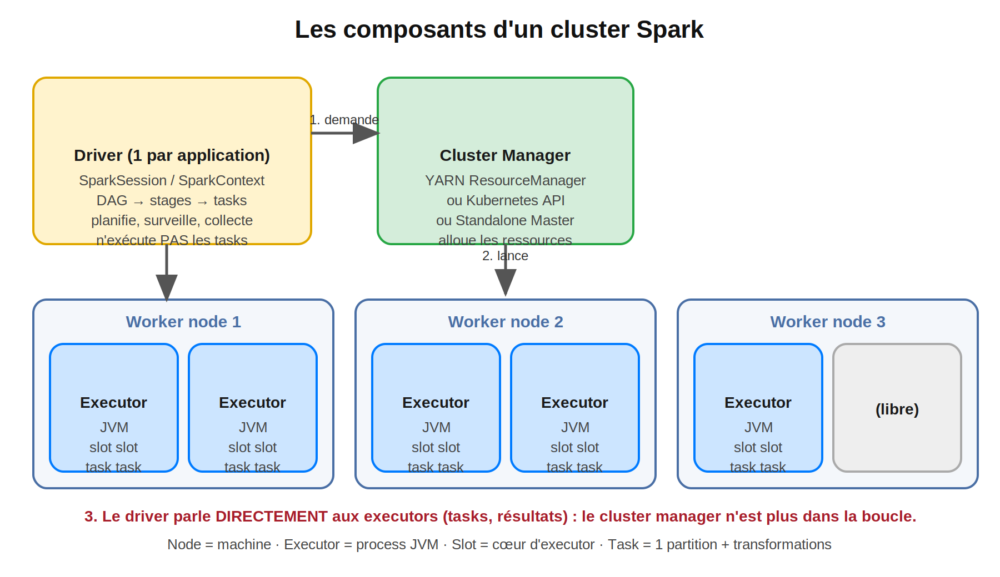
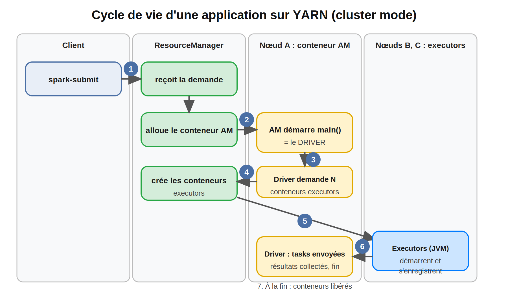
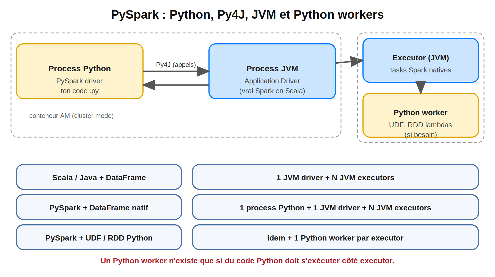
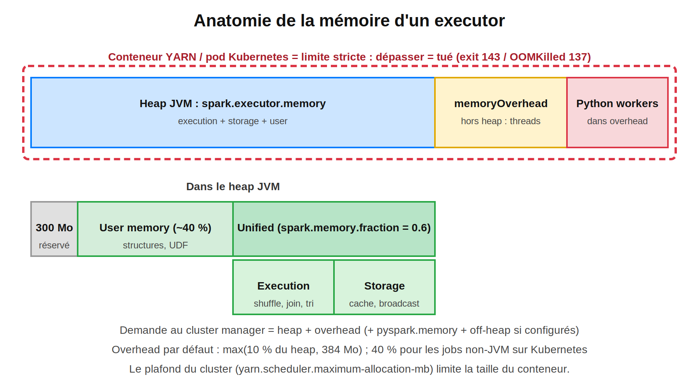

> **Série :** Spark de 0 à expert |
> **Temps de lecture :** ~30 min | 

#Spark #ApacheSpark #PySpark #Architecture #Driver #Executor #YARN #Kubernetes #Py4J #MemoryOverhead #DataEngineering #BigData #SparkDeZeroAExpert

---

## Sommaire

1. Rappel : les questions laissées par les blogs précédents
2. Pourquoi ce blog est différent
3. Cluster, nœuds, ressources : le vocabulaire exact
4. Les composants d'une application Spark
5. Cycle de vie d'une application sur YARN
6. Client mode vs Cluster mode
7. PySpark : Python, Py4J, JVM et Python workers
8. Dimensionner les executors
9. La mémoire d'un executor et le « Container killed by YARN »
10. Kubernetes et Standalone : mêmes concepts, autres mots
11. Lire l'onglet Executors et l'API REST
12. Les 10 incidents de production liés à l'architecture
13. Cas complet : une application PySpark tuée sur YARN
14. Checklist avant de lancer une application sur un cluster
15. Questions type certification


---

## 1. Rappel : les questions laissées par les blogs précédents

| Question | Réponse courte | Section |
|---|---|---|
| Où vit exactement un **Python worker** ? Un executor est-il une JVM, un conteneur, un processus ? | Un executor est un **process JVM** (dans un conteneur YARN ou un pod Kubernetes). Un Python worker est un **process Python lancé à côté**, uniquement si du code Python doit s'exécuter côté executor | 7 |
| Que fait **Py4J** entre ton code Python et la JVM ? | Il transmet tes appels PySpark à la **JVM driver**, qui exécute le vrai Spark (Scala) | 7 |
| Qui demande les ressources, qui les accorde, et que se passe-t-il sur YARN ou Kubernetes ? | Le **driver** demande, le **cluster manager** accorde et crée les conteneurs ; ensuite le driver parle **directement** aux executors | 4, 5 |
| Pourquoi un job qui marche dans le notebook est-il **tué en production** (`Container killed by YARN`) ? | Le conteneur dépasse sa limite mémoire (heap **+ overhead**) | 9, 13 |

---

## 2. Pourquoi ce blog est différent

Jusqu'ici, tu as écrit du code. En entreprise, **ce code s'exécute sur des machines que tu ne vois pas**, et les pannes les plus coûteuses ne viennent pas de la syntaxe mais de l'**architecture** :

- une application « ACCEPTED » pendant des heures sans jamais démarrer ;
- un executor tué par le cluster manager sans qu'aucune exception ne soit levée dans ton code ;
- un `collect()` qui fait tomber le driver ;
- un job qui tourne sur ton poste et échoue sur le cluster, parce que le driver, les executors et les Python workers ne vivent pas au même endroit.

Un diagnostic exige de répondre à trois questions : **quel processus ? sur quelle machine ? avec quelle limite de ressources ?** Ce blog t'apprend à y répondre.

> **Note de transparence :** les démonstrations de la section 7 (PIDs) et de la section 11 (API REST) ont été exécutées sur PySpark 3.5.3 en mode local. Le comportement de YARN et de Kubernetes est décrit d'après leur fonctionnement standard : **à valider sur ton infrastructure**, car les valeurs par défaut dépendent de la configuration de ton cluster.

---

## 3. Cluster, nœuds, ressources : le vocabulaire exact

Un **cluster** est un ensemble de machines interconnectées. Exemple :

| Élément | Valeur |
|---|---|
| Nœuds workers | 10 |
| Par nœud | 16 CPU et 64 Go de RAM |
| **Capacité totale** | **160 CPU et 640 Go de RAM** |

Spark nécessite un cluster pour les gros volumes, même si on peut utiliser la machine locale (`local[*]`) pour développer.

| Terme | Définition | Piège |
|---|---|---|
| **Nœud (node)** | Une **machine** physique ou virtuelle | Ne pas confondre avec un executor |
| **Worker node** | Nœud qui héberge des executors | Un nœud peut en héberger plusieurs |
| **Driver** | Process qui coordonne l'application | **Un seul** par application |
| **Executor** | **Process JVM** qui exécute des tasks | Pas synonyme de nœud |
| **Core / slot** | Un cœur d'executor : une task à la fois | Un executor a **un ou plusieurs** cores |
| **Task** | Unité de travail la plus fine : 1 partition + transformations | Niveau d'exécution le plus granulaire |
| **Conteneur** | Enveloppe de ressources (CPU, mémoire) allouée par YARN, ou **pod** sous Kubernetes | Un executor tourne **dans** un conteneur |

**Technologies de cluster supportées :** **Hadoop YARN** et **Kubernetes** couvrent plus de 90 % des cas d'usage. Le mode **Standalone** (celui de ton lab Docker) sert à apprendre et aux petits clusters dédiés ; **Apache Mesos** est déprécié.

---

## 4. Les composants d'une application Spark



| Composant | Rôle | Ne fait **pas** |
|---|---|---|
| **Driver** | Exécute `main()`, crée la SparkSession, transforme le code en plan (DAG, stages, tasks), **planifie, assigne et surveille** les tasks | Il n'exécute **pas** les tasks de traitement |
| **Cluster manager** | **Alloue** et suit les ressources entre applications (YARN RM, Kubernetes, Standalone Master) | Il ne planifie pas les tasks et **ne relaie pas** les échanges driver ↔ executors |
| **Executors** | Exécutent les tasks, gardent les données en mémoire/disque (cache, shuffle) | Ils ne décident de rien : ils obéissent au driver |

**Deux faits à retenir (ils reviennent à la certification et en incident) :**

1. Le driver et les executors **communiquent directement**. Si le réseau entre eux est coupé (pare-feu, mauvais `spark.driver.host`), l'application échoue même si le cluster est en bonne santé.
2. **Chaque application a son propre driver et ses propres executors.** Deux applications A1 et A2 ne partagent rien : elles se partagent seulement les **ressources du cluster**, via le cluster manager.

Le driver **ne se met pas à l'échelle** : il n'y en a qu'un. C'est pourquoi tout ce qui le surcharge (`collect()`, `toPandas()`, énormes broadcasts) est un goulot d'étranglement par construction.

---

## 5. Cycle de vie d'une application sur YARN



Quand tu lances `spark-submit` (cluster mode) :

1. `spark-submit` contacte le **ResourceManager (RM)** de YARN.
2. Le RM alloue un conteneur pour l'**Application Master (AM)**, un environnement isolé avec une allocation de CPU et de mémoire (ex. 4 CPU, 16 Go).
3. Ce conteneur démarre la méthode **`main()`** de l'application : c'est le **driver**.
4. Le driver, via l'AM, **demande des conteneurs** supplémentaires pour les executors.
5. Le RM crée ces conteneurs sur des nœuds disposant des ressources (ex. 4 CPU, 16 Go chacun).
6. Chaque executor (une JVM) démarre et **s'enregistre auprès du driver**.
7. Le driver envoie les tasks, collecte les résultats. À la fin, les conteneurs sont libérés.

| Conteneur | Contient | Environnement |
|---|---|---|
| **AM container** | Le **Spark driver** | JVM (+ process Python si PySpark) |
| **Executor container** | Les tasks Spark | JVM (+ Python worker si nécessaire) |

> **Pourquoi un conteneur reste « ACCEPTED » :** le RM n'a pas pu allouer l'AM (file d'attente saturée, demande supérieure au plafond autorisé). Aucune ligne de ton code n'a encore été exécutée : le problème est **côté ressources**, pas côté Spark.

---

## 6. Client mode vs Cluster mode

La seule différence entre les deux modes est **l'emplacement du driver**. Les executors tournent **toujours dans le cluster**.

| | **Cluster mode** | **Client mode** |
|---|---|---|
| Où est le driver ? | Dans un conteneur AM **sur le cluster** | Sur la **machine qui lance** `spark-submit` |
| Latence driver ↔ executors | **Faible** (même réseau) | Dépend du réseau entre le client et le cluster |
| Déconnexion du client | L'application **continue** | Le driver meurt, **les executors sont tués** |
| Résultats immédiats | Via les logs / le stockage | **Directement** dans le terminal / notebook |
| Usage | **Production**, jobs planifiés | **Interactif** : `spark-shell`, notebooks, développement |

**Rappel de ton lab Docker (Blog 2) :** le notebook Jupyter est le **driver en client mode** ; c'est pourquoi on a dû fixer `spark.driver.host` : les executors, hors du conteneur notebook, doivent pouvoir **le joindre**.

**Règle pratique :** cluster mode pour tout ce qui est planifié ou long, client mode pour explorer.

---

## 7. PySpark : Python, Py4J, JVM et Python workers



- Spark est écrit en **Scala** et s'exécute dans la **JVM**.
- PySpark permet d'écrire en Python : tes appels passent par **Py4J** vers un **wrapper Java**, qui appelle le code Scala. **Même une application PySpark démarre donc une JVM.**

| Terme | Signification |
|---|---|
| **PySpark driver** | Le **process Python** qui exécute ton script |
| **Application driver** | Le **process JVM** qui exécute réellement Spark |
| **Python worker** | Un process Python lancé **dans l'executor**, seulement si du code Python doit s'y exécuter |

| Cas | Architecture (processus) |
|---|---|
| Scala / Java + DataFrame API | 1 JVM driver + N JVM executors |
| PySpark + DataFrame API (fonctions natives) | 1 process Python + 1 JVM driver + N JVM executors |
| PySpark + UDF, RDD Python, bibliothèques Python externes | idem **+ 1 Python worker par executor** |

C'est la réponse à la question du Blog 7 : une UDF s'exécute dans le **Python worker** de l'executor, ce qui explique le coût de sérialisation et le besoin d'avoir **Python et les librairies sur chaque nœud**.

### 7.1 Voir les trois processus

Squelette : affiche les PIDs.

```python
import os
from pyspark.sql.functions import udf

pid_py  = os.getpid()                                                                   # process Python driver
pid_jvm = spark._jvm.java.lang.management.ManagementFactory.getRuntimeMXBean().getpid()  # process JVM driver

@udf("int")
def pid_worker(x):
    return os.getpid()                                                                  # exécuté côté executor

pids = [r[0] for r in spark.range(8).repartition(4).select(pid_worker("id")).distinct().collect()]

print("Python driver  :", pid_py)
print("JVM driver     :", pid_jvm)
print("Python workers :", sorted(pids))
```
Résultat obtenu en mode local :

```
PID Python driver : 228
PID JVM driver    : 230
PID Python workers: [320, 321]
```

**Trois familles de processus distincts** : le Python du driver, la JVM du driver (atteinte via Py4J), et les Python workers qui exécutent l'UDF. Les PIDs changent à chaque exécution : seul le fait qu'ils soient **différents** compte.

</details>

Sur ton cluster Docker, ajoute `socket.gethostname()` dans l'UDF pour voir **quel conteneur** (`spark-worker-1` ou `spark-worker-2`) a exécuté chaque task :

```python
import socket

@udf("string")
def ou_suis_je(x):
    return socket.gethostname()

spark.range(1000).repartition(8).select(ou_suis_je("id")).distinct().show()
```

### 7.2 Spark Connect : une évolution à connaître

Depuis Spark 3.4, **Spark Connect** propose une architecture client-serveur : le client Python (léger, sans JVM locale) envoie des plans au serveur Spark via gRPC. Cela change l'emplacement du « driver » côté application. Cette série reste sur le modèle classique décrit ci-dessus, qui reste la base de ce que tu rencontreras sur la plupart des clusters existants.

---

## 8. Dimensionner les executors

Les trois paramètres qui définissent ta capacité :

| Paramètre | Rôle |
|---|---|
| `--num-executors` | Nombre d'executors |
| `--executor-cores` | Cœurs par executor = **tasks parallèles par executor** |
| `--executor-memory` | Mémoire heap par executor |

**Parallélisme total = nombre d'executors × cores par executor** (= nombre de slots).

### 8.1 Squelette : dimensionner le cluster de la section 3

Données : 10 nœuds de 16 CPU et 64 Go. Règle de départ : on **réserve 1 cœur et 1 Go par nœud** pour le système et les démons (NodeManager), et on vise **5 cœurs par executor**.


<details>
<summary>Solution</summary>

```text
Cœurs utilisables par nœud    = 16 - 1 = 15
Executors par nœud            = 15 / 5 = 3
Executors au total            = 3 x 10 = 30  → 29 en réservant 1 emplacement pour l'AM/driver
Mémoire utilisable par nœud   = 64 - 1 = 63 Go
Mémoire par conteneur         = 63 / 3 = 21 Go
Heap (+ overhead de 10 %)     = 21 / 1.10 ≈ 19 Go
Slots de tasks                = 29 x 5 = 145
```

Soit : `--num-executors 29 --executor-cores 5 --executor-memory 19G`, avec un overhead d'environ 2 Go.
Pour que chaque slot soit occupé, vise **2 à 4 partitions par slot** (ici environ 300 à 600), ce qui se règle avec `spark.sql.shuffle.partitions` et le partitionnement des données (Blog 13).

</details>

> **Les « 5 cœurs » sont une règle empirique historique** (débit du client HDFS), pas une loi. Les valeurs réelles dépendent de ton stockage, de tes jobs et de ton cluster : mesure. YARN **arrondit** aussi les conteneurs au multiple de `yarn.scheduler.minimum-allocation-mb`, et refuse ceux qui dépassent `yarn.scheduler.maximum-allocation-mb`.

### 8.2 Trois profils d'executors

| Profil | Exemple | Avantage | Problèmes |
|---|---|---|---|
| **Trop petits** | 1 core, 4 Go (≈ 15 par nœud) | Granularité fine | Les broadcasts sont **dupliqués** dans chaque executor, overhead de JVM multiplié, moins de mémoire par task |
| **Trop gros** | 15 cores, 60 Go (1 par nœud) | Peu de JVM | Longues **pauses GC**, tasks concurrentes qui se disputent le heap, débit disque par processus limité |
| **Équilibrés** | 4 à 5 cores, 15 à 20 Go | Bon compromis | À valider par mesure |

**Mémoire par task :** le heap est **partagé** entre toutes les tasks concurrentes d'un executor. Avec 20 Go et 5 cores, chaque task dispose en gros de 4 Go. Si le job manque de mémoire, **réduire `--executor-cores`** libère de la mémoire par task, sans acheter de RAM.

---

## 9. La mémoire d'un executor et le « Container killed by YARN »



Un executor tourne dans un conteneur dont la mémoire est **limitée strictement**. Ce conteneur contient bien plus que le heap :

| Zone | Contrôlée par | Contenu |
|---|---|---|
| **Heap JVM** | `spark.executor.memory` | Execution, storage, user memory |
| **Memory overhead** | `spark.executor.memoryOverhead` | Hors heap : piles de threads, buffers natifs, Arrow, métadonnées JVM… **et les Python workers** |
| (Optionnel) Python | `spark.executor.pyspark.memory` | Limite dédiée aux Python workers (s'ajoute à la demande si définie) |
| (Optionnel) Off-heap | `spark.memory.offHeap.size` | Mémoire off-heap utilisée par Spark |

**Ce que le cluster manager réserve :** `heap + overhead (+ pyspark.memory + off-heap)`. S'il est supérieur au plafond autorisé, la demande est refusée ; s'il est dépassé **à l'exécution**, le conteneur est **tué**.

**Overhead par défaut :** `max(10 % du heap, 384 Mo)`, valeur par défaut de `spark.executor.memoryOverheadFactor` ; sur **Kubernetes avec un job non-JVM (PySpark)**, la valeur par défaut passe à **40 %**.

### 9.1 Dans le heap : le modèle unifié

Le heap utile = `heap − 300 Mo` (réservé). Cette zone se divise en :

- **Unified memory** (`spark.memory.fraction`, **0,6** par défaut) : **execution** (shuffle, jointures, tris, agrégations) et **storage** (cache, broadcast) se partagent cet espace de façon souple (`spark.memory.storageFraction`, 0,5 par défaut, est la part du storage protégée de l'éviction par l'execution) ;
- **User memory** (le reste, ~40 %) : tes structures Python/Scala, tes UDF.

On approfondit le réglage au **Blog 13**. Ici, retiens le point essentiel : **deux types d'OOM très différents**, qu'il faut savoir distinguer.

| | `java.lang.OutOfMemoryError: Java heap space` | `Container killed by YARN` / `OOMKilled` |
|---|---|---|
| Qui l'a détecté ? | La **JVM** elle-même | Le **cluster manager** (YARN) ou le **noyau** via les cgroups (Kubernetes) |
| Mémoire dépassée | Le **heap** | La **limite du conteneur** (heap + overhead + Python…) |
| Message | Exception dans les logs de l'executor | `Container killed by YARN for exceeding memory limits` (exit code 143), `OOMKilled` (exit code 137) |
| Cause fréquente | Partitions énormes, skew, `collect_list`, cache trop gros | **Python workers, Pandas UDF, Arrow, broadcasts, trop de threads**, overhead trop faible |
| Premier réflexe | Plus de partitions, moins de cores par executor, plus de heap | **Augmenter `memoryOverhead`**, pas le heap |

> **Piège courant :** augmenter `--executor-memory` quand le conteneur est tué **ne règle rien** si l'excès vient de l'overhead (augmenter le heap augmente le conteneur sans traiter la cause), et peut même aggraver la situation en dépassant le plafond du cluster.

### 9.2 Le facteur PySpark

En PySpark, le Python worker consomme sa mémoire **en dehors du heap JVM** : elle compte dans l'**overhead**. Une Pandas UDF qui traite des lots de 10 000 lignes larges, ou une UDF qui charge un modèle volumineux, peut dépasser l'overhead par défaut sans que le heap soit sous pression.

| Levier | Effet |
|---|---|
| `spark.executor.memoryOverhead` | Plus de marge hors heap |
| `spark.executor.pyspark.memory` | Plafonne (et réserve explicitement) la mémoire Python |
| `spark.sql.execution.arrow.maxRecordsPerBatch` | Lots plus petits dans les Pandas UDF |
| `--executor-cores` plus bas | Moins de Python workers actifs simultanément |

---

## 10. Kubernetes et Standalone : mêmes concepts, autres mots

| Concept | YARN | Kubernetes | Standalone (ton lab Docker) |
|---|---|---|---|
| Cluster manager | ResourceManager | API Kubernetes | Spark Master |
| Driver | Conteneur AM (cluster mode) | **Pod driver** | Process (client : notebook) |
| Executor | Conteneur | **Pod executor** | Process lancé par un Worker |
| Soumission | `--master yarn` | `--master k8s://https://<api-server>:6443` | `--master spark://spark-master:7077` |
| Isolation / limites | cgroups YARN | requests/limits du pod | Aucune limite stricte de mémoire |
| Logs | `yarn logs -applicationId <id>` | `kubectl logs <pod>` | Master / Worker UI |

**Ce qui change en pratique sous Kubernetes :**

- le driver crée lui-même les **pods executors** : il lui faut un **compte de service** avec les droits (RBAC) ;
- tu fournis l'**image Docker** (`spark.kubernetes.container.image`) : Python, les librairies et la version de Spark y sont **déjà** ;
- les incidents typiques portent sur le **cycle de vie des pods** : `Pending` (ressources ou quotas insuffisants), `ImagePullBackOff` (image introuvable), `OOMKilled` (exit 137).

```bash
kubectl get pods -n spark
kubectl describe pod <pod-executor> -n spark      # raison d'un Pending / OOMKilled
kubectl logs <pod-driver> -n spark
```

Le **Standalone** de ton lab reproduit fidèlement le **modèle** (master, workers, executors, driver), mais **sans les contraintes** de YARN ou de Kubernetes. Tu n'y verras donc normalement **pas** de « Container killed by YARN » : ce type d'incident ne se reproduit qu'avec un vrai gestionnaire de conteneurs (ou si tu imposes une limite mémoire Docker aux conteneurs de ton lab).

---

## 11. Lire l'onglet Executors et l'API REST

### 11.1 L'onglet Executors (`:4040` → Executors)

| Colonne | Ce qu'on y cherche |
|---|---|
| **Cores** | Nombre de slots de l'executor |
| **Active / Failed / Complete Tasks** | Répartition du travail ; des *Failed* élevés signalent un executor instable |
| **Task Time (GC Time)** | Le GC dépasse ~10 % du temps de task : la JVM souffre (mémoire insuffisante, executors trop gros) |
| **Storage Memory** | Cache et broadcast utilisés / disponibles |
| **Shuffle Read / Write** | Un executor qui lit bien plus que les autres = **skew** (Blog 6) |
| **Disk Used** | Du **spill** : la mémoire d'execution est insuffisante |
| **Status** | Un executor *Dead* = perdu : lis la raison (OOM, preemption, nœud perdu) |

### 11.2 L'API REST : surveiller depuis le code

Le Spark UI expose les mêmes informations en JSON. Pratique pour **alerter** ou documenter un incident.

```python
import json, urllib.request

def executors(sc):
    url = f"{sc.uiWebUrl}/api/v1/applications/{sc.applicationId}/executors"
    return json.load(urllib.request.urlopen(url))

for e in executors(spark.sparkContext):
    print(e["id"], e["hostPort"], "| cores:", e["totalCores"],
          "| GC(ms):", e["totalGCTime"], "| tâches en échec:", e["failedTasks"])
```

En mode local, la liste ne contient que le **driver**. Sur ton cluster Docker, tu verras en plus **un executor par worker**, avec leurs cores, leur temps de GC et leurs échecs.

### 11.3 Voir la configuration réellement appliquée

```python
conf = spark.sparkContext.getConf()
for k in ["spark.master", "spark.submit.deployMode", "spark.executor.memory",
          "spark.executor.memoryOverhead", "spark.executor.cores", "spark.driver.memory",
          "spark.driver.maxResultSize"]:
    print(k, "=", conf.get(k, "(défaut)"))
```

> En mode local, un paramètre non défini affiche `(défaut)`. L'onglet **Environment** de la Spark UI donne la liste complète et fiable.

### 11.4 Le History Server : l'UI après la fin de l'application

La Spark UI **disparaît avec l'application**. En production, active les **event logs** pour pouvoir analyser un incident **après coup** :

```text
spark.eventLog.enabled=true
spark.eventLog.dir=hdfs:///spark-logs        # ou s3a://..., un volume partagé
```

Le **Spark History Server** relit ces fichiers et réaffiche l'UI de chaque application terminée. Sans cela, un job de nuit tué à 3 h n'est plus analysable le matin.

---

## 12. Les 10 incidents de production liés à l'architecture

### Incident 1 : `Container killed by YARN for exceeding memory limits` (exit 143) ou `OOMKilled` (exit 137)

**Cause :** heap + overhead + Python dépassent la limite du conteneur. **Diagnostic :** les logs YARN / `kubectl describe pod`. **Correction :** `spark.executor.memoryOverhead` plus élevé, Pandas UDF avec lots plus petits, `--executor-cores` plus bas. Sections 9 et 13.

### Incident 2 : `java.lang.OutOfMemoryError: Java heap space` dans un executor

**Cause :** le **heap** est plein : partitions énormes, skew, `collect_list`, cache excessif. **Correction :** plus de partitions, corriger le skew (Blog 6), moins de cores par executor, puis seulement plus de heap.

### Incident 3 : le driver tombe sur un `collect()` ou un `toPandas()`

Un test réel avec `spark.driver.maxResultSize=1m` et un `collect()` de 2 millions de lignes produit :

```text
SparkException: Job aborted due to stage failure: Total size of serialized results of 1 tasks (64.8 MiB)
is bigger than spark.driver.maxResultSize (1024.0 KiB)
```

La valeur par défaut est **1 Go**. **Causes :** ramener au driver un volume que ses 1 Go ne peuvent contenir ; broadcast énorme ; `toPandas()` sur un gros DataFrame. **Corrections :** **ne pas collecter** (écrire en Parquet, `limit`, agréger avant), `toLocalIterator()` pour parcourir par morceaux, et n'augmenter `maxResultSize` ou `--driver-memory` qu'après avoir vérifié qu'on ne peut pas faire autrement : **le driver est unique et non scalable**.

### Incident 4 : `ExecutorLostFailure` / *heartbeat timeout*

L'executor ne répond plus au driver. **Causes :** pauses GC très longues, nœud perdu, **preemption** (YARN) ou instance spot reprise, saturation réseau. **Diagnostic :** temps de GC dans l'onglet Executors, état du nœud. **Corrections :** executors plus petits, réduire la pression mémoire, résilience (les tasks sont relancées grâce à la lineage, Blog 3). Ne pas augmenter à l'aveugle `spark.network.timeout` : tu masques le symptôme.

### Incident 5 : application bloquée en `ACCEPTED` ou *« Initial job has not accepted any resources »*

**Causes :** file d'attente saturée, demande **supérieure au plafond** (`yarn.scheduler.maximum-allocation-mb`), cluster occupé par une autre application. **Diagnostic :** UI du ResourceManager (file, ressources demandées vs disponibles). **Corrections :** demander moins, viser une file moins chargée, allocation dynamique (Blog 12).

### Incident 6 : le job marche sur le poste, échoue sur le cluster (réseau driver ↔ executors)

En client mode, les executors doivent **joindre le driver**. **Causes :** pare-feu entre le cluster et le poste client, `spark.driver.host` incorrect (Docker, VPN, NAT), ports aléatoires bloqués. **Corrections :** cluster mode pour la production ; sinon fixer `spark.driver.host`, `spark.driver.bindAddress`, `spark.driver.port` et `spark.blockManager.port` et ouvrir ces ports. C'est exactement le réglage du lab Docker du Blog 2.

### Incident 7 : `PYTHON_VERSION_MISMATCH` et `ModuleNotFoundError`

Le driver et les executors n'ont pas le **même Python** ou pas les mêmes librairies (Blog 7). **Corrections :** même image/environnement partout, `spark.pyspark.python` et `spark.pyspark.driver.python`, packaging de l'environnement (Blog 9).

### Incident 8 : erreurs Py4J mal comprises

| Message | Signification | Action |
|---|---|---|
| `Java gateway process exited before sending its port number` | La JVM n'a **pas pu démarrer** | Vérifier Java (`JAVA_HOME`, version supportée) |
| `Py4JNetworkError: Answer from Java side is empty` | La **JVM driver est morte** (souvent un OOM) | Lire les logs du driver, augmenter sa mémoire ou arrêter le `collect()` |
| `Py4JJavaError` | Une **exception Java** remontée à Python | Lire la section **Caused by** : c'est elle qui compte |

### Incident 9 : executors mal dimensionnés

Voir section 8.2 : trop petits (broadcasts dupliqués) ou trop gros (pauses GC).

### Incident 10 : pas de logs pour comprendre

| Besoin | Où chercher |
|---|---|
| Logs d'une application YARN terminée | `yarn logs -applicationId <id>` (nécessite l'agrégation de logs) |
| Logs Kubernetes | `kubectl logs <pod>`, `kubectl describe pod <pod>` |
| Stages, tasks, skew, GC d'une application terminée | **History Server** (`spark.eventLog.enabled=true`) |
| Application en cours | Spark UI `:4040` |

---

## 13. Cas complet : une application PySpark tuée sur YARN

**Contexte.** Un job de scoring (Pandas UDF sur 200 millions de lignes) tourne parfaitement dans le notebook. Sur YARN, en cluster mode, il échoue au bout de 40 minutes :

```text
ExecutorLostFailure (executor 12 exited caused by one of the running tasks)
Reason: Container killed by YARN for exceeding physical memory limits.
```

**Démarche de diagnostic**

| Étape | Question | Constat | Conclusion |
|---|---|---|---|
| 1 | Quel type d'OOM ? | Le message vient de **YARN** et non d'une exception Java | Limite du **conteneur**, pas du heap |
| 2 | Qui consomme hors heap ? | Un Python worker par executor (Pandas UDF, lots de 10 000 lignes larges) | La mémoire Python vit dans l'**overhead** |
| 3 | Taille de l'overhead ? | Valeur par défaut (10 % du heap) | **Trop faible** pour le worker Python |
| 4 | Concurrence ? | 5 cores donc 5 Python workers actifs par executor | Pression multipliée |

**Correction.** Squelette de la commande :

<details>
<summary>Solution</summary>

```bash
spark-submit \
  --master yarn \
  --deploy-mode cluster \
  --num-executors 29 \
  --executor-cores 4 \
  --executor-memory 14G \
  --conf spark.executor.memoryOverhead=6G \
  --conf spark.sql.execution.arrow.maxRecordsPerBatch=2000 \
  score_clients.py
```

**Ce qui a changé :**

- **overhead** passé à environ **6 Go** (au lieu d'environ 1,4 Go par défaut), car la mémoire Python y vit ;
- **heap réduit à 14 Go** pour que `14 + 6 = 20 Go` reste sous le plafond du conteneur (21 Go dans notre dimensionnement) ;
- **4 cores** au lieu de 5 : un Python worker de moins par executor ;
- **lots Arrow plus petits** : chaque lot occupe moins de mémoire côté Python.

Les valeurs exactes sont **à ajuster par mesure** (suivre l'utilisation mémoire dans les logs YARN) : elles illustrent le **raisonnement**, pas un réglage universel.

</details>

**Leçon.** Dans la plupart des incidents « Container killed » en PySpark, **le heap n'est pas le problème**. Il faut regarder l'overhead, la mémoire Python et la concurrence.

---

## 14. Checklist avant de lancer une application sur un cluster

| # | Question | Pourquoi |
|---|---|---|
| 1 | Cluster mode (production) ou client mode (interactif) ? | Survie de l'application, latence, réseau |
| 2 | Le dimensionnement **tient dans le conteneur** (heap + overhead ≤ plafond) ? | Évite un refus ou un kill |
| 3 | Les cores par executor laissent-ils assez de **mémoire par task** ? | Évite les OOM de heap |
| 4 | L'overhead est-il suffisant pour **PySpark, Arrow, broadcasts** ? | Cause n°1 des kills |
| 5 | Le driver a-t-il assez de mémoire et **aucun `collect()` massif** ? | Le driver est unique |
| 6 | Python et librairies identiques sur **tous** les nœuds ? | Évite `ModuleNotFoundError` |
| 7 | Le réseau driver ↔ executors est-il ouvert (client mode) ? | Évite l'échec au démarrage |
| 8 | **Event logs** activés et History Server disponible ? | Diagnostic après coup |
| 9 | Le nombre de **partitions** couvre-t-il les slots (2 à 4 par slot) ? | Utilisation du cluster |
| 10 | Sais-tu **où lire les logs** de ton gestionnaire (YARN / K8s) ? | Réaction rapide en incident |

---

## 15. Questions type certification

**Q1. Quelle affirmation sur le driver est incorrecte ?**
- Il coordonne l'application → ✅ correcte
- Il contient le SparkContext → ✅ correcte
- Il planifie l'exécution sur les workers → ✅ correcte
- Il doit être proche des workers pour de meilleures performances → ✅ correcte
- **Il peut être mis à l'échelle horizontalement → ❌ incorrecte** (un seul driver par application)

**Q2. Quelle affirmation décrit les nœuds en cluster mode ?**
→ Les nœuds workers sont des **machines** qui hébergent les executors. Un nœud n'est pas un executor, et le niveau le plus granulaire est la **task**.

**Q3. Qu'est-ce qu'un « slot » ?**
→ Un **cœur d'executor** : une ressource de parallélisation, une task à la fois. Il n'est pas synonyme d'executor, et la task reste le niveau le plus granulaire.

**Q4. Quelle combinaison d'un bloc de données et d'un ensemble de transformations est exécutée par un seul executor ?**
→ Une **task**.

**Q5. Quelle configuration garantit l'exécution complète d'une application en cas de panne d'un nœud worker ?**
→ Plusieurs **nœuds workers**, avec des executors répartis dessus : les tasks perdues sont relancées ailleurs.

**Q6. Quelle affirmation sur le cluster manager est correcte ?**
→ Il **alloue les ressources et suit leur utilisation** entre les applications. Il ne planifie pas les tasks, n'exécute pas le code et ne relaie pas les échanges driver ↔ executors.

**Q7. A1 et A2 s'exécutent en cluster mode. Qu'est-ce qui est correct ?**
→ A1 et A2 ont **chacune leur propre driver et leurs propres executors**.

**Q8. Que démarre le conteneur AM dans YARN cluster mode ?**
→ La méthode **`main()`** : c'est-à-dire le **driver**.

**Q9. Quelle est la différence entre client et cluster mode ?**
→ Uniquement l'**emplacement du driver**. Les executors tournent toujours dans le cluster. En client mode, la mort du client tue l'application.

**Q10. Une application PySpark n'utilise que des fonctions DataFrame natives. Combien de types de processus ?**
→ Un process **Python** (driver PySpark), une **JVM** driver, des **JVM** executors. **Pas de Python worker.**

**Q11. Une application PySpark avec une UDF Python : qu'est-ce qui s'ajoute ?**
→ Un **Python worker par executor**.

**Q12. `Container killed by YARN for exceeding memory limits` : que faire en premier ?**
→ Augmenter **`spark.executor.memoryOverhead`** (et examiner la mémoire Python), pas seulement le heap.

---

## Points clés

1. Un **cluster** = des **nœuds** ; un **executor** = un **process JVM** ; un **slot** = un cœur ; une **task** = 1 partition + transformations.
2. Le **driver est unique** : il planifie mais n'exécute pas les tasks. Tout ce qui le surcharge est un goulot.
3. Le **cluster manager alloue** ; ensuite **driver et executors communiquent directement**.
4. Chaque application a **son propre driver et ses propres executors**.
5. **Cluster mode** pour la production, **client mode** pour l'interactif : seul l'emplacement du driver change.
6. PySpark = **process Python + Py4J + JVM driver** ; un **Python worker** apparaît dès qu'une UDF ou un RDD Python s'exécute côté executor.
7. Un conteneur = **heap + overhead (+ Python)** : le dépasser le fait **tuer** par YARN ou Kubernetes. En PySpark, **augmente l'overhead avant le heap**.
8. Dimensionne par **conteneur** (ni trop petit, ni trop gros) et par **mémoire par task**.
9. Active les **event logs** et le **History Server** : sans eux, un incident de nuit est inanalysable.
10. Savoir répondre à *quel process, quelle machine, quelle limite* résout la plupart des incidents.

---

## 16. Prochain blog

Tu connais maintenant les acteurs : driver, cluster manager, executors, conteneurs, Python workers. Reste une question pratique, celle qui conditionne tout ce qu'on vient de voir :

**comment lance-t-on réellement une application sur le cluster ?**

- Quelles sont les **options** de `spark-submit` qui contrôlent l'architecture de ce blog (`--master`, `--deploy-mode`, `--num-executors`, `--executor-memory`, `--conf`) ?
- Comment livrer la librairie Python manquante sur les executors (le problème `ModuleNotFoundError` du Blog 7) avec `--py-files`, `--files`, `--archives` ou `--packages` ?
- Comment soumettre **la même application** sur trois environnements (dev, recette, prod) sans changer le code ?
- Que se passe-t-il si tu lances un `--deploy-mode client` depuis un conteneur Docker ou un orchestrateur comme Airflow ?


---


#Spark #ApacheSpark #PySpark #Architecture #YARN #Kubernetes #Py4J #LearnSpark #DataEngineer #BigData #SparkDeZeroAExpert