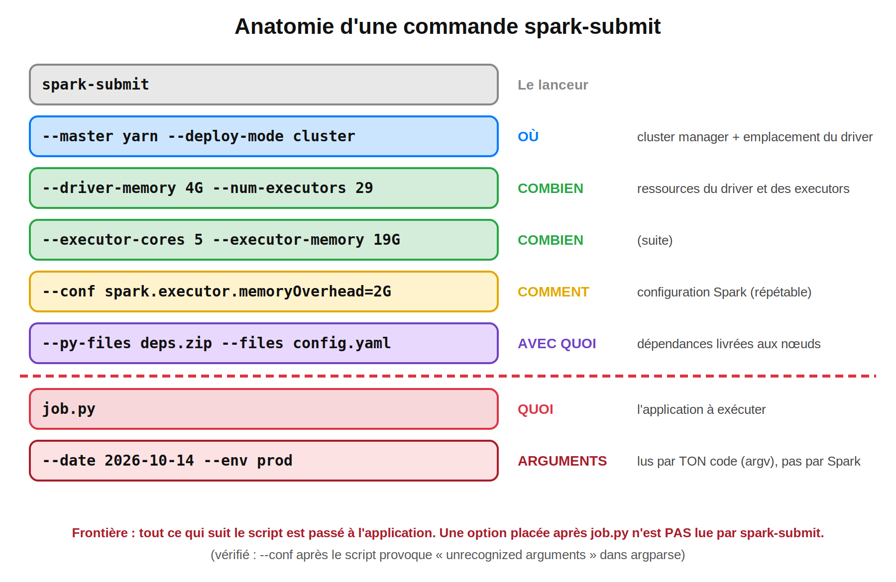
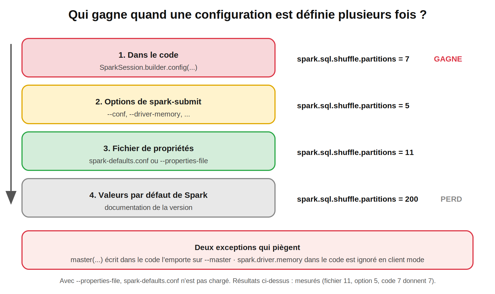
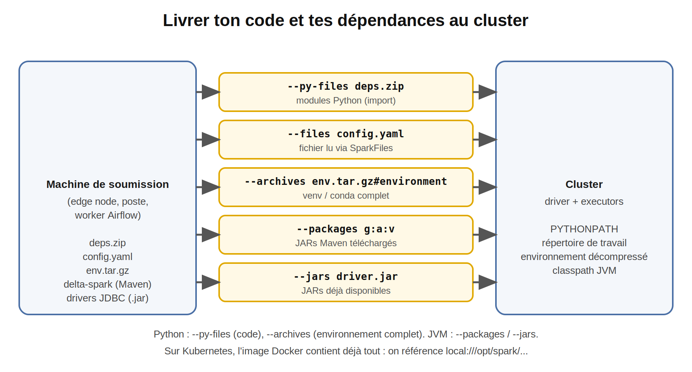
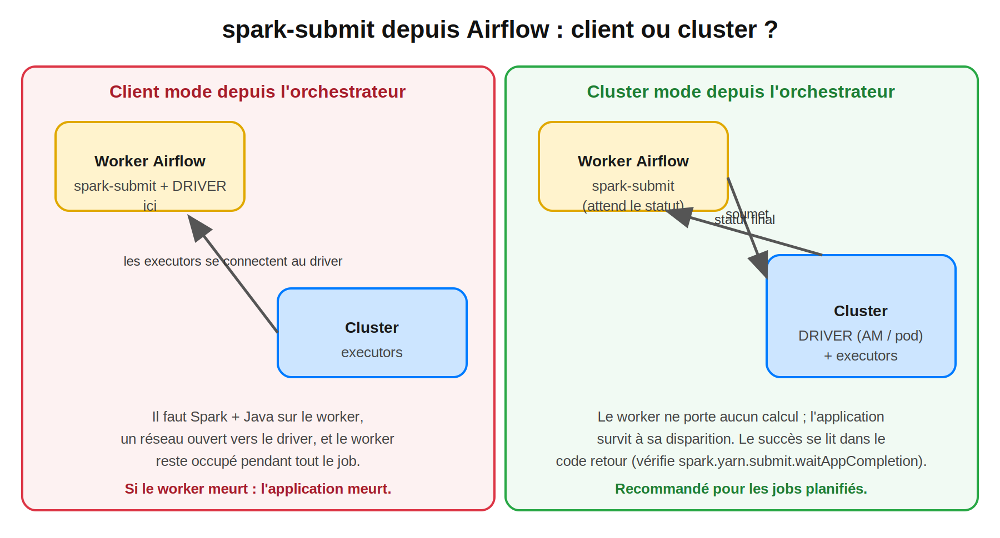

> **Temps de lecture :** ~30 min |  

#Spark #ApacheSpark #PySpark #SparkSubmit #DeployMode #YARN #Kubernetes #Airflow #DataEngineering #BigData #Production #SparkDeZeroAExpert

---

## Sommaire

1. Rappel : les 4 questions du Blog 8
2. Pourquoi ce blog est différent
3. Anatomie d'une commande `spark-submit`
4. `--master` et `--deploy-mode` : les combinaisons valides
5. Qui gagne quand une configuration est définie plusieurs fois ?
6. Une application prête pour la production
7. Un même job, trois environnements
8. Livrer le code et les dépendances aux executors
9. Secrets et journaux
10. Soumettre depuis un orchestrateur (Airflow)
11. Les 10 incidents de soumission
12. Cas complet : livrer un job proprement, de bout en bout
13. Checklist avant la mise en production
14. Questions type certification
15. Prochain blog

---

## 1. Rappel : les 4 questions du Blog 8

| Question | Réponse courte | Section |
|---|---|---|
| Quelles options de `spark-submit` contrôlent l'architecture (master, mode, mémoire, executors) ? | `--master`, `--deploy-mode`, `--driver-*`, `--num-executors`, `--executor-*`, `--conf` | 3, 4 |
| Comment livrer la librairie Python manquante aux executors (`ModuleNotFoundError`, Blog 7) ? | `--py-files` (code), `--archives` (environnement), image Docker (Kubernetes) | 8 |
| Comment soumettre **la même application** en dev, recette et prod sans changer le code ? | **Aucune configuration en dur dans le code** : fichiers de propriétés par environnement + arguments d'application | 6, 7 |
| Que se passe-t-il avec `--deploy-mode client` depuis un conteneur Docker ou Airflow ? | Le **driver** tourne dans ce conteneur : les executors doivent pouvoir le joindre, et l'application meurt avec lui | 10 |

---

## 2. Pourquoi ce blog est différent

`spark-submit` est le **contrat** entre ton code et le cluster. Tout ce que tu as appris (driver, executors, conteneurs, mémoire) se décide **dans cette commande**. En entreprise, les incidents les plus fréquents ne sont pas dans la logique métier :

- le job « tourne » mais **localement sur le serveur de rebond**, parce qu'un `.master("local[*]")` traînait dans le code ;
- une configuration passée en option est **silencieusement écrasée** ;
- une option placée au mauvais endroit est **lue par ton script** au lieu de Spark ;
- le job s'exécute **deux fois** après une panne et **écrit en double** ;
- un mot de passe est **visible** dans le journal de l'orchestrateur.

> **Note de transparence :** le comportement de `spark-submit` décrit ici (ordre des arguments, priorité des configurations, `--py-files`, `--files`, code de retour, masquage des secrets) a été **exécuté** avec PySpark **3.5.3** (Java 17) en mode local, et les résultats sont cités tels quels. Le comportement propre à YARN, Kubernetes et Airflow est décrit d'après la documentation : **valide-le sur ton cluster**, car il dépend de sa configuration.

---

## 3. Anatomie d'une commande `spark-submit`



```text
spark-submit [options] job.py [arguments de l'application]
```

| Segment | Rôle |
|---|---|
| `[options]` | Commencent par `--` : destinées à **Spark** |
| `job.py` (ou un `.jar`) | L'application ; placé **juste avant** ses propres arguments |
| `[arguments]` | Lus par **ton code** (`sys.argv`, `argparse`) |

### 3.1 Les options principales

| Option | Rôle | Remarque |
|---|---|---|
| `--class` | Classe contenant `main()` | **JAR Java/Scala uniquement** ; inutile pour PySpark |
| `--master` | Gestionnaire de cluster | `local`, `local[3]` (3 threads), `local[*]`, `yarn`, `k8s://https://…`, `spark://hôte:7077` |
| `--deploy-mode` | Où tourne le **driver** | `client` ou `cluster`. ⚠️ `local` n'est **pas** un deploy-mode : c'est une valeur de `--master` |
| `--name` | Nom de l'application | Visible dans les UI ; sous Kubernetes, doit respecter le format DNS (minuscules, tirets) |
| `--driver-cores`, `--driver-memory` | Ressources du driver | Ex. `2`, `8G` |
| `--num-executors` | Nombre d'executors | YARN et Kubernetes |
| `--executor-cores`, `--executor-memory` | CPU et mémoire par executor | Ex. `2`, `16G` |
| `--conf clé=valeur` | N'importe quelle configuration Spark | La clé doit commencer par `spark.` |
| `--properties-file` | Fichier de configurations | Remplace `spark-defaults.conf` |
| `--queue` | File YARN | Capacité réservée à une équipe |
| `--py-files`, `--files`, `--archives`, `--packages`, `--jars` | Dépendances | Section 8 |
| `--verbose` | Affiche les arguments interprétés | Utile pour diagnostiquer |

### 3.2 La mémoire d'overhead : attention à l'unité

```text
--conf spark.executor.memoryOverhead=2G          # valeur ABSOLUE (taille)
--conf spark.executor.memoryOverheadFactor=0.20  # RATIO du heap (défaut 0.10)
```

Une valeur comme `0.20` ne se passe **pas** à `memoryOverhead`, qui attend une taille. Le ratio se règle avec `memoryOverheadFactor` (rappel du Blog 8 : défaut `max(10 % du heap, 384 Mo)`).

### 3.3 Squelette : une commande YARN complète

Complète à partir de l'énoncé : application PySpark `ventes_kpi.py`, cluster YARN, driver dans le cluster, driver 2 cœurs et 8 Go, **4 executors** de 2 cœurs et 16 Go, overhead de 2 Go, dépendances dans `deps.zip`, arguments `--annee 2025 --env prod`.


<summary>Solution</summary>

```bash
spark-submit \
  --master yarn \
  --deploy-mode cluster \
  --name ventes-kpi \
  --driver-cores 2 --driver-memory 8G \
  --num-executors 4 --executor-cores 2 --executor-memory 16G \
  --conf spark.executor.memoryOverhead=2G \
  --py-files deps.zip \
  ventes_kpi.py \
  --annee 2025 --env prod
```

Pas de `--class` : c'est un script Python.

</details>

### 3.4 Vérifier ce que Spark a compris

```bash
spark-submit --verbose --master "local[2]" --name mon-job --conf spark.a=1 job.py --env x
```

`--verbose` affiche les « Parsed arguments » : si une option apparaît parmi les arguments de l'application au lieu d'être reconnue, tu viens de trouver ta faute.

---

## 4. `--master` et `--deploy-mode` : les combinaisons valides

| Master | `client` | `cluster` | Remarque |
|---|---|---|---|
| `local[...]` | ✅ (unique) | — | Un seul process : driver et executors ensemble |
| `spark://…` (Standalone) | ✅ | ⚠️ **non supporté pour Python** | La documentation indique que le Standalone ne supporte pas le cluster mode pour les applications Python |
| `yarn` | ✅ | ✅ | Le cas le plus courant en entreprise |
| `k8s://…` | ✅ (driver joignable depuis les pods) | ✅ | Le cluster mode est la norme |

C'est exactement ton lab Docker (Blog 2) : **Standalone + PySpark = client mode obligatoire**.

### 4.1 Soumettre au cluster Docker du lab

Dépose le job dans le volume partagé (`./data/jobs/`), puis depuis ta machine :

```bash
docker compose exec spark-master /opt/spark/bin/spark-submit \
  --master spark://spark-master:7077 \
  --deploy-mode client \
  --name ventes-kpi \
  --executor-memory 1g \
  --total-executor-cores 4 \
  /data/jobs/ventes_kpi.py --annee 2025 --env dev
```

Ici, le **driver tourne dans le conteneur `spark-master`** (client mode), les executors dans les workers. `--total-executor-cores` est l'option du Standalone équivalente à `spark.cores.max`. Je n'ai pas exécuté cette commande sur ton `docker-compose.yml` : si l'écriture échoue, vois le piège des permissions du Blog 4.

### 4.2 Rappel : client ou cluster ?

| | Cluster | Client |
|---|---|---|
| Driver | Dans le cluster | Sur la machine qui soumet |
| Déconnexion de la machine | L'application continue | L'application **meurt** |
| Usage | Production, jobs planifiés | Notebooks, `spark-shell`, développement |

---

## 5. Qui gagne quand une configuration est définie plusieurs fois ?



Une même clé peut être définie à quatre endroits. Test réalisé avec `spark.sql.shuffle.partitions` :

| Source | Valeur définie | Valeur effective |
|---|---|---|
| `spark-defaults.conf` seul | 11 | **11** |
| + option `--conf` | 5 | **5** |
| + `.config(...)` dans le code | 7 | **7** |

**Ordre de priorité : code > options de `spark-submit` > fichier de propriétés > valeurs par défaut.**

### 5.1 Deux pièges mesurés

**Piège 1 : un `master()` écrit en dur gagne sur `--master`.**

```python
# job.py
spark = SparkSession.builder.master("local[3]").getOrCreate()
```

```bash
spark-submit --master "local[1]" job.py       # résultat mesuré : master = local[3]
```

Conséquence en production : tu soumets `--master yarn`, mais le code force `local[*]`. **L'application s'exécute en local sur la machine de soumission**, sans erreur, et occupe un serveur de rebond au lieu du cluster.

**Piège 2 : `spark.driver.memory` dans le code est ignoré en client mode.**

| Méthode | Heap maximal mesuré |
|---|---|
| `.config("spark.driver.memory", "2g")` dans le code | **990 Mo** (défaut 1 Go, valeur ignorée) |
| `--driver-memory 2g` | **1 980 Mo** |

La JVM du driver est **déjà démarrée** quand ton code s'exécute : on ne peut plus changer sa taille. Les paramètres qui concernent le démarrage d'un processus (`spark.driver.memory`, `--master`, `--deploy-mode`) se règlent **dans la commande ou le fichier de propriétés**.

### 5.2 Règles

| Où mettre quoi ? | Exemple |
|---|---|
| **Dans la commande / fichier de propriétés** | master, mode, mémoire, cores, executors, event logs, chemins par environnement |
| **Dans le code** | Uniquement ce qui fait partie de la **logique** et ne change pas selon l'environnement (ex. `spark.sql.sources.partitionOverwriteMode`) |
| **Jamais en dur** | `master(...)`, mémoire, nombre de cores, chemins de production |

Si tu passes `--properties-file`, `spark-defaults.conf` n'est **pas** chargé.

---

## 6. Une application prête pour la production

Une application qui se soumet proprement obéit à trois règles : **aucun paramètre d'infrastructure dans le code**, **arguments explicites**, **sortie reproductible**.

### 6.1 Squelette : `ventes_kpi.py`

```python
import argparse
from pyspark.sql import SparkSession, functions as F


def parse_args():
    p = argparse.ArgumentParser()
    p.add_argument("--annee", type=int, required=True)
    p.add_argument("--env", choices=["dev", "recette", "prod"], default="dev")
    return p.parse_args()


def main():
    args = parse_args()

    # PAS de master(), PAS de mémoire, PAS de cores : tout vient de spark-submit
    spark = SparkSession.builder.AppName("ventes-kpi").getOrCreate()

    entree = spark.conf.get("spark.myapp.input", "/data/out/ventes_enrichies")
    sortie = spark.conf.get("spark.myapp.output", "/data/out/kpi_pays")

    kpi = (
        spark.read.parquet(entree)
        .filter(F.col("annee") == args.annee)
        .groupBy("pays")
        .agg(F.count("*").alias("nb_ventes"), F.round(F.sum("montant"), 2).alias("ca"))
    )
    kpi.write.mode("overwrite").parquet(f"{sortie}/annee={args.annee}")   # relançable sans doublon

    spark.stop()


if __name__ == "__main__":
    main()
```


Points à retenir :

- les **chemins** viennent de la configuration (`spark.myapp.*`), pas du code ;
- les **arguments** (`--annee`, `--env`) viennent de la ligne de commande ;
- l'écriture est **idempotente** : relancer le job pour la même année **remplace** la sortie de cette année au lieu de la dupliquer (voir problème 8, section 11).

</details>

> **Pourquoi `spark.myapp.*` ?** `spark-submit` n'accepte via `--conf` que des clés qui commencent par `spark.` : une clé sans ce préfixe est ignorée avec un avertissement. Un préfixe propre à ton application (`spark.myapp.input`) permet de passer des paramètres métier par la configuration.

---

## 7. Un même job, trois environnements

Structure du projet :

```text
ventes-kpi/
├── jobs/ventes_kpi.py
├── conf/
│   ├── dev.conf
│   └── prod.conf
├── dist/deps.zip
└── submit.sh
```

`conf/dev.conf` (cluster Docker du lab) :

```text
spark.master                spark://spark-master:7077
spark.executor.memory       1g
spark.cores.max             4
spark.myapp.input           /data/out/ventes_enrichies
spark.myapp.output          /data/out/kpi_pays
```

`conf/prod.conf` (YARN) :

```text
spark.master                  yarn
spark.submit.deployMode       cluster
spark.executor.instances      29
spark.executor.cores          5
spark.executor.memory         19g
spark.executor.memoryOverhead 2g
spark.driver.memory           4g
spark.yarn.maxAppAttempts     1
spark.eventLog.enabled        true
spark.eventLog.dir            hdfs:///spark-logs
spark.myapp.input             hdfs:///lake/ventes_enrichies
spark.myapp.output            hdfs:///lake/kpi_pays
```

Les dimensionnements de `prod.conf` reprennent le calcul du Blog 8 (29 executors de 5 cœurs et 19 Go). Ce sont des **valeurs de départ à mesurer**, pas un réglage universel.

### 7.1 Squelette : le script de lancement

```bash
#!/usr/bin/env bash
set -euo pipefail          # s'arrêter à la première erreur, y compris dans un pipe

- `-e` arrête le script à la première commande en échec ;
- `-u` refuse les variables non définies ;
- `pipefail` fait qu'un pipe renvoie le code d'erreur de **n'importe quelle** commande du pipe.


ENV="${1:?usage: submit.sh <dev|recette|prod> <annee>}"
ANNEE="${2:?annee manquante}"
HERE="$(cd "$(dirname "$0")" && pwd)"

spark-submit \
  --properties-file "$HERE/conf/${ENV}.conf" \
  --name "ventes-kpi-${ENV}-${ANNEE}" \
  --py-files "$HERE/dist/deps.zip" \
  "$HERE/jobs/ventes_kpi.py" \
  --annee "$ANNEE" --env "$ENV"
```


**Pourquoi c'est vital :** `spark-submit … | tee job.log` renvoie le code de `tee` (toujours 0) : un job en échec apparaît alors comme **réussi** pour l'orchestrateur. Sans `pipefail`, ne mets jamais de pipe derrière `spark-submit`.

</details>

Utilisation :

```bash
./submit.sh dev 2025       # cluster Docker
./submit.sh prod 2025      # YARN
```

**Le code de l'application est strictement le même** : seul le fichier de propriétés change.

---

## 8. Livrer le code et les dépendances aux executors



Ton code s'exécute sur des machines qui n'ont **ni ton dossier, ni tes librairies** (problème n°4 du Blog 7). `spark-submit` sait les livrer :

| Option | Livre | Où le retrouver | Cas d'usage |
|---|---|---|---|
| `--py-files deps.zip` | Modules Python (`.py`, `.zip`, `.egg`) | Sur le `PYTHONPATH` du driver **et** des executors | Ton package interne |
| `--files config.yaml` | Fichiers quelconques | Répertoire de travail ; `SparkFiles.get("config.yaml")` | Configuration, référentiels légers |
| `--archives env.tar.gz#environment` | Archive **décompressée** sur chaque nœud | Dossier `./environment` | **Environnement Python complet** |
| `--packages g:a:v` | JARs Maven (avec dépendances) | Classpath JVM | Delta Lake, connecteurs |
| `--jars x.jar` | JARs déjà disponibles | Classpath JVM | Pilote JDBC |

### 8.1 Mesuré : avec et sans `--py-files`

Package interne `monpkg` utilisé **dans une UDF** (donc côté executor) :

| Commande | Résultat |
|---|---|
| `spark-submit --py-files deps.zip --files config.yaml job.py` | ✅ l'UDF s'exécute, le fichier de configuration est lu |
| `spark-submit --files config.yaml job.py` (sans `--py-files`) | ❌ `ModuleNotFoundError: No module named 'monpkg'` |

Lecture d'un fichier livré avec `--files` :

```python
from pyspark import SparkFiles
config = open(SparkFiles.get("config.yaml")).read()
```

### 8.2 Librairies tierces : l'environnement complet

`--py-files` convient à **ton** code. Pour des librairies tierces (par exemple `phonenumbers`, avec leurs dépendances), on livre un **environnement empaqueté**.


```bash
python -m venv venv && source venv/bin/activate
pip install phonenumbers venv-pack
venv-pack -o env.tar.gz                              # empaqueter l'environnement

export PYSPARK_PYTHON=./environment/bin/python        # Python de l'environnement livré

spark-submit \
  --master yarn --deploy-mode cluster \
  --archives  env.tar.gz#environment \
  job.py
```

`#environment` donne le nom du dossier dans lequel l'archive est décompressée sur chaque nœud, d'où `./environment/bin/python`. En **client mode**, le driver utilise le Python local : exporte aussi `PYSPARK_DRIVER_PYTHON=python`. Ne le définis pas en cluster mode.

**Précautions :** l'environnement empaqueté doit avoir été construit sur un système **compatible** avec les nœuds (même OS et architecture), et avec la **même version mineure de Python** que celle attendue (problème `PYTHON_VERSION_MISMATCH`, Blog 8). `conda-pack` est une alternative souvent plus portable. À valider sur ton cluster.

</details>

### 8.3 Dépendances JVM : `--packages` et ses limites

```bash
spark-submit --packages io.delta:delta-spark_2.12:3.2.0 job.py        # Delta (Blog 4)
```

`--packages` **télécharge depuis un dépôt Maven**. Sur un cluster sans accès internet (fréquent en entreprise bancaire) il échoue : utilise `--repositories` vers un dépôt interne, ou place les JARs sur un stockage partagé et passe-les avec `--jars`.

### 8.4 Kubernetes : l'image est la livraison

Sous Kubernetes, **l'image Docker** contient Spark, Python, tes librairies et ton code. On référence les fichiers de l'image avec le schéma `local://` :

```bash
spark-submit \
  --master k8s://https://<api-server>:6443 \
  --deploy-mode cluster \
  --name ventes-kpi \
  --conf spark.kubernetes.container.image=registry.exemple/spark-ventes:1.4.2 \
  --conf spark.kubernetes.namespace=spark \
  --conf spark.kubernetes.authenticate.driver.serviceAccountName=spark \
  --conf spark.executor.instances=10 \
  local:///opt/app/ventes_kpi.py --annee 2025
```

Versionne l'image (`1.4.2`, jamais `latest`) : c'est ce qui rend un incident **reproductible**.

### 8.5 Cluster mode : les chemins locaux ne sont pas visibles

En cluster mode, le driver tourne **dans le cluster** : un chemin comme `/home/moi/data.csv` ou `./config.yaml` **n'existe pas** pour lui. Trois solutions : un stockage partagé (`hdfs://`, `s3a://`), `--files` + `SparkFiles.get`, ou intégrer le fichier à l'image.

---

## 9. Secrets et journaux

**Ne passe jamais un mot de passe en option** (`--conf spark.db.password=…`) : il apparaît dans l'historique du shell, dans la liste des processus (`ps`), dans les journaux de l'orchestrateur.

Spark masque certaines valeurs dans son **interface web**. Mesuré :

```text
spark.db.password -> *********(redacted)
spark.db.user     -> bob
```

Le masquage repose sur l'expression régulière `spark.redaction.regex` (par défaut, les clés contenant des mots comme `secret`, `password`, `token`). Une clé mal nommée (`spark.db.pwd`) **n'est pas masquée**, et ce masquage **ne protège ni la ligne de commande ni les journaux de l'orchestrateur**.

| Bonne pratique | Pourquoi |
|---|---|
| Gestionnaire de secrets (Vault, Kubernetes Secret, connexion Airflow) | Les secrets ne passent pas par la ligne de commande |
| Variables d'environnement injectées au runtime | Absentes du code et des fichiers versionnés |
| Fichiers de propriétés **sans** secrets | Peuvent être versionnés |
| Nommer les clés sensibles avec `password`, `secret` ou `token` | Masquage dans la Spark UI |

**Cluster sécurisé Kerberos** (courant sur Hadoop) : `--principal` et `--keytab` permettent de renouveler les tickets d'une application longue ; sans cela, un job qui dépasse la durée de vie du ticket échoue en cours de route. À valider avec l'équipe sécurité de ton cluster.

---

## 10. Soumettre depuis un orchestrateur (Airflow)



Un orchestrateur (Airflow, cron, Jenkins) déclenche `spark-submit`. Le choix du deploy mode change radicalement ce qui se passe **sur le worker de l'orchestrateur**.

| | Client mode depuis le worker | Cluster mode depuis le worker |
|---|---|---|
| Driver | **Sur le worker Airflow** | Dans le cluster (AM ou pod) |
| Prérequis sur le worker | Spark, Java, réseau ouvert **depuis** les executors | Spark client + accès au cluster manager |
| Mémoire / CPU du worker | Consommés pendant tout le job | Négligeables |
| Panne du worker | **L'application meurt** | L'application continue |
| Usage recommandé | Tests | **Jobs planifiés en production** |

### 10.1 Les trois façons de brancher Spark à Airflow

| Approche | Principe |
|---|---|
| `SparkSubmitOperator` (provider Apache Spark) | Airflow construit la commande `spark-submit` ; le master et le deploy mode viennent de la **connexion** Airflow |
| `BashOperator` + `submit.sh` | Tu contrôles la commande ; reprends le script de la section 7 |
| `KubernetesPodOperator` / opérateur Spark-on-K8s | Un pod lance le job ; adapté à Kubernetes |

Les noms exacts des paramètres dépendent de la version de ton provider : vérifie sa documentation.

### 10.2 Le statut du job : ce que l'orchestrateur voit réellement

Airflow juge le succès par le **code de retour** de `spark-submit`.

| Constat | Mesure / règle |
|---|---|
| Application qui échoue (test local) | `spark-submit` retourne **1** : l'orchestrateur voit l'échec |
| `spark-submit … \| tee log` sans `pipefail` | Le code retourné est celui de `tee` : l'échec est **masqué** |
| YARN cluster mode, `spark.yarn.submit.waitAppCompletion=false` | `spark-submit` rend la main **dès l'acceptation** : l'orchestrateur voit un succès avant la fin du job |
| `spark.yarn.maxAppAttempts` > 1 (souvent 2 par défaut selon la configuration YARN) | Après un échec de l'AM, **tout le job est relancé** : doublons possibles si l'écriture n'est pas idempotente |

Pour une exécution **idempotente**, relancer ne doit pas dupliquer : `mode("overwrite")` sur la partition du jour, avec `spark.sql.sources.partitionOverwriteMode=dynamic` (Blog 4), ou `MERGE` avec Delta (Blog 14).

---

## 11. Les 10 incidents de soumission

### Incident 1 : le job s'exécute en local sur la machine de soumission

**Cause :** un `.master("local[*]")` écrit en dur gagne sur `--master` (**mesuré**). **Diagnostic :** `sc.master` dans les journaux, onglet *Environment*, aucune application visible dans l'UI du cluster. **Correction :** retirer `master()` du code, tout passer par `spark-submit`.

### Incident 2 : une option est lue par le script au lieu de Spark

```bash
spark-submit --master yarn job.py --conf spark.sql.shuffle.partitions=5   # ❌
```

`--conf` placé **après** le script est passé à l'application : avec `argparse`, tu obtiens `error: unrecognized arguments: --conf …` (**mesuré**). **Correction :** toutes les options de Spark **avant** le script.

### Incident 3 : une configuration passée en option n'a pas l'effet attendu

**Cause :** la même clé est redéfinie dans le code (**le code gagne**, section 5). **Diagnostic :** onglet *Environment* de la Spark UI, ou `spark.conf.get(...)` dans le job. **Correction :** supprimer la valeur du code.

### Incident 4 : `spark.driver.memory` n'a aucun effet

**Cause :** réglé dans le code alors que la JVM du driver est déjà démarrée (**mesuré : 990 Mo au lieu de 2 Go**). **Correction :** `--driver-memory` ou fichier de propriétés.

### Incident 5 : `ModuleNotFoundError` côté executor

**Cause :** le module n'est pas livré (**mesuré** sans `--py-files`). **Correction :** `--py-files`, `--archives` ou une image Docker.

### Incident 6 : `FileNotFoundException` en cluster mode

**Cause :** chemin local (poste ou serveur de rebond) inexistant pour le driver qui tourne dans le cluster. **Correction :** stockage partagé, `--files` + `SparkFiles`, ou fichier dans l'image.

### Incident 7 : `Cluster deploy mode is currently not supported for python applications on standalone clusters`

**Cause :** `--deploy-mode cluster` avec PySpark sur le Standalone (ton lab Docker). **Correction :** `--deploy-mode client`, ou YARN / Kubernetes.

### Incident 8 : le job s'exécute deux fois et écrit en double

**Cause :** `spark.yarn.maxAppAttempts` supérieur à 1 : après un échec de l'AM, YARN **relance toute l'application**. **Corrections :** écritures **idempotentes** (`overwrite` par partition) ; pour un job non rejouable, `--conf spark.yarn.maxAppAttempts=1` (ou valider les relances dans l'orchestrateur, jamais les deux à la fois).

### Incident 9 : l'orchestrateur affiche « succès » alors que le job a échoué

**Causes :** pipe sans `pipefail`, `waitAppCompletion=false`, script de lancement qui ignore le code de retour. **Correction :** `set -euo pipefail`, laisser `spark-submit` attendre la fin, vérifier le code de retour.

### Incident 10 : un secret apparaît dans un journal

**Cause :** mot de passe passé via `--conf` ou dans une variable affichée. **Correction :** gestionnaire de secrets, clés nommées pour être masquées (section 9). Pense aussi à **ré-émettre** un secret exposé.

**Autres causes fréquentes :** un `--conf` avec des espaces non protégé par des guillemets (ex. `--conf "spark.executor.extraJavaOptions=-XX:+UseG1GC -Dx=y"`), `--packages` sans accès internet, nom d'application non conforme au format DNS sous Kubernetes.

---

## 12. Cas complet : livrer un job proprement, de bout en bout

**Objectif :** livrer `ventes_kpi` sur trois environnements, avec dépendances, sans secret, relançable sans doublon et surveillable.

| Étape | Action | Section |
|---|---|---|
| 1 | Code **sans** `master()`, sans mémoire, sans chemin en dur ; arguments via `argparse` | 6 |
| 2 | Un fichier de propriétés par environnement (`conf/dev.conf`, `conf/prod.conf`) | 7 |
| 3 | `submit.sh` avec `set -euo pipefail`, sans pipe derrière `spark-submit` | 7 |
| 4 | Dépendances livrées : `deps.zip` (code), `env.tar.gz` ou image (librairies) | 8 |
| 5 | Écriture **idempotente** (`overwrite` par année) et `maxAppAttempts` choisi | 6, 10 |
| 6 | Event logs activés pour le History Server (Blog 8) | 7 |
| 7 | Secrets via un gestionnaire, jamais en ligne de commande | 9 |
| 8 | Orchestrateur en **cluster mode**, succès lu dans le code de retour | 10 |

Commande finale en production :

```bash
./submit.sh prod 2025
# équivaut à :
spark-submit \
  --properties-file conf/prod.conf \
  --name ventes-kpi-prod-2025 \
  --py-files dist/deps.zip \
  jobs/ventes_kpi.py --annee 2025 --env prod
```

Et en développement, sur le cluster Docker du lab :

```bash
docker compose exec spark-master /opt/spark/bin/spark-submit \
  --properties-file /data/conf/dev.conf --deploy-mode client \
  --py-files /data/dist/deps.zip /data/jobs/ventes_kpi.py --annee 2025 --env dev
```

---

## 13. Checklist avant la mise en production

| # | Question | Pourquoi |
|---|---|---|
| 1 | Le code ne contient-il **ni `master()`, ni mémoire, ni cores** en dur ? | Sinon le code écrase la commande |
| 2 | Toutes les options Spark sont-elles **avant** le script ? | Sinon elles vont à l'application |
| 3 | Un **fichier de propriétés** par environnement, versionné **sans secret** ? | Reproductibilité |
| 4 | `--deploy-mode cluster` pour les jobs planifiés ? | Résilience, pas de dépendance au poste |
| 5 | Les dépendances sont-elles **livrées** (`--py-files`, `--archives`, image) ? | `ModuleNotFoundError` |
| 6 | Les chemins sont-ils sur un **stockage partagé** ? | Cluster mode |
| 7 | Écriture **idempotente** et `maxAppAttempts` décidé ? | Pas de doublons après relance |
| 8 | `set -euo pipefail` et code de retour propagé ? | L'orchestrateur voit les échecs |
| 9 | Aucun secret en ligne de commande ni dans les journaux ? | Sécurité |
| 10 | Event logs, History Server et nom d'application explicite ? | Diagnostic après coup |
| 11 | Image / environnement **versionné** ? | Incidents reproductibles |
| 12 | `--verbose` lu une fois pour valider ce que Spark a compris ? | Détecte les erreurs d'arguments |

---

## 14. Questions type certification

**Q1. Quelle est la structure de base de la commande ?**
→ `spark-submit [options] app.py [arguments de l'application]` : les options commencent par `--`, le script se place juste avant ses propres arguments.

**Q2. Quelle option précise la classe contenant `main()` ? Faut-il l'utiliser avec PySpark ?**
→ `--class`. Pas pour PySpark : c'est réservé aux applications **Java/Scala** (JAR).

**Q3. `local` est-il un deploy-mode ?**
→ **Non**. C'est une valeur de `--master` (`local`, `local[3]`, `local[*]`). Les deploy-modes sont `client` et `cluster`.

**Q4. Que signifie `--master local[3]` ?**
→ Exécution locale avec **3 threads**.

**Q5. En cluster mode, où s'exécute le driver ? En client mode ?**
→ Cluster : dans un conteneur du cluster (AM). Client : sur la machine qui exécute `spark-submit`.

**Q6. Un `master("local[3]")` est écrit dans le code ; tu lances `--master yarn`. Où s'exécute l'application ?**
→ **En local** : la configuration du code l'emporte.

**Q7. Une même clé est définie dans `spark-defaults.conf`, en `--conf` et dans le code. Laquelle s'applique ?**
→ Celle du **code**. Ordre : code > options de `spark-submit` > fichier de propriétés > défauts.

**Q8. Pourquoi `.config("spark.driver.memory", "2g")` dans le code n'a-t-il pas d'effet en client mode ?**
→ La JVM du driver est déjà démarrée : utilise `--driver-memory` ou le fichier de propriétés.

**Q9. Quelle option livre un module Python aux executors ? Un environnement complet ?**
→ `--py-files` pour le code ; `--archives` (archive décompressée) pour un environnement.

**Q10. Qu'est-ce que `spark.executor.memoryOverhead=0.20` ?**
→ Une erreur : `memoryOverhead` attend une **taille** (ex. `2G`). Le ratio est `spark.executor.memoryOverheadFactor` (défaut 0,10).

**Q11. Pourquoi `spark-submit … | tee log` peut-il masquer un échec ?**
→ Le code de retour du pipe est celui de `tee`, sauf avec `set -o pipefail`.

**Q12. Quel est le risque de `spark.yarn.maxAppAttempts` > 1 pour un job qui écrit en mode `append` ?**
→ Après un échec de l'AM, l'application est **relancée entièrement** et peut **dupliquer** les données écrites.

---

## Points clés

1. `spark-submit [options] job.py [arguments]` : tout ce qui suit le script va à l'**application**.
2. `local` est une valeur de `--master`, pas un deploy-mode ; le Standalone ne supporte pas le **cluster mode pour Python**.
3. **Priorité : code > options > fichier de propriétés > défauts.** Un `master()` en dur écrase `--master` ; `spark.driver.memory` dans le code est **ignoré** en client mode.
4. **Aucune configuration d'infrastructure dans le code** : un fichier de propriétés par environnement, des arguments pour la partie métier.
5. Livre tes dépendances : `--py-files` (code), `--archives` (environnement), `--packages` / `--jars` (JVM), image Docker (Kubernetes).
6. En cluster mode, les chemins locaux sont invisibles : stockage partagé ou `--files`.
7. **Jamais de secret** en ligne de commande ; le masquage de la Spark UI est partiel.
8. Depuis un orchestrateur : **cluster mode**, `set -euo pipefail`, code de retour propagé, écritures **idempotentes**, `maxAppAttempts` choisi.
9. `--verbose`, l'onglet *Environment* et les event logs sont tes outils de diagnostic.

---

## 15. Prochain blog

Tu sais lancer une application, la dimensionner et la livrer. Mais une fois qu'elle tourne, **que se passe-t-il à l'intérieur ?**

- Pourquoi la Spark UI affiche-t-elle **3 jobs** pour un code qui n'appelle qu'une seule méthode ?
- Qu'est-ce qui décide qu'un job comporte **5 stages** et pas 2 ?
- Pourquoi un stage affiche-t-il **200 tasks** alors que tes données tiennent dans 3 partitions ?
- Qu'est-ce qu'un **stage « skipped »**, et pourquoi est-ce une bonne nouvelle ?
- Comment lire un **shuffle** dans la Spark UI (*Shuffle Read / Write*, *Spill*) pour trouver le goulot d'un job de nuit ?

---


#Spark #ApacheSpark #PySpark #SparkSubmit #DeployMode #Airflow #LearnSpark #DataEngineer #BigData #Production #SparkDeZeroAExpert
