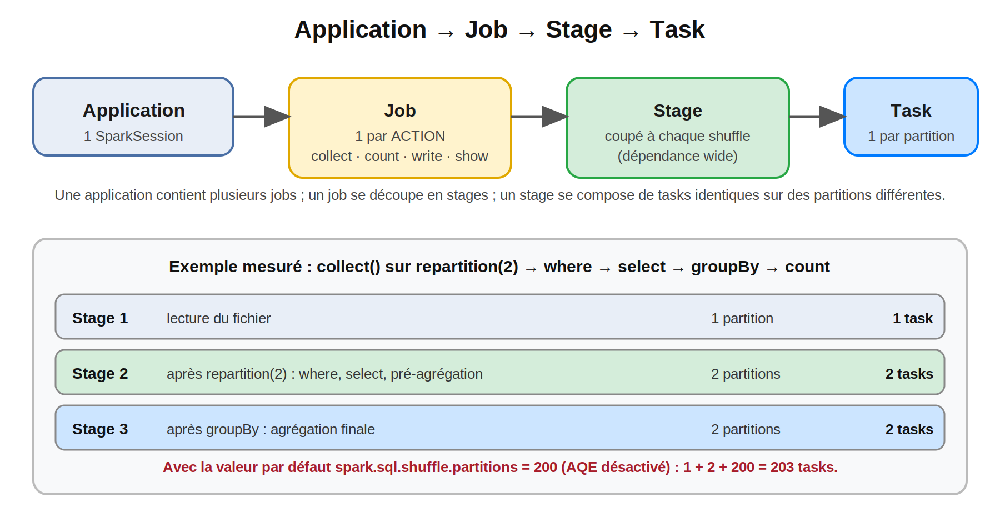
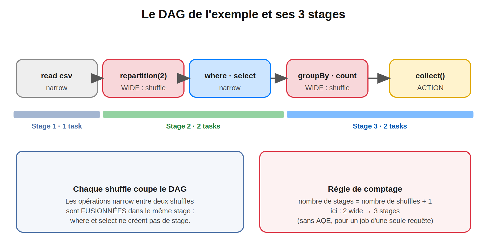
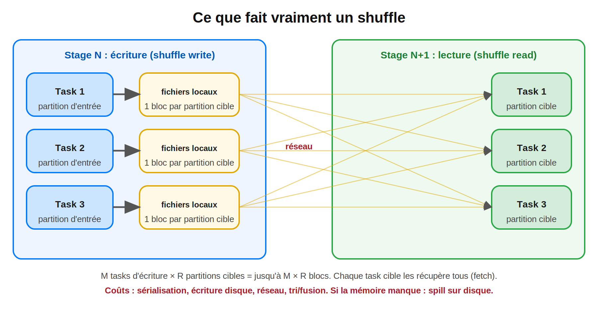
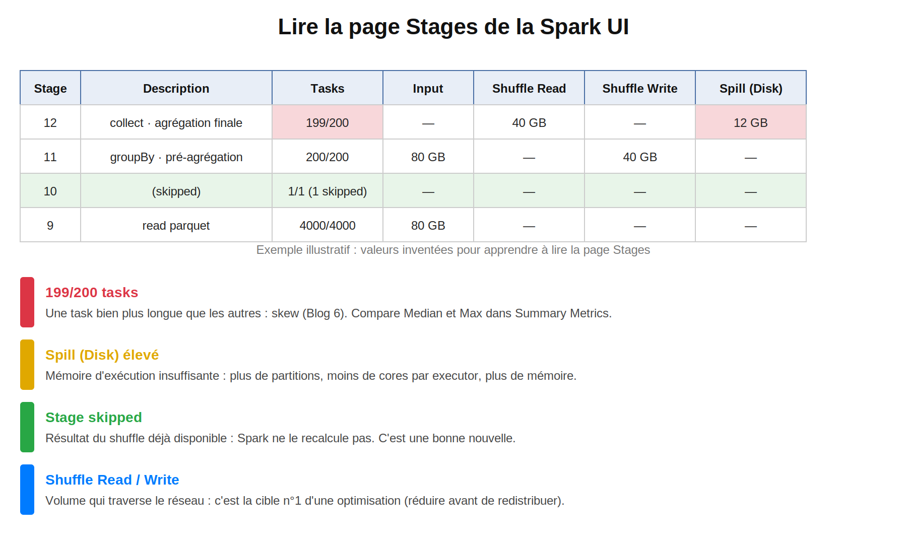

# Spark : de 0 à expert — Blog 10/14
## Jobs, Stages, Tasks et Shuffle : lire un job Spark comme un expert

> **Série :** Spark de 0 à expert | **Niveau 3 : Architecture interne** | Blog 10 sur 14
> **Temps de lecture :** ~30 min | **Prérequis :** Blogs 1 à 9 (surtout les Blogs 3, 5, 6 et 8)

#Spark #ApacheSpark #PySpark #Jobs #Stages #Tasks #Shuffle #DAG #SparkUI #Performance #DataEngineering #BigData #SparkDeZeroAExpert

---

## Sommaire

1. Rappel : les 5 questions du Blog 9
2. Pourquoi ce blog est différent
3. Transformations et actions : ce qui déclenche l'exécution
4. Jobs : 1 action = 1 job… ou presque
5. Stages : le DAG coupé aux shuffles
6. Tasks : 1 partition = 1 task
7. Le shuffle : ce que fait vraiment la redistribution
8. Stages « skipped » et réutilisation des shuffles
9. Lire la Spark UI méthodiquement
10. Pannes : retry de task, retry de stage, échec du job
11. Les 10 incidents de performance liés aux jobs, stages et shuffles
12. Cas complet : un job de nuit qui passe de 20 minutes à 3 heures
13. Checklist de diagnostic
14. Questions type certification
15. Prochain blog

---

## 1. Rappel : les 5 questions du Blog 9

| Question | Réponse courte | Section |
|---|---|---|
| Pourquoi la Spark UI affiche-t-elle **3 jobs** pour un code qui n'appelle qu'une seule méthode ? | Lecture avec `inferSchema`, `limit`/`take` qui scannent par étapes, **AQE** qui fait apparaître un job par shuffle matérialisé | 4 |
| Qu'est-ce qui décide qu'un job a **5 stages** ? | Le nombre de **shuffles** (dépendances wide) + 1 | 5 |
| Pourquoi **200 tasks** alors que les données tiennent dans 3 partitions ? | `spark.sql.shuffle.partitions` vaut 200 par défaut : le stage **après** un shuffle a 200 partitions | 6 |
| Qu'est-ce qu'un stage **« skipped »** ? | Ses résultats de shuffle existent déjà : Spark ne le recalcule pas | 8 |
| Comment lire un **shuffle** dans la Spark UI ? | Colonnes *Shuffle Read / Write*, *Spill*, *Summary Metrics* (Median vs Max) | 7, 9 |

---

## 2. Pourquoi ce blog est différent

Dans la grande majorité des problèmes de performance Spark, le coupable est **un shuffle** : trop de données redistribuées, mal réparties, ou redistribuées pour rien. Pour le trouver, il faut **lire** ce que fait Spark, pas le deviner.

Ce blog t'apprend à répondre à quatre questions dans la Spark UI :

1. **Quel job** est lent ?
2. **Quel stage** de ce job ?
3. **Pourquoi** : volume, skew, spill, ou trop de petites tasks ?
4. **Quelle transformation** a créé ce shuffle ?

> **Note de transparence :** les nombres de jobs, de stages et de tasks cités ont été **mesurés** sur PySpark **3.5.3** en mode local (2 cœurs, Java 21) via l'API REST de la Spark UI, sur un fichier CSV de 200 000 lignes. Les ordres de grandeur d'un vrai cluster (gigaoctets de shuffle, durées) sont **illustratifs** et marqués comme tels. Pour la clarté des mesures, l'**AQE est désactivé** sauf mention contraire (section 6.3).

---

## 3. Transformations et actions : ce qui déclenche l'exécution

Rappel des Blogs 3 et 5 :

| Type | Effet | Exemples |
|---|---|---|
| **Transformation narrow** | Chaque partition se traite seule | `select`, `filter`, `withColumn`, `drop`, `coalesce` |
| **Transformation wide** | Redistribue les données (**shuffle**) | `groupBy` + agrégation, `join`, `distinct`, `orderBy`, `repartition`, `cube`, `rollup` |
| **Action** | Déclenche l'exécution | `collect`, `count`, `show`, `take`, `write`, `foreach` |

Les transformations **construisent un plan**, les actions **le lancent**. Rien ne s'exécute avant une action.

> **Nuance sur `read` :** on classe souvent `read` parmi les actions, mais ce n'est pas exact. Une lecture peut **ne lancer aucun job**, ou en lancer un ou deux pour inférer le schéma (mesuré en section 4.1).

---

## 4. Jobs : 1 action = 1 job… ou presque

Règle de base : **chaque action déclenche au moins un job**. Voici ce que j'ai **mesuré** (une ligne = ce que la Spark UI a affiché).

### 4.1 Mesures

| Code | Jobs affichés |
|---|---|
| `spark.read.option("header", True).option("inferSchema", True).csv(...)` (aucune action) | **2 jobs** (lecture de l'en-tête, puis passe d'inférence) |
| `spark.read.option("header", True).schema(schema).csv(...)` (aucune action) | **0 job** |
| `df.show(3)` | 1 job, 1 task |
| `df.count()` | 1 job, **2 stages** (comptage partiel par partition, puis total) |
| `spark.read.parquet(...)` sur 4 ou 50 fichiers (aucune action) | **1 petit job** (métadonnées / listing de fichiers) |
| `limit(3).collect()` dont les lignes ne se trouvent que dans la **dernière** des 8 partitions | **3 jobs** (de 1, puis 4, puis 3 tasks) |
| `groupBy(...).count().collect()` avec **AQE activé** | **2 jobs** dans l'UI (un par shuffle matérialisé) |

### 4.2 Pourquoi plusieurs jobs pour une action ?

| Cas | Explication |
|---|---|
| `inferSchema=True` | Spark **parcourt les données** pour deviner les types : c'est le job supplémentaire du Blog 4. Un schéma explicite l'évite |
| `limit(n)` / `take(n)` / `show()` | Spark scanne **1 partition**, puis 4, puis davantage… jusqu'à avoir `n` lignes : plusieurs jobs si les lignes sont rares |
| **AQE** (activé par défaut depuis Spark 3.2) | Chaque étape de shuffle est **matérialisée puis réoptimisée** : l'UI les affiche comme des jobs distincts |
| `read.parquet` | Listing de fichiers ou lecture de métadonnées |
| Broadcast | La préparation de la table diffusée peut apparaître comme un job |

**Conséquence pratique :** compter les jobs dans la Spark UI **ne te dit pas** combien d'actions contient ton code. Regarde la colonne **Description** (elle indique la ligne de code d'où part le job).

### 4.3 Squelette : compte jobs et stages

Hypothèses : AQE désactivé (`spark.sql.adaptive.enabled=false`), `shuffle.partitions=200` (défaut), fichier CSV d'une seule partition.

```python
schema = "Age INT, Gender STRING, Country STRING, state STRING"

df = spark.read.option("header", True).schema(schema).csv("survey.csv")      # jobs : ______
p  = df.repartition(2)                                                         # jobs : ______
r  = p.where("Age < 40").select("Age", "Country").groupBy("Country").count()   # jobs : ______
r.collect()                                                                    # jobs : ______   stages : ______
```

<details>
<summary>Solution (mesuré)</summary>

Lecture avec schéma explicite : **0 job**. `repartition`, `where`, `select`, `groupBy`, `count` : **0 job** (transformations). `collect()` : **1 job, 3 stages** (203 tasks avec la valeur par défaut de `shuffle.partitions`).

</details>

---

## 5. Stages : le DAG coupé aux shuffles



Pour chaque job, le **driver** construit un **DAG** (*Directed Acyclic Graph*) : le plan d'exécution. Il le découpe en **stages** aux **frontières de shuffle**.



Exemple du blog précédent, `collect()` sur `repartition(2) → where → select → groupBy → count` :

| Stage | Contenu | Pourquoi une frontière ici ? |
|---|---|---|
| **1** | Lecture du fichier | `repartition(2)` est **wide** : fin du stage |
| **2** | Après `repartition(2)` : `where`, `select`, pré-agrégation | `groupBy` est **wide** : fin du stage |
| **3** | Agrégation finale | Dernière étape avant l'action |

**Règle :** `nombre de stages = nombre de shuffles + 1` (pour un job issu d'une seule requête).

- `where` et `select` sont **narrow** : ils sont **fusionnés** dans le stage 2 et ne créent pas de stage.
- Un **stage** est un ensemble de tasks **parallèles** qui exécutent les **mêmes opérations** sur des partitions différentes, **sans shuffle** à l'intérieur.

### 5.1 Voir le DAG

```python
r.explain()          # chercher les lignes « Exchange » : chacune est un shuffle (une frontière de stage)
```

Dans la Spark UI : onglet **Jobs** → clique sur un job → **DAG Visualization**. Les frontières entre stages y sont visibles.

---

## 6. Tasks : 1 partition = 1 task

Dans un stage, **chaque partition est traitée par une task**. Le nombre de tasks est donc le **nombre de partitions du stage**.

| Stage | Partitions | Tasks |
|---|---|---|
| 1 : lecture du fichier | 1 | 1 |
| 2 : après `repartition(2)` | 2 | 2 |
| 3 : après `groupBy` (avec `shuffle.partitions = 2`) | 2 | 2 |

**Total mesuré : 1 + 2 + 2 = 5 tasks.** Avec la valeur par défaut `spark.sql.shuffle.partitions = 200`, le stage 3 passe à **200 tasks** et le job totalise **1 + 2 + 200 = 203 tasks** (mesuré).

### 6.1 D'où vient le nombre de partitions ?

| Origine | Nombre de partitions |
|---|---|
| Lecture de fichiers (DataFrame) | Fichiers **découpés ou regroupés** selon `spark.sql.files.maxPartitionBytes` (128 Mo) et `spark.sql.files.openCostInBytes` (4 Mo) |
| Après un **shuffle** (`groupBy`, `join`…) | `spark.sql.shuffle.partitions` (**200** par défaut) |
| `repartition(n)` | **n** (avec shuffle) |
| `coalesce(n)` | **au plus n** (sans shuffle) |
| `spark.range(a, b, step, numPartitions)` | `numPartitions` |
| `sc.parallelize(...)` | `spark.default.parallelism` |

**Mesuré :** lire 50 petits fichiers Parquet donne **2 tasks** (et 4 fichiers, 2 tasks aussi) : Spark **regroupe** les petits fichiers dans des partitions. Le nombre de tasks n'égale donc pas le nombre de fichiers. En revanche, des milliers de petits fichiers coûtent cher à **lister et ouvrir** (le coût d'ouverture est comptabilisé par fichier), ce qui justifie de les compacter à l'écriture (Blog 4).

### 6.2 Squelette : slots, tasks et vagues

Cluster du Blog 8 : 29 executors × 5 cœurs. Un stage de **200 tasks**.


```text
Slots                       = 29 x 5 = 145
Vagues de tasks (200 tasks) = ceil(200 / 145) = 2
Occupation de la 2e vague   = (200 - 145) / 145 = 55 / 145 ≈ 38 %
Avec 290 tasks              = 290 / 145 = 2 vagues pleines
```

Avec 200 tasks, la **deuxième vague n'occupe que 38 % des slots** : le stage dure deux « tours » alors que 62 % du cluster est inactif pendant le second. D'où la règle du Blog 8 : choisir un nombre de partitions **multiple du nombre de slots**, et viser **2 à 4 partitions par slot**.

</details>

### 6.3 AQE : le nombre de tasks après shuffle change à l'exécution

Mesuré avec l'AQE activé (le défaut) sur `groupBy("Country").count()` : le stage final n'a que **1 task** (au lieu de 200) pour **432 octets** de shuffle lus. L'AQE a **fusionné** les 200 partitions quasi vides en une seule (`coalescePartitions`, cible `spark.sql.adaptive.advisoryPartitionSizeInBytes`, 64 Mo par défaut).

| | AQE désactivé | AQE activé |
|---|---|---|
| Stage après shuffle | 200 tasks (mesuré) | **1 task** (mesuré) |
| Jobs affichés dans l'UI | 1 | **2** (mesuré) |

On creuse l'AQE au **Blog 13**.

---

## 7. Le shuffle : ce que fait vraiment la redistribution



Un **shuffle** redistribue **physiquement** les données entre executors, pour que toutes les lignes ayant la même clé se retrouvent dans la même partition.

| Phase | Où | Ce qui se passe |
|---|---|---|
| **Shuffle write** | Fin du stage N, côté executor | Chaque task **trie et regroupe** ses lignes par partition cible, puis écrit sur le **disque local** (un fichier de données et un fichier d'index par task) |
| **Shuffle read** | Début du stage N+1 | Chaque task cible **récupère** (*fetch*) ses blocs auprès de **tous** les executors, via le réseau |

**M tasks d'écriture × R partitions cibles** : le nombre de blocs échangés croît très vite. C'est pourquoi **200 partitions pour un petit volume** créent un surcoût de planification disproportionné.

### 7.1 Les quatre coûts d'un shuffle

| Coût | Effet |
|---|---|
| **Sérialisation / compression** | Les lignes sont encodées puis décodées |
| **Disque** | Écriture des fichiers de shuffle sur les disques locaux |
| **Réseau** | Transfert entre executors |
| **Tri / fusion et mémoire** | Si la mémoire d'exécution est insuffisante : **spill** sur disque |

### 7.2 Spill : « Memory » vs « Disk »

Dans la Spark UI, un stage qui **déborde** affiche deux colonnes :

| Colonne | Signification |
|---|---|
| **Spill (Memory)** | Taille **désérialisée** en mémoire des données déversées |
| **Spill (Disk)** | Taille **sérialisée** écrite sur disque |

Un spill signale un **manque de mémoire d'exécution** par task. Leviers : plus de partitions (chaque task traite moins), moins de cores par executor (plus de mémoire par task), plus de mémoire (Blog 13).

### 7.3 Réduire le coût d'un shuffle

| Levier | Principe |
|---|---|
| **Filtrer et sélectionner avant** | Moins de lignes et de colonnes à redistribuer |
| **Broadcast join** | Supprime le shuffle de la grande table (Blog 6) |
| **Agrégation partielle** | `groupBy` pré-agrège localement : réduit le volume avant le shuffle (Blog 5) |
| **Éviter `orderBy`, `distinct`, `repartition` inutiles** | Chacun ajoute un shuffle |
| **Données déjà partitionnées / bucketées** | Évite de redistribuer ce qui est déjà bien rangé |
| **Régler le nombre de partitions** | Ni 200 tasks vides, ni quelques partitions géantes |

> **Rappel du Blog 5 :** éviter un shuffle **fusionne des stages**, pas des jobs. Le nombre de jobs dépend des **actions**.

---

## 8. Stages « skipped » et réutilisation des shuffles

Les fichiers de shuffle restent sur les **disques des executors**. Si un deuxième job a besoin du **même résultat de shuffle**, Spark **ne recalcule pas** le stage qui l'a produit : il l'affiche comme **skipped**.

Mesuré : la même agrégation exécutée **deux fois** :

```python
agg = df.groupBy("Country").count()
agg.collect()      # job A : 2 stages, 201 tasks
agg.collect()      # job B : 1 stage exécuté + 1 stage SKIPPED, 200 tasks
```

Le stage de lecture et de pré-agrégation (1 task) a été **sauté** : seule la lecture du shuffle (200 tasks) a été refaite. **Un stage skipped est une bonne nouvelle** : du travail évité.

| Ce qui rend la réutilisation possible | Ce qui l'empêche |
|---|---|
| Même DataFrame (même plan) réutilisé | Reconstruire le DataFrame (nouveau plan) |
| Fichiers de shuffle encore présents | Executor perdu, nettoyage des fichiers |
| — | Sans shuffle dans le plan : tout est recalculé |

**Piège :** un DataFrame **sans shuffle** (juste `filter`/`select`) est **recalculé en entier** à chaque action. Pour réutiliser un résultat coûteux : `cache()` / `persist()` (puis `unpersist()`), ou l'écrire en Parquet et le relire.

---

## 9. Lire la Spark UI méthodiquement



### 9.1 Les onglets

| Onglet | Question à laquelle il répond |
|---|---|
| **Jobs** | Quel job est lent ou en échec ? Quelle ligne de code l'a lancé ? |
| **Stages** | Quel stage ? Combien de tasks, quel volume lu/écrit, quel spill ? |
| **Stage (détail)** | Les tasks sont-elles équilibrées ? (*Summary Metrics*, *Event Timeline*) |
| **SQL** | Quel opérateur du plan (jointure, `Exchange`) coûte le plus, avec combien de lignes ? |
| **Executors** | Un executor est-il en GC, en échec, perdu ? (Blog 8) |
| **Storage** | Ce qui est en cache |
| **Environment** | Les configurations **réellement** appliquées (Blog 9) |

### 9.2 La méthode en 6 étapes

| # | Étape | Où regarder | Signal d'alerte |
|---|---|---|---|
| 1 | Trouver le **job** qui domine la durée | Jobs | Un job de plusieurs heures parmi des jobs de secondes |
| 2 | Trouver le **stage** le plus long | Détail du job | Un stage qui dure presque autant que le job |
| 3 | **Skew ?** | Stage → *Summary Metrics* | **Max** de la durée ou du *Shuffle Read Size* bien supérieur à la **Median** |
| 4 | **Spill ?** | Stage → colonnes *Spill* | Du spill disque : manque de mémoire par task |
| 5 | **GC ?** | Stage ou Executors → *GC Time* | GC supérieur à ~10 % du temps de task |
| 6 | **Quelle ligne de code ?** | SQL → plan, ou *Description* du job | Un `Exchange` énorme, une jointure sur clé déséquilibrée |

### 9.3 Squelette : un résumé de jobs depuis l'API REST

Pour **automatiser** ce diagnostic (alertes, rapport après exécution). Complète les blancs.


```python
def api(sc, chemin):
    url = f"{sc.uiWebUrl}/api/v1/applications/{sc.applicationId}/{chemin}"
    return json.load(urllib.request.urlopen(url))

def resume_jobs(sc):
    for j in sorted(api(sc, "jobs"), key=lambda x: x["jobId"]):
        print(j["jobId"], j["name"][:40],
              "| stages:", j["numCompletedStages"], "| skipped:", j["numSkippedStages"],
              "| tasks:", j["numCompletedTasks"], "| échecs:", j["numFailedTasks"])
```

C'est exactement la fonction utilisée pour produire les mesures de ce blog. D'autres chemins utiles : `stages` (tasks, `shuffleReadBytes`, `shuffleWriteBytes`, spills) et `executors`.

</details>

> **Pour garder les stats après la fin du job :** active les **event logs** et le History Server (Blog 8). L'API REST du Spark UI disparaît avec l'application.

---

## 10. Pannes : retry de task, retry de stage, échec du job

Spark est conçu pour **survivre aux pannes partielles** grâce à la lineage (Blog 3). Trois niveaux :

| Niveau | Déclencheur | Réaction |
|---|---|---|
| **Task** | Exception, executor perdu pendant la task | La task est **relancée** (jusqu'à `spark.task.maxFailures`, **4** par défaut sur cluster) |
| **Stage** | Les fichiers de shuffle d'un executor perdu sont **introuvables** (`FetchFailedException`) | Le stage qui les avait produits est **recalculé** |
| **Job** | Une task échoue plus que le maximum autorisé | `Job aborted due to stage failure: Task X in stage Y failed 4 times` |

### 10.1 Mesuré : une task en panne est relancée

Test avec `local[2,4]` (le second nombre est le maximum d'échecs) et une UDF qui lève une exception **seulement** lors de la première tentative de la partition 1 :

```python
from pyspark import TaskContext

@udf("long")
def flaky(x):
    tc = TaskContext.get()
    if tc.partitionId() == 1 and tc.attemptNumber() == 0:
        raise RuntimeError("panne simulée")
    return x

spark.range(0, 100, 1, 4).select(flaky("id").alias("v")).agg(F.sum("v")).show()
```

**Résultat :** le stage affiche **1 task en échec**, la task est relancée, et le job **réussit** avec le bon résultat (somme = **4950**). Une panne ponctuelle **ne casse pas** le job.

> En mode `local` simple, `maxFailures` vaut **1** : la première panne tue le job. Sur un cluster, la valeur par défaut est **4**.

### 10.2 Ce qu'il faut en retenir

| Situation | Lecture |
|---|---|
| Quelques tasks en échec, job réussi | Executors instables ou pannes ponctuelles : regarder l'onglet Executors |
| Les mêmes tasks échouent 4 fois | **Erreur déterministe** (donnée corrompue, bug, OOM) : relancer ne servira à rien |
| `FetchFailedException` | Executor perdu qui détenait des fichiers de shuffle : stage recalculé ; envisager un **service de shuffle externe** et l'allocation dynamique (Blog 12) |

---

## 11. Les 10 incidents de performance liés aux jobs, stages et shuffles

| # | Symptôme | Cause | Correction |
|---|---|---|---|
| 1 | **200 tasks de quelques millisecondes** pour un petit volume | `shuffle.partitions=200` par défaut, surcoût de planification | AQE (coalesce) ou réduire `shuffle.partitions` |
| 2 | **199/200 tasks** terminées, une task de plusieurs heures | **Skew** : une clé dominante | Blog 6 : broadcast, AQE skew join, salting, isoler la clé |
| 3 | Un stage avec **1 seule task** énorme | `coalesce(1)`, `Window` sans `partitionBy`, tout dans une partition | Répartir : `partitionBy`, `repartition`, supprimer `coalesce(1)` |
| 4 | Des milliers de **petites tasks** à la lecture | Des milliers de petits fichiers | Compacter à l'écriture (Blog 4), `coalesce` avant `write` |
| 5 | Colonne **Spill (Disk)** élevée | Mémoire d'exécution insuffisante par task | Plus de partitions, moins de cores par executor, plus de mémoire |
| 6 | **`FetchFailedException`** | Executor (et ses fichiers de shuffle) perdu | Service de shuffle externe, executors plus stables, vérifier mémoire/GC |
| 7 | Le **même calcul refait** plusieurs fois | Plusieurs actions sur un DataFrame sans shuffle ni cache | `cache()` / écrire un résultat intermédiaire |
| 8 | **`orderBy`** en plein milieu du pipeline | Tri global = shuffle inutile | Trier à la fin seulement |
| 9 | **`repartition`** « par réflexe » | Shuffle complet sans bénéfice | Le retirer, ou `coalesce` pour réduire |
| 10 | Un **`count()` de contrôle** sur un gros DataFrame | Il relance **tout** le calcul (aucun cache) | Contrôler sur un échantillon, ou après l'écriture |

**Règle d'or :** un job Spark est lent parce que (a) il **redistribue trop** (shuffle), (b) il redistribue **mal** (skew), (c) il **recalcule** (pas de cache), ou (d) il découpe **mal** (trop ou pas assez de partitions).

---

## 12. Cas complet : un job de nuit qui passe de 20 minutes à 3 heures

> **Scénario illustratif** : les chiffres ci-dessous sont inventés pour montrer la **démarche** ; ce ne sont pas des mesures.

**Contexte.** Un job de consolidation des ventes s'exécute en 20 minutes depuis des mois. Un matin, il en prend 180.

| Étape | Action dans la Spark UI (History Server) | Constat | Conclusion |
|---|---|---|---|
| 1 | **Jobs** : quel job domine ? | Un seul job représente presque toute la durée | Un job, pas une accumulation |
| 2 | **Stages** : quel stage ? | Un stage après un shuffle : « 199/200 » depuis des heures | Une task retarde tout |
| 3 | **Summary Metrics** | Durée : Median 8 s, **Max 2 h 40** ; Shuffle Read Size : Max 150 fois la médiane | **Skew** |
| 4 | **SQL** : quelle jointure ? | Jointure `ventes ⨝ clients` sur `client_id` | Clé suspecte |
| 5 | Données : `groupBy("client_id").count()` | `client_id = NULL` représente 30 % des lignes depuis une anomalie en amont | **Clés nulles** : toutes dans une partition |
| 6 | Correction | Traiter les null à part, `left join`, `unionByName` (Blog 6) | Le skew disparaît |
| 7 | Validation | Relance : **Max proche de la Median** | Retour à ~20 minutes |
| 8 | Prévention | Contrôle qualité en amont : alerte si le taux de null dépasse un seuil | Ne plus subir |

**Leçon.** Le problème n'était **pas** dans le code, mais dans la **donnée**. Sans la méthode « job → stage → Summary Metrics → plan SQL », on aurait pu perdre des jours à ajouter de la mémoire.

---

## 13. Checklist de diagnostic

| # | Question | Où |
|---|---|---|
| 1 | Quel **job** est lent ? Quelle ligne de code ? | Jobs → *Description* |
| 2 | Quel **stage** ? | Détail du job |
| 3 | **Nombre de tasks** adapté (ni 200 vides, ni 3 géantes) ? | Stage |
| 4 | **Max ≫ Median** (skew) ? | Stage → *Summary Metrics* |
| 5 | **Spill** disque ? | Stage → colonnes *Spill* |
| 6 | **GC > 10 %** ? | Executors |
| 7 | **Volume de shuffle** justifié ? Peut-on réduire avant de redistribuer ? | Stages / SQL |
| 8 | Des **stages skipped** ? (bon signe : réutilisation) | Jobs |
| 9 | Le même calcul est-il **refait** par plusieurs actions ? | Jobs |
| 10 | Les **event logs** sont-ils actifs pour analyser après coup ? | Configuration |

---

## 14. Questions type certification

**Q1. Quelle affirmation est incorrecte ?**
- Le moteur Spark démarre un nouveau stage après un shuffle → ✅ correcte
- `spark.sql.shuffle.partitions` vaut 200 par défaut → ✅ correcte (selon la version)
- Un shuffle est une redistribution physique des données → ✅ correcte
- **Éviter le shuffle peut fusionner plusieurs jobs en un seul → ❌ incorrecte**

Éviter un shuffle fusionne des **stages**, jamais des **jobs**. Spark lance au moins un job par action ; on réduit le nombre de jobs en réduisant le nombre d'**actions**.

**Q2. Quelle affirmation décrit le mieux un stage ?**
→ Une unité de travail exécutée comme un **ensemble de tasks parallèles, sans shuffle**. Le shuffle sépare deux stages. (Une unité envoyée à un executor est une **task** ; un driver avec des executors est une **application**.)

**Q3. Quelle affirmation décrit correctement un shuffle ?**
→ Il résulte d'une **transformation wide**. Il n'est pas exécuté lors d'un broadcast join (qui l'**évite**), il ne vient pas de `coalesce()` (narrow), et il **repartitionne** plutôt que de « combiner des partitions ».

**Q4. Combien de jobs, de stages et de tasks pour `repartition(2) → where → groupBy → count → collect`, avec `shuffle.partitions=2` et une partition d'entrée ?**
→ **1 job, 3 stages, 5 tasks** (1 + 2 + 2). Avec la valeur par défaut de 200 : 203 tasks (AQE désactivé).

**Q5. Quel est le nombre de stages d'un job ayant 4 shuffles ?**
→ **5**.

**Q6. Qu'est-ce qu'une task ?**
→ L'unité de travail envoyée à un executor : **une partition + les transformations** à lui appliquer.

**Q7. Pourquoi un stage peut-il être « skipped » ?**
→ Les résultats de shuffle qu'il produit existent déjà (réutilisés), Spark ne le recalcule pas.

**Q8. Combien de jobs lance `limit(3).collect()` ?**
→ **Un ou plusieurs** : Spark scanne un nombre croissant de partitions jusqu'à obtenir `n` lignes.

**Q9. Pourquoi l'AQE peut-il afficher plusieurs jobs pour une requête ?**
→ Chaque stage de shuffle est matérialisé puis la suite du plan est réoptimisée : ils apparaissent comme des jobs distincts.

**Q10. Que se passe-t-il si une task échoue une fois sur un cluster ?**
→ Elle est **relancée** (jusqu'à `spark.task.maxFailures`, 4 par défaut) ; le job ne tombe que si ce maximum est dépassé.

**Q11. Que signifie `FetchFailedException` ?**
→ Une task n'a pas pu lire des blocs de shuffle (executor perdu) : le stage producteur est recalculé.

**Q12. Quelles colonnes indiquent un manque de mémoire dans un stage ?**
→ **Spill (Memory)** et **Spill (Disk)**.

---

## Points clés

1. **Application → Job → Stage → Task.** 1 action = au moins 1 job ; chaque shuffle coupe un stage ; 1 partition = 1 task.
2. `nombre de stages = nombre de shuffles + 1`. Les opérations narrow entre deux shuffles sont **fusionnées**.
3. **Mesuré :** l'exemple `repartition(2) → groupBy → collect` donne 3 stages et 5 tasks avec `shuffle.partitions=2`, **203 tasks** avec le défaut 200.
4. Compter les jobs dans l'UI ne compte pas les actions : `inferSchema`, `limit`/`take`, **AQE** et les lectures de métadonnées en ajoutent.
5. Un **shuffle** écrit sur disque, transfère par le réseau, trie, et peut **spiller** : c'est la cible n°1 d'une optimisation.
6. Un stage **skipped** est une réutilisation : une bonne nouvelle. Sans shuffle dans le plan, tout est **recalculé** à chaque action : `cache()` si besoin.
7. Méthode de lecture : **job → stage → Summary Metrics (Median vs Max) → spill → GC → plan SQL**.
8. Une task qui échoue est **relancée** (4 fois sur cluster) ; un `FetchFailedException` recalcule le stage producteur.
9. Un job est lent s'il **redistribue trop, mal, recalcule, ou découpe mal**.

---

## 15. Prochain blog

Tu sais maintenant **ce que fait Spark** quand il exécute une requête : jobs, stages, tasks, shuffles. Reste une question centrale, posée dès le Blog 1 :

**qui décide de ce plan, et comment ?**

- Quand tu écris `ventes.join(clients, ...)` puis `filter(...)`, pourquoi Spark exécute-t-il **le filtre avant la jointure** ?
- Comment Spark décide-t-il de choisir un **Broadcast Hash Join** plutôt qu'un **Sort Merge Join** ? Sur quelle base chiffrée ?
- Pourquoi le plan SQL et le plan DataFrame étaient-ils **identiques** au Blog 7 ?
- Que montre réellement `explain()` ? Comment lire `Exchange`, `HashAggregate`, `PushedFilters`, `AdaptiveSparkPlan` ?

**👉 Blog 11 : Spark SQL Engine et Catalyst.**
Les quatre étapes (analyse, optimisation logique, planification physique, génération de code), l'optimisation basée sur les règles et sur le coût, les statistiques de tables, `explain("formatted")` et `explain("cost")`, et pourquoi les UDF empêchent l'optimisation. Avec des plans réels à lire ligne par ligne.

---


#Spark #ApacheSpark #PySpark #Shuffle #SparkUI #DAG #LearnSpark #DataEngineer #Performance #BigData #SparkDeZeroAExpert