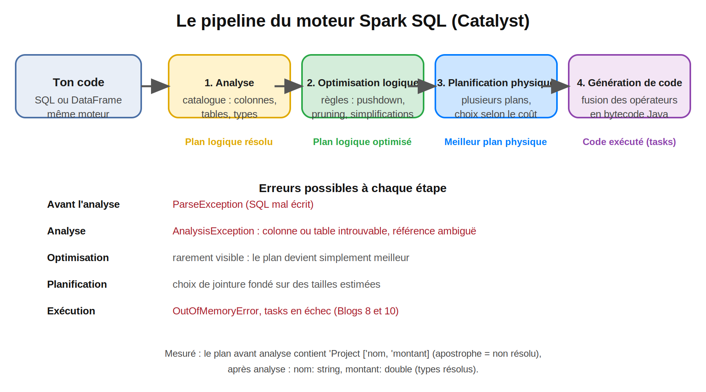
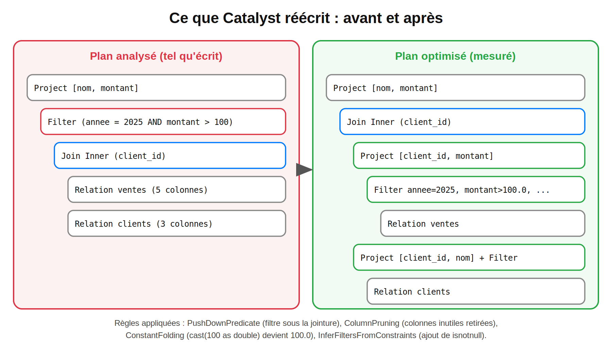
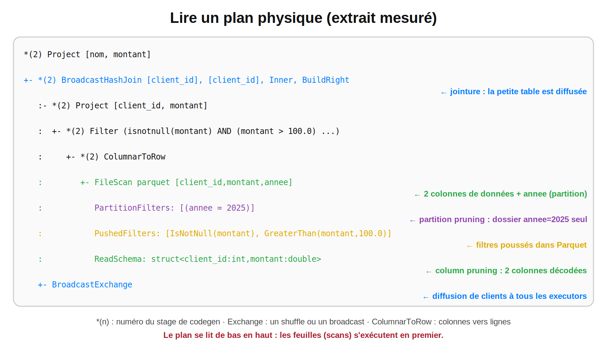
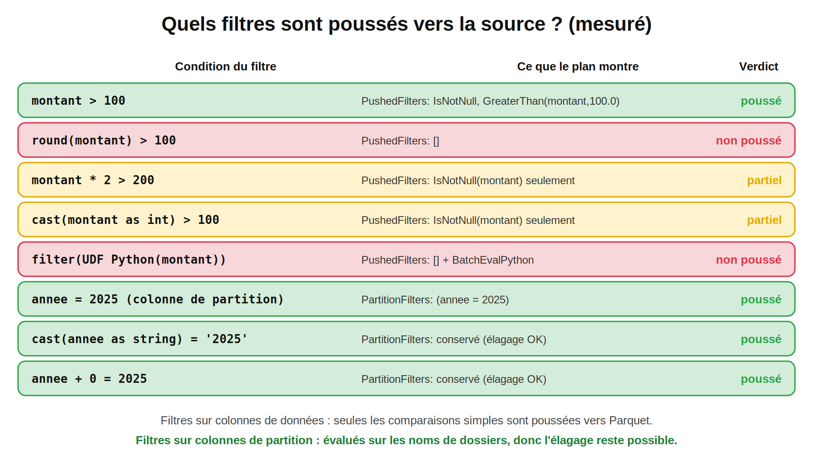

# Spark : de 0 à expert — Blog 11/14
## Spark SQL Engine et Catalyst : lire et comprendre les plans d'exécution


> **Temps de lecture :** ~35 min 

#Spark #ApacheSpark #PySpark #Catalyst #SparkSQL #QueryPlan #Explain #Tungsten #PredicatePushdown #DataEngineering #BigData #Performance #SparkDeZeroAExpert

---

## Sommaire

1. Rappel : les 4 questions du Blog 10
2. Pourquoi ce blog est différent
3. Un moteur, trois interfaces
4. Les 4 étapes du moteur Spark SQL
5. Étape 1 : l'analyse
6. Étape 2 : l'optimisation logique
7. Étape 3 : la planification physique
8. Étape 4 : la génération de code
9. Lire un plan : les 5 formats d'`explain`
10. Ce qui est poussé vers la source… et ce qui ne l'est pas
11. Pièges de lecture des plans
12. Les 10 incidents de plan en production
13. Cas complet : un filtre qui ne descend jamais
14. Checklist avant de valider un plan
15. Questions type certification
16. Prochain blog

---

## 1. Rappel : les 4 questions du Blog 10

| Question | Réponse courte | Section |
|---|---|---|
| Quand j'écris `join` puis `filter`, pourquoi Spark exécute-t-il **le filtre avant la jointure** ? | La règle d'optimisation **PushDownPredicate** réécrit le plan | 6 |
| Comment Spark choisit-il **Broadcast Hash Join** ou **Sort Merge Join** ? | À la planification physique, selon la **taille estimée** des tables, les hints et la configuration | 7 |
| Pourquoi le plan SQL et le plan DataFrame étaient-ils **identiques** (Blog 7) ? | Les deux interfaces produisent le **même plan logique**, ensuite traité par Catalyst | 3 |
| Que montre réellement `explain()` ? Comment lire `Exchange`, `PushedFilters`, `AdaptiveSparkPlan` ? | Le plan physique, de bas en haut ; chaque ligne a une signification précise | 9 |

---

## 2. Pourquoi ce blog est différent

Aux Blogs 8 à 10, tu as appris à lire **ce qui s'exécute** (conteneurs, jobs, stages, tasks). Ce blog te donne l'outil qui permet d'anticiper **avant** d'exécuter : le **plan**.

En entreprise, un plan se lit comme une radio :

- *« Mon filtre est-il appliqué à la lecture, ou après avoir chargé 2 To ? »*
- *« Cette jointure va-t-elle diffuser (broadcast) une table de 8 Go ? »*
- *« Combien de colonnes Spark lit-il vraiment dans ce Parquet de 300 colonnes ? »*

Toutes ces questions se répondent **en 10 secondes avec `explain()`**, sans lancer le job.

> **Note de transparence :** tous les plans, messages d'erreur, valeurs de configuration et durées cités ici ont été **mesurés** sur PySpark **3.5.3** en mode local (Java 21), sur 200 000 lignes de ventes (Parquet partitionné par `annee`) et 950 clients. L'AQE était **désactivé** pour des plans stables, sauf mention contraire. Les identifiants internes (`#123`, `plan_id`) sont retirés pour la lisibilité. Sur un vrai cluster, les **tailles** estimées et donc certains **choix** (jointures) peuvent différer.

---

## 3. Un moteur, trois interfaces

Spark propose trois façons d'exprimer un traitement :

| Interface | Disponibilité | Remarque |
|---|---|---|
| **Spark SQL** | Python, Scala, Java, R | Requêtes SQL standard (`spark.sql("...")`) |
| **DataFrame API** | Python, Scala, Java, R | API fonctionnelle, enchaînement de transformations |
| **Dataset API** | **Scala et Java uniquement** | Typage à la compilation ; **absente de PySpark** (Blog 3) ; hors programme de la certification |

Spark recommande les **DataFrames**, qui couvrent pratiquement tous les besoins.

**Point central :** que tu écrives du SQL ou des DataFrames, Spark les traite **de la même façon**. Chaque action (ou chaque requête) est un **plan logique utilisateur**, que le moteur Spark SQL transforme en exécution. Mesuré au Blog 7 : les deux écritures de la même requête donnent des **plans optimisés identiques**.

---

## 4. Les 4 étapes du moteur Spark SQL



| # | Étape | Rôle | Sortie |
|---|---|---|---|
| 1 | **Analyse** | Vérifie colonnes, tables, types ; les résout via le **catalogue** | Plan logique **résolu** |
| 2 | **Optimisation logique** | Applique des **règles** (optimisation basée sur des règles) | Plan logique **optimisé** |
| 3 | **Planification physique** | Génère **plusieurs plans physiques**, choisit selon le **coût** | **Meilleur plan physique** |
| 4 | **Génération de code** | Compile le plan en **bytecode Java** | Code exécuté dans les tasks |

Résumé : **analyser, simplifier, choisir, compiler.**

**Catalyst** est l'optimiseur qui réalise les étapes 1 à 3 : il représente un plan comme un **arbre** et lui applique des **règles de réécriture** par lots, **jusqu'à ce que le plan ne change plus**. **Tungsten** désigne l'exécution bas niveau (format binaire des lignes, gestion mémoire, génération de code).

---

## 5. Étape 1 : l'analyse

Spark prend le plan « brut » (des noms de colonnes non vérifiés) et consulte le **catalogue** pour :

- vérifier que les **tables** et **colonnes** existent ;
- résoudre leur **type** ;
- insérer des **conversions implicites** de type (ex. comparer un `double` à `100`).

### 5.1 Mesuré : le plan avant et après analyse

```text
== Parsed Logical Plan ==
'Project ['nom, 'montant]                  ← l'apostrophe ' = nom NON résolu
+- Filter ((annee = 2025) AND (montant > cast(100 as double)))
...
== Analyzed Logical Plan ==
nom: string, montant: double              ← types résolus
Project [nom, montant]
```

Deux choses à remarquer : l'**apostrophe** devant un nom signale un élément **non encore résolu**, et `cast(100 as double)` montre la **conversion implicite** insérée à l'analyse.

### 5.2 Les erreurs d'analyse (mesurées)

| Erreur | Cause | Message observé (extrait) |
|---|---|---|
| `AnalysisException` `UNRESOLVED_COLUMN.WITH_SUGGESTION` | Faute de frappe dans un nom de colonne | `A column ... with name 'montnat' cannot be resolved. Did you mean one of the following? ['montant', 'annee', 'pays', ...]` |
| `AnalysisException` `TABLE_OR_VIEW_NOT_FOUND` | Table ou vue inexistante (ou vue d'une autre session, Blog 7) | `The table or view 'table_inconnue' cannot be found. Verify the spelling...` |
| `AnalysisException` `AMBIGUOUS_REFERENCE` | Deux colonnes du même nom après une jointure (Blog 6) | `Reference 'montant' is ambiguous, could be: ['montant', 'montant']` |
| `ParseException` `PARSE_SYNTAX_ERROR` | SQL mal écrit : **avant** l'analyse | `Syntax error at or near 'SELEC'.(line 1, pos 0)` |

> Spark te **propose les noms valides** dans le message : lis-le avant de chercher ailleurs.

### 5.3 Analyse et mode ANSI

Le mode ANSI change ce qui est une **erreur** et ce qui est un `NULL` (rappel Blog 7). Mesuré avec `spark.sql.ansi.enabled` :

| Expression | ANSI désactivé | ANSI activé |
|---|---|---|
| `cast('abc' as int)` | **`NULL`** | Erreur `CAST_INVALID_INPUT` (suggère `try_cast`) |
| `1/0` | **`NULL`** | Erreur `DIVIDE_BY_ZERO` (suggère `try_divide`) |

En production, un `NULL` silencieux est souvent pire qu'une erreur.

---

## 6. Étape 2 : l'optimisation logique



À cette étape, Spark applique des **règles standards** (optimisation basée sur des règles) qui évoluent à chaque version : tu n'as **pas besoin de connaître la liste**, mais de savoir **ce qu'elles font** et le **voir** dans un plan.

### 6.1 Mesuré : une jointure suivie d'un filtre

Code écrit :

```python
q = (ventes.join(clients, "client_id")
           .filter("annee = 2025 AND montant > 100")
           .select("nom", "montant"))
```

Plan **optimisé** observé :

```text
Project [nom, montant]
+- Join Inner, (client_id = client_id)
   :- Project [client_id, montant]
   :  +- Filter (isnotnull(annee) AND isnotnull(montant) AND (annee = 2025) AND (montant > 100.0) AND isnotnull(client_id))
   :     +- Relation [vente_id, client_id, pays, montant, annee] parquet
   +- Project [client_id, nom]
      +- Filter isnotnull(client_id)
         +- Relation [client_id, nom, segment] parquet
```

Ce que Catalyst a fait **sans que tu le demandes** :

| Règle | Effet visible dans le plan |
|---|---|
| **Predicate pushdown** | Le `Filter` écrit **après** la jointure est descendu **sous** la jointure, sur `ventes` |
| **Column pruning** | `Project [client_id, montant]` : `vente_id` et `pays` ne sont pas lus. `segment` non plus |
| **Constant folding** | `cast(100 as double)` est devenu `100.0` |
| **Inférence de contraintes** | `isnotnull(client_id)` ajouté : une clé `null` ne peut pas joindre, autant l'éliminer avant |

### 6.2 Mesuré : simplifications d'expressions

Code :

```python
q = (ventes.filter("montant > 100 AND 1 = 1")
           .filter("pays = 'MA' OR 1 = 0")
           .select((F.lit(2) * F.lit(3) + F.col("montant")).alias("m"), "pays"))
```

| Avant (plan analysé) | Après (plan optimisé) |
|---|---|
| `Project [(cast((2 * 3) as double) + montant) AS m, pays]` | `Project [(6.0 + montant) AS m, pays]` |
| `Filter ((pays = MA) OR (1 = 0))` puis `Filter ((montant > 100.0) AND (1 = 1))` | **Un seul** `Filter` : `isnotnull(montant) AND isnotnull(pays) AND (montant > 100.0) AND (pays = MA)` |

Trois règles visibles : **constant folding** (`2 * 3` devient `6.0`), **simplification booléenne** (`1 = 1` et `OR 1 = 0` disparaissent), **fusion de filtres**.

**Conséquence pratique :** n'écris pas ton code en pensant « je dois mettre le filtre avant la jointure pour que ce soit rapide ». Catalyst le fait. Écris pour la **lisibilité** et **vérifie** le plan.

---

## 7. Étape 3 : la planification physique

Le plan logique dit **quoi** faire. Le plan physique dit **comment** : quelle stratégie de jointure, quel type d'agrégation, quels échanges (`Exchange`). Spark génère **plusieurs plans physiques** possibles et choisit selon une **estimation du coût** (optimisation basée sur le coût).

### 7.1 Mesuré : le choix de la jointure

| Configuration ou hint | Opérateur obtenu |
|---|---|
| Par défaut (`clients` est petite) | `BroadcastHashJoin` |
| `spark.sql.autoBroadcastJoinThreshold = -1` | `SortMergeJoin` |
| `-1` **et** `hint("broadcast")` | `BroadcastHashJoin` (le **hint l'emporte**) |
| `hint("merge")` | `SortMergeJoin` |
| `hint("shuffle_hash")` | `ShuffledHashJoin` |
| Condition **non-équi** (`<`) avec `broadcast()` | `BroadcastNestedLoopJoin` |

(Les stratégies et leurs usages sont détaillés au Blog 6.)

### 7.2 Sur quoi repose le « coût » ?

Sur des **statistiques**, d'abord la **taille estimée** (`sizeInBytes`) de chaque côté. Mesuré avec `explain("cost")` :

| Situation | Statistiques vues par l'optimiseur |
|---|---|
| Table lue sans `ANALYZE`, CBO désactivé | `sizeInBytes = 1762.8 KiB` (taille des fichiers sur disque) |
| Après `ANALYZE`, **CBO désactivé** (défaut) | **identique** : `1762.8 KiB`, sans `rowCount` |
| Après `ANALYZE`, **CBO activé** | `sizeInBytes = 8.8 MiB`, `rowCount = 2.00E+5` |

Deux enseignements importants :

1. **Le CBO est désactivé par défaut** (`spark.sql.cbo.enabled = false`, et `spark.sql.cbo.joinReorder.enabled = false`). Sans lui, `ANALYZE` ne change **rien** aux estimations de plan (le nombre de lignes et les stats de colonnes ne sont exploités que CBO activé).
2. **La taille d'un fichier Parquet sous-estime la taille en mémoire.** Ici, 1,7 Mio sur disque (compressé) devient **8,8 Mio** estimés à partir du nombre de lignes : un facteur 5. Une table « de 8 Mo » sur disque peut donc peser **bien plus** une fois diffusée en mémoire (voir incident 2, section 12).

### 7.3 `ANALYZE TABLE` : produire des statistiques

Squelette : complète.

```python
spark.sql("ANALYZE TABLE ventes_t COMPUTE ______")                              # taille + nombre de lignes
spark.sql("ANALYZE TABLE ventes_t COMPUTE STATISTICS FOR ______ montant, pays")  # statistiques de colonnes
spark.conf.set("spark.sql.cbo.______", True)                                    # l'optimiseur les utilise

spark.sql("DESCRIBE EXTENDED ventes_t montant").show(truncate=False)
```

<details>
<summary>Solution</summary>

```python
spark.sql("ANALYZE TABLE ventes_t COMPUTE STATISTICS")
spark.sql("ANALYZE TABLE ventes_t COMPUTE STATISTICS FOR COLUMNS montant, pays")
spark.conf.set("spark.sql.cbo.enabled", True)
```

Mesuré, `DESCRIBE EXTENDED ventes_t montant` renvoie : `min = 0.01`, `max = 500.0`, `num_nulls = 0`, `distinct_count = 48863`, `avg_col_len = 8`, `max_col_len = 8`, `histogram = NULL` (histogramme désactivé par défaut).

`ANALYZE TABLE` ne s'applique qu'à une **table du catalogue** : pas à un simple `spark.read.parquet(chemin)`. Et les statistiques deviennent **périmées** quand les données changent : à relancer après un gros chargement.

</details>

> **Sans statistiques fiables**, c'est l'**AQE** (Blog 13) qui compense : il décide pendant l'exécution à partir des **vraies** tailles observées après chaque shuffle.

---

## 8. Étape 4 : la génération de code

Le plan physique retenu est transformé en **bytecode Java** : Spark agit comme un **compilateur**. Le *Whole-Stage Code Generation* **fusionne** plusieurs opérateurs (lecture, filtre, projection, agrégation partielle…) en **une seule fonction Java**, sans appel virtuel ni objet intermédiaire par ligne. C'est ce qui rend Spark très rapide.

### 8.1 Mesuré : repérer le codegen

```text
*(2) HashAggregate(keys=[pays], functions=[sum(montant)])
+- *(1) HashAggregate(keys=[pays], functions=[partial_sum(montant)])
   +- *(1) Project [pays, montant]
      +- *(1) Filter (isnotnull(montant) AND (montant > 100.0))
         +- *(1) ColumnarToRow
```

- `*(n)` marque un **stage de codegen** : toutes les lignes préfixées par `*(1)` sont compilées **ensemble**.
- Avec `spark.sql.codegen.wholeStage = false`, le même plan n'affiche **plus aucun** `*(`.
- `explain("codegen")` imprime le **code Java généré** : **95 lignes** pour un simple filtre + projection, avec la méthode `processNext` (la classe générée s'appelle `GeneratedIteratorForCodegenStageN`).

### 8.2 Ce qui interrompt le codegen

| Cas | Effet |
|---|---|
| **UDF Python** | Nœud `BatchEvalPython` : la chaîne est coupée, les données quittent la JVM (Blog 7) |
| Schéma très large | Au-delà de `spark.sql.codegen.maxFields` (**100**, mesuré), Spark peut renoncer au codegen du stage |
| Méthode générée trop grosse | Au-delà de `spark.sql.codegen.hugeMethodLimit` (**65535**, mesuré), repli sur une exécution interprétée plus lente |

Si un stage devient subitement lent après l'ajout de nombreuses colonnes, regarde si les `*(n)` ont disparu du plan.

---

## 9. Lire un plan : les 5 formats d'`explain`

| Appel | Contenu | Quand l'utiliser |
|---|---|---|
| `df.explain()` | **Plan physique** seul | Contrôle rapide |
| `df.explain("formatted")` | Plan physique **numéroté** + détail de chaque nœud | **Le plus lisible** pour un plan réel |
| `df.explain("extended")` | Les **4 plans** : parsé, analysé, optimisé, physique | Voir ce que Catalyst a réécrit |
| `df.explain("cost")` | Plan logique optimisé + **statistiques** | Comprendre un choix de jointure |
| `df.explain("codegen")` | Le **code Java généré** | Diagnostic de codegen |

### 9.1 Capturer un plan dans une chaîne

`explain` **imprime** : pour le conserver (tests, journaux), redirige la sortie.

```python
import io, contextlib

def plan_text(df, mode="formatted"):
    buf = io.StringIO()
    with contextlib.redirect_stdout(buf):
        df.explain(mode)
    return buf.getvalue()

assert "PushedFilters" in plan_text(ventes.filter("montant > 100"))      # test automatisé de plan
```

### 9.2 Lire le plan physique mesuré



```text
*(2) Project [nom, montant]
+- *(2) BroadcastHashJoin [client_id], [client_id], Inner, BuildRight
   :- *(2) Project [client_id, montant]
   :  +- *(2) Filter (isnotnull(montant) AND (montant > 100.0) AND isnotnull(client_id))
   :     +- *(2) ColumnarToRow
   :        +- FileScan parquet [client_id,montant,annee]
   :              PartitionFilters: [isnotnull(annee), (annee = 2025)]
   :              PushedFilters: [IsNotNull(montant), GreaterThan(montant,100.0), IsNotNull(client_id)]
   :              ReadSchema: struct<client_id:int,montant:double>
   +- BroadcastExchange HashedRelationBroadcastMode(...)
      +- *(1) Filter isnotnull(client_id)
         +- *(1) ColumnarToRow
            +- FileScan parquet [client_id,nom]
                  PushedFilters: [IsNotNull(client_id)]
                  ReadSchema: struct<client_id:int,nom:string>
```

**Règle de lecture : de bas en haut.** Les feuilles (les `FileScan`) s'exécutent en premier, la racine en dernier.

| Élément | Signification |
|---|---|
| `FileScan parquet [client_id,montant,annee]` | Colonnes que Spark lit (`annee` vient du nom de dossier) |
| **`ReadSchema`** | Colonnes **réellement décodées** dans les fichiers : le *column pruning* (2 sur 4 colonnes de données) |
| **`PartitionFilters`** | **Élagage de partitions** : seul le dossier `annee=2025` est lu |
| **`PushedFilters`** | Filtres **transmis à Parquet**, évalués à la lecture (statistiques min/max des blocs) |
| `BroadcastExchange` | La petite table est **diffusée** (pas de shuffle) |
| `Exchange` (absent ici) | Un **shuffle** : une frontière de stage (Blog 10) |
| `HashAggregate (partial)` → `Exchange` → `HashAggregate` | Agrégation locale, shuffle, agrégation finale (Blog 5) |
| `*(n)` | Opérateurs fusionnés dans un même stage de codegen |
| `AdaptiveSparkPlan isFinalPlan=false` | Plan **initial** AQE : il peut encore changer |

### 9.3 Squelette : lire un plan

À partir du plan ci-dessus, réponds sans regarder le tableau.

```text
1. Quelles colonnes de DONNÉES sont lues dans ventes ?        → ______
2. Quel dossier de partition est lu ?                         → ______
3. Quelle stratégie de jointure ?                             → ______
4. Y a-t-il un shuffle (Exchange hashpartitioning) ?          → ______
5. La table clients est-elle lue en entier (toutes colonnes) ? → ______
```

<details>
<summary>Solution</summary>

1. `client_id` et `montant` (`annee` est une colonne de partition, `vente_id` et `pays` ne sont pas lues).
2. `annee = 2025`.
3. `BroadcastHashJoin` (côté droit diffusé, `BuildRight`).
4. **Non** : seulement un `BroadcastExchange`.
5. **Non** : seules `client_id` et `nom` (`segment` est élaguée).

</details>

### 9.4 `AdaptiveSparkPlan` : le plan qui change en cours de route

Mesuré avec l'AQE activé sur `groupBy("pays").count()` :

| Moment | Première ligne du plan |
|---|---|
| **Avant** exécution | `AdaptiveSparkPlan isFinalPlan=false` |
| **Après** l'action | `AdaptiveSparkPlan isFinalPlan=true` puis `== Final Plan ==` |

Le plan affiché **avant** l'action peut donc différer de celui réellement exécuté (jointure convertie en broadcast, partitions fusionnées, skew corrigé). **Relis toujours `explain` après l'action**, ou consulte l'onglet SQL de la Spark UI (Blog 10).

---

## 10. Ce qui est poussé vers la source… et ce qui ne l'est pas



Un filtre poussé vers Parquet permet d'**éviter de lire** des blocs entiers. Mais Catalyst ne peut pousser que ce qu'il **comprend**. Mesuré sur la colonne `montant` (donnée) et `annee` (partition) :

| Condition | Plan observé | Verdict |
|---|---|---|
| `montant > 100` | `PushedFilters: [IsNotNull(montant), GreaterThan(montant,100.0)]` | ✅ Poussé |
| `round(montant) > 100` | `PushedFilters: []` | ❌ **Non poussé** |
| `montant * 2 > 200` | `PushedFilters: [IsNotNull(montant)]` | ⚠️ Seul le test de nullité est poussé |
| `cast(montant as int) > 100` | `PushedFilters: [IsNotNull(montant)]` | ⚠️ Idem |
| Filtre par **UDF Python** | `PushedFilters: []`, `DataFilters: []`, nœud `BatchEvalPython` | ❌ **Rien n'est poussé** |
| `annee = 2025` (**partition**) | `PartitionFilters: [isnotnull(annee), (annee = 2025)]` | ✅ Élagage |
| `cast(annee as string) = '2025'` | `PartitionFilters` conservé | ✅ Élagage |
| `annee + 0 = 2025` | `PartitionFilters` conservé | ✅ Élagage |

**Deux règles pratiques :**

1. **Sur une colonne de données**, compare la colonne **brute** à une constante (`montant > 100`) : toute fonction ou calcul sur la colonne **empêche** le pushdown vers le fichier. Réécris `round(montant) > 100` en une comparaison directe (`montant >= 99.5`) quand la logique le permet.
2. **Sur une colonne de partition**, l'élagage résiste mieux, car Spark évalue l'expression sur les **noms de dossiers** (peu nombreux), pas sur les données. Mesuré : `cast` et `+ 0` n'empêchent pas l'élagage.

> **À retenir :** « le filtre est poussé » se **vérifie** dans `PushedFilters` / `PartitionFilters`, il ne se suppose pas.

---

## 11. Pièges de lecture des plans

### 11.1 Un même objet DataFrame garde son plan

Mesuré : on construit `j = ventes.join(clients, "client_id")`, on fait `explain` (`BroadcastHashJoin`), puis on met `spark.sql.autoBroadcastJoinThreshold = -1` et on refait `explain` **sur le même objet** : le plan affiché est **toujours** `BroadcastHashJoin`.

```python
j = ventes.join(clients, "client_id")
plan_text(j)                                              # BroadcastHashJoin
spark.conf.set("spark.sql.autoBroadcastJoinThreshold", -1)
plan_text(j)                                              # toujours BroadcastHashJoin (plan déjà calculé)
plan_text(ventes.join(clients, "client_id"))              # nouveau DataFrame : SortMergeJoin
```

**Règle :** après un changement de configuration, **reconstruis le DataFrame** avant de relire le plan, sinon tu observes l'ancien.

### 11.2 `explain` ne dit rien du volume réel

Un plan indique **comment** Spark s'y prend, pas **combien de lignes** passent à chaque étape. Pour cela : l'onglet **SQL** de la Spark UI (nombre de lignes par opérateur), ou `explain("cost")` avec statistiques.

### 11.3 Le plan peut être excellent… et le résultat faux

Un plan optimal sur une **jointure N–N** produit simplement très vite un résultat énorme (Blog 6). Le plan ne vérifie pas la **cardinalité** de tes clés.

---

## 12. Les 10 incidents de plan en production

| # | Symptôme | Cause | Correction |
|---|---|---|---|
| 1 | Le filtre ne réduit pas la lecture | Fonction, calcul ou **UDF** sur la colonne filtrée : `PushedFilters` vide (section 10) | Comparer la colonne brute à une constante ; filtre natif |
| 2 | **Broadcast d'une table trop grosse** (OOM executor/driver) | Estimation sur la taille **compressée** des fichiers : mesuré 1,7 Mio sur disque pour 8,8 Mio estimés en mémoire, facteur ≈ 5 | `autoBroadcastJoinThreshold` plus bas, `hint("merge")`, `ANALYZE` + CBO, AQE |
| 3 | La JVM tombe sur une jointure | **Jointure N–N** sur une clé à très faible cardinalité (voir encadré ci-dessous) | `assert_unique` (Blog 6), lire le plan **avant** de lancer |
| 4 | Le plan lu n'est pas celui attendu | Configuration modifiée sur un DataFrame **déjà planifié** (section 11.1) | Reconstruire le DataFrame |
| 5 | `AnalysisException` en pleine nuit | Colonne renommée ou supprimée en amont ; schéma dérivé | Schéma explicite (Blog 4), tests de contrat de schéma |
| 6 | Parquet de 300 colonnes très lent | `select("*")`, ou colonnes non élaguées (`ReadSchema` énorme) | Sélectionner **explicitement** les colonnes |
| 7 | Pas d'élagage de partitions | Filtre sur une colonne **non** partitionnée, ou table non partitionnée par l'axe de filtre (`PartitionFilters: []`) | Repenser le partitionnement (Blog 4), filtrer sur la colonne de partition |
| 8 | Stage lent, nœud `BatchEvalPython` | UDF Python | Natif d'abord (Blog 7) |
| 9 | La **planification** elle-même est lente (avant tout job) | Boucle de `withColumn` : voir mesure ci-dessous | **Un seul `select`** avec la liste des expressions |
| 10 | Mêmes requêtes, résultats différents (`NULL` ou erreur) | Mode **ANSI** différent entre environnements (section 5.3) | Fixer `spark.sql.ansi.enabled` par fichier de configuration |

### 12.1 Mesuré : la boucle de `withColumn` coûte cher en planification

Chaîne de `n` colonnes dérivées (`c1 = c0 + 1`, `c2 = c1 + 1`…), temps pour **construire le plan optimisé** (aucune donnée lue) :

| n | `withColumn` en boucle | un seul `select` |
|---|---|---|
| 50 | 3,7 s (inclut le démarrage de la JVM) | 0,3 s |
| 100 | 4,5 s | 0,4 s |
| 200 | 9,5 s | 0,4 s |
| **400** | **31,5 s** | **0,5 s** |

Chaque `withColumn` ajoute un nœud au plan, et chaque nouveau nœud force à **réanalyser l'arbre entier** : le coût croît **plus vite que linéairement**. Sur des tables à centaines de colonnes construites en boucle, on peut perdre des dizaines de secondes (voire des minutes) **avant même de lire une ligne**. Les durées exactes dépendent de ta machine, la **tendance** est le point à retenir.

```python
# ❌ N appels : plan de plus en plus profond
for i in range(1, 400):
    df = df.withColumn(f"c{i}", F.col(f"c{i-1}") + 1)

# ✅ Une seule projection
df = base.select("c0", *[(F.col("c0") + i).alias(f"c{i}") for i in range(1, 400)])
# PySpark 3.3+ : df.withColumns({...}) avec un dictionnaire, en un seul appel
```

> **Observé pendant la préparation de ce blog :** une jointure N–N entre deux tables de 200 000 lignes sur `pays` (**4 valeurs distinctes**) a fait tomber la JVM locale : `java.lang.OutOfMemoryError: Java heap space` dans le code généré (`GeneratedIteratorForCodegenStage…`), puis `Py4JNetworkError: Answer from Java side is empty` côté Python, exactement le scénario de l'incident 8 du Blog 8. Chaque ligne de gauche trouvait environ 50 000 correspondances : environ 10 milliards de lignes théoriques. **Le plan était parfaitement « valide »** : c'est la lecture de la **cardinalité** qui l'aurait évité.

---

## 13. Cas complet : un filtre qui ne descend jamais

**Contexte.** Une requête de reporting filtre les ventes supérieures à 100 avec une règle métier écrite en **UDF Python** (`sup100`). Elle met des heures à scanner l'historique complet.

**Étape 1 : lire le plan** (mesuré) :

```text
*(2) Filter pythonUDF0: boolean
+- BatchEvalPython [sup100(montant)], [pythonUDF0]
   +- FileScan parquet [montant,annee]
         DataFilters: []
         PushedFilters: []
         ReadSchema: struct<montant:double>
```

| Observation | Conclusion |
|---|---|
| `BatchEvalPython` | Chaque ligne passe par un **Python worker** (Blog 7) |
| `PushedFilters: []` et `DataFilters: []` | **Aucun** filtre transmis à Parquet : toutes les lignes sont lues avant d'être testées |
| `Filter pythonUDF0` | Le filtre s'exécute **après** la lecture et le passage Python |

**Étape 2 : réécrire en natif** :

```python
ventes.filter("montant > 100").select("montant")
```

**Étape 3 : relire le plan** (mesuré) :

```text
*(1) Filter (isnotnull(montant) AND (montant > 100.0))
+- *(1) ColumnarToRow
   +- FileScan parquet [montant,annee]
         DataFilters: [isnotnull(montant), (montant > 100.0)]
         PushedFilters: [IsNotNull(montant), GreaterThan(montant,100.0)]
         ReadSchema: struct<montant:double>
```

| Avant | Après |
|---|---|
| `BatchEvalPython` | **Disparu** : tout reste dans la JVM, codegen `*(1)` |
| `PushedFilters: []` | `GreaterThan(montant,100.0)` poussé |
| Filtre après lecture | Filtre **dans** le scan Parquet |

**Étape 4 : filtre de partition en plus.** Si la requête porte sur une année, ajouter `annee = 2025` réduit les **dossiers lus** (`PartitionFilters`), ce qui est encore plus efficace que le pushdown de colonne.

**Étape 5 : valider par la mesure.** Compare les durées avec `format("noop")` (Blog 7) et le volume lu dans la Spark UI (colonne *Input* du stage). Je n'ai pas chronométré ce cas sur de gros volumes : à toi de mesurer sur ton cluster.

**Leçon.** Une lenteur est souvent visible **avant** l'exécution : `BatchEvalPython` + `PushedFilters: []` suffisent à poser le diagnostic.

---

## 14. Checklist avant de valider un plan

| # | Question | Où regarder dans le plan |
|---|---|---|
| 1 | Les filtres sont-ils **poussés** ? | `PushedFilters`, `PartitionFilters` |
| 2 | Lit-on **seulement** les colonnes utiles ? | `ReadSchema` |
| 3 | La stratégie de jointure est-elle **adaptée** aux tailles réelles ? | `BroadcastHashJoin` / `SortMergeJoin` |
| 4 | Combien de **shuffles** ? Sont-ils justifiés ? | Nombre de `Exchange` |
| 5 | Y a-t-il des **UDF Python** ? | `BatchEvalPython`, `ArrowEvalPython` |
| 6 | Le **codegen** est-il actif ? | Préfixes `*(n)` |
| 7 | Les **statistiques** sont-elles fiables ? | `explain("cost")`, `ANALYZE TABLE` |
| 8 | Le plan lu est-il le **plan final** (AQE) ? | `isFinalPlan=true` après l'action |
| 9 | La **cardinalité** des clés de jointure est-elle connue ? | `assert_unique`, `groupBy().count()` |
| 10 | Un **test automatisé** garde-t-il ce plan en place ? | `plan_text(df)` + `assert` |

---

## 15. Questions type certification

**Q1. À quelle étape Catalyst applique-t-il l'optimisation basée sur des **règles** ?**
→ À l'**optimisation logique** (planification logique), avant la planification physique.

**Q2. À quelle étape le **catalogue** est-il utilisé ?**
→ À l'**analyse** : il sert à résoudre les noms de colonnes, de tables et les types. Il n'a rien à voir avec le calcul du coût.

**Q3. Quelle étape dépend de l'optimisation basée sur le **coût** ?**
→ La **planification physique** : Spark génère plusieurs plans physiques, leur attribue un coût et choisit le moins coûteux.

**Q4. Le plan physique sera-t-il différent entre l'API DataFrame et SQL pour des opérations identiques ?**
→ **Non** : le moteur applique le même plan aux deux.

**Q5. Dans quel ordre se déroulent les étapes ?**
→ Analyse, optimisation logique, planification physique, **génération de code** (la dernière).

**Q6. Quelle exception obtient-on en référençant une colonne inexistante ?**
→ `AnalysisException` (levée à l'analyse). Une **faute de syntaxe SQL** donne une `ParseException`.

**Q7. Que produit la génération de code ?**
→ Du **bytecode Java** : plusieurs opérateurs fusionnés en une seule fonction (*whole-stage codegen*).

**Q8. L'API Dataset est-elle disponible en PySpark ?**
→ **Non** (Scala et Java uniquement).

**Q9. Que signifie `*(2)` devant un opérateur ?**
→ Il fait partie du **stage de codegen n°2** : compilé avec les autres opérateurs du même numéro.

**Q10. Différence entre `PartitionFilters` et `PushedFilters` ?**
→ `PartitionFilters` : élagage de **dossiers** de partition. `PushedFilters` : filtres transmis à la **source** (Parquet) pour éviter de lire des blocs.

**Q11. Pourquoi un filtre par UDF Python n'est-il pas poussé ?**
→ L'UDF est une **boîte noire** pour Catalyst : il ne peut ni la traduire en filtre de source, ni l'optimiser.

**Q12. `explain` affiche `AdaptiveSparkPlan isFinalPlan=false`. Que faire ?**
→ C'est le plan **initial** : il peut changer à l'exécution. Relire le plan **après** l'action (`isFinalPlan=true`) ou l'onglet SQL.

---

## Points clés

1. **SQL et DataFrame = même plan** : même moteur, même Catalyst.
2. **4 étapes :** analyse (catalogue, `AnalysisException`), optimisation logique (règles), planification physique (coût), génération de code (bytecode Java).
3. Catalyst réécrit pour toi : **pushdown de filtres**, **élagage de colonnes**, **simplification d'expressions**, **fusion de filtres**. Écris pour la lisibilité, **vérifie** dans le plan.
4. Un plan se lit **de bas en haut** ; cherche `PartitionFilters`, `PushedFilters`, `ReadSchema`, `Exchange`, `BroadcastHashJoin`, `BatchEvalPython`, `*(n)`.
5. Le choix de jointure repose sur des **tailles estimées**, qui peuvent **sous-estimer** la mémoire réelle (Parquet compressé). Le **CBO est désactivé par défaut**.
6. Une **fonction, un calcul ou une UDF** sur une colonne de données **empêche** le pushdown vers le fichier ; sur une colonne de partition, l'élagage résiste.
7. Un **DataFrame déjà planifié garde son plan** : reconstruis-le après un changement de configuration.
8. Avec l'**AQE**, le plan avant l'action n'est pas le plan final.
9. Des dizaines de `withColumn` en boucle ralentissent la **planification** : utilise un seul `select` ou `withColumns`.
10. `explain` te dit **comment**, pas **combien** : complète avec l'onglet SQL et la cardinalité de tes clés.

---

## 16. Prochain blog : on passe à la production (Niveau 4)

Tu sais maintenant écrire un traitement, le soumettre, le dimensionner, le lire dans la Spark UI et vérifier son plan. Reste un problème que **aucun plan ne résout** : ton job n'est pas seul sur le cluster.

- Un cluster partagé accepte **100 conteneurs** : ton application de 100 conteneurs occupe tout. Une petite application de 5 conteneurs **doit attendre** qu'elle se termine. Comment éviter cela ?
- Ton job a un stage de 400 tasks, puis un de 100, puis des stages de 200 : pourquoi **garder 100 executors** pendant toute la durée alors que 25 suffisent pour certains stages ?
- Que font réellement `spark.dynamicAllocation.enabled`, `executorIdleTimeout` (60 s par défaut) et `schedulerBacklogTimeout` (1 s par défaut) ?
- Deux jobs soumis depuis des **threads différents** d'une même application s'exécutent-ils en parallèle ? Quelle différence entre le planificateur **FIFO** (défaut) et **FAIR** ?
- Qu'est-ce que la **spéculation** : lancer une **copie** d'une task lente, et pourquoi ne faut-il pas la confondre avec un redémarrage de task ?

**👉 Blog 12 : Allocation des ressources et scheduling.**
Allocation statique vs dynamique, planification entre applications et au sein d'une application (FIFO vs FAIR, pools), spéculation, et le réglage d'un cluster partagé multi-équipes. Début du **Niveau 4 : Performance et production**.

---

**Série « Spark : de 0 à expert »**
Niveau 1 : 1. Pourquoi Spark ? | 2. Environnement | 3. RDD, DataFrame, Dataset
Niveau 2 : 4. I/O | 5. Transformations | 6. Joins & Windows | 7. SQL & UDF
Niveau 3 : 8. Architecture | 9. spark-submit | 10. Jobs/Stages | **11. Catalyst** ← tu es ici (fin du niveau 3)
Niveau 4 : 12. Scheduling | 13. Optimisation | 14. Production

#Spark #ApacheSpark #PySpark #Catalyst #QueryPlan #Explain #LearnSpark #DataEngineer #BigData #Performance #SparkDeZeroAExpert
